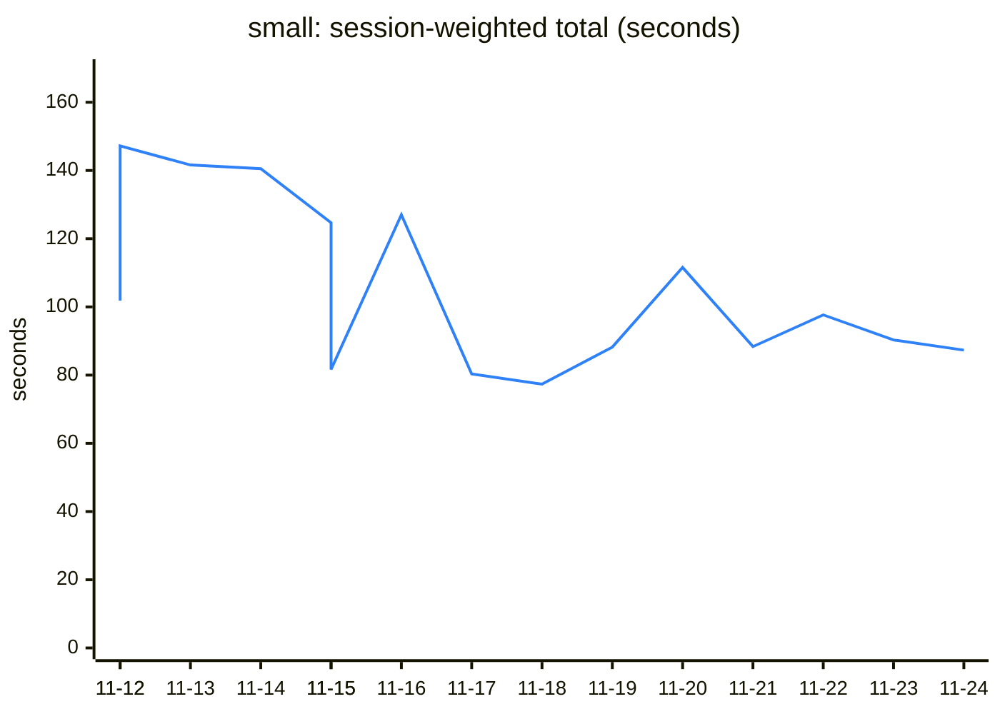
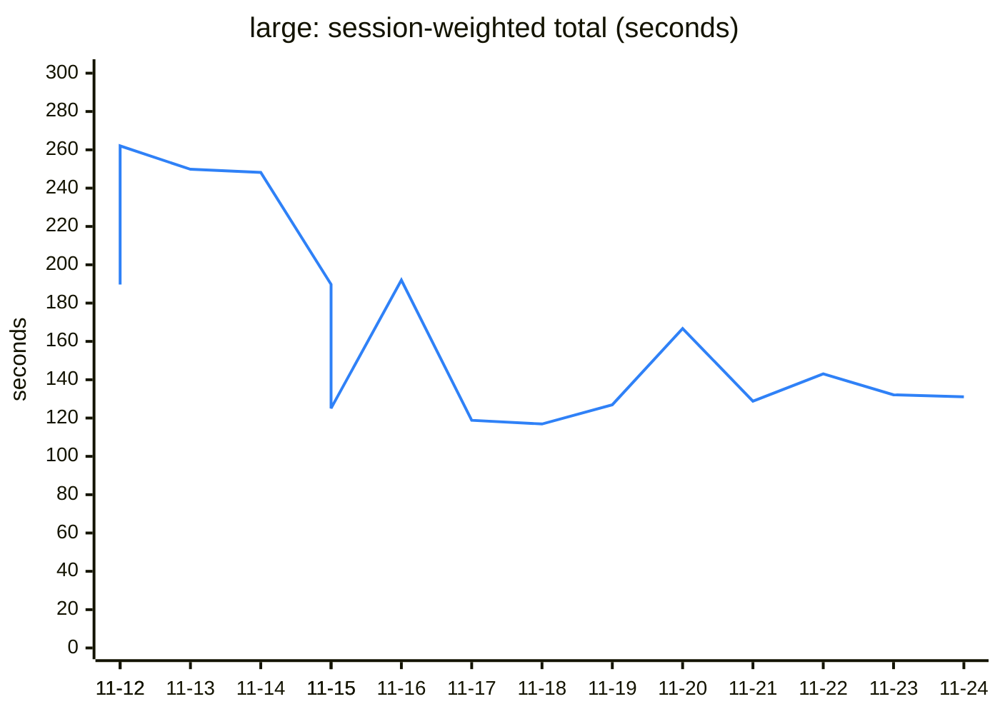
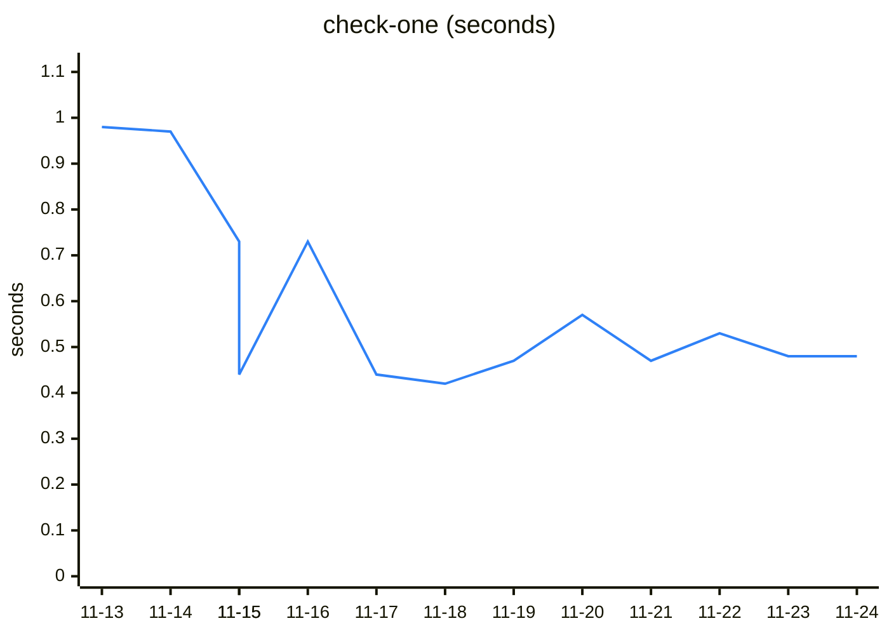
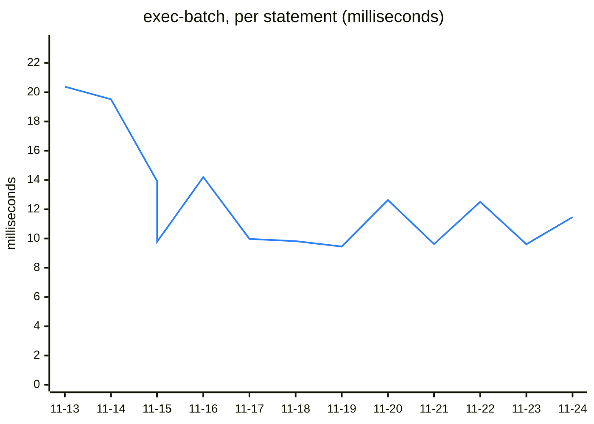
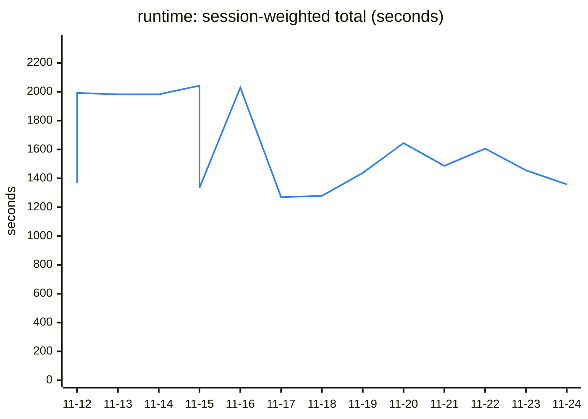

# Agent dev-loop benchmark — trend

15 runs, 2026-11-12 to 2026-11-24. Latest: `mxcli version 997c721 (2026-11-24T12:06:16Z)` against `mxcli version nightly-20261123-811702bfd (2026-11-23T11:21:40Z)`.

Generated by `scripts/agentbench/trend` after each run; do not edit. Times are the candidate's median wall time on that night's runner, so two nights differ by the machine as well as by the code: read a level that stays, not one night's step. How to read it: `docs-site/src/internals/agent-benchmark.md` on `main`.

## Alerts

- **counts-increased**, runtime session, step `apply-entity`: units read from a file or the unit store: 108, the baseline 107

## small project — 370 units

| step | latest | run before | median of the 7 before | against that median | against its baseline, latest | last runs |
|---|---:|---:|---:|---:|---:|---|
| (session-weighted total) | 87.3 s | 90.3 s | 88.4 s | × 0.99 | × 0.99 | ███▆▁▆▁▁▂▄▂▃▂▂ |
| open-cold | 162 ms | 133 ms | 152 ms | × 1.06 | × 1.03 | ████▄█▄▃▁█▁▆▁▅ |
| open | 47 ms | 46 ms | 45 ms | × 1.04 | × 0.99 | ████▁▇▁▁▁▄▁▄▁▂ |
| domain | 558 ms | 611 ms | 600 ms | × 0.93 | × 0.99 | █▆▆▆▁▆▁▁▂▄▂▃▂▂ |
| microflows | 447 ms | 415 ms | 405 ms | × 1.10 | × 0.97 | █▅▅▅▁▅▁▁▁▄▁▄▁▂ |
| pages | 1.47 s | 1.42 s | 1.39 s | × 1.05 | × 1.04 | █▅▄▄▁▅▁▁▁▄▂▃▂▂ |
| describe | 104 ms | 106 ms | 106 ms | × 0.98 | × 0.97 | ██▇▆▂▇▁▁▂▄▂▄▂▂ |
| catalog | 176 ms | 174 ms | 174 ms | × 1.01 | × 0.98 | ████▁█▁▁▁▅▁▃▁▂ |
| catalog-full | 855 ms | 923 ms | 923 ms | × 0.93 | × 1.00 | ████▁█▁▁▂▄▂▄▂▁ |
| query | 64 ms | 65 ms | 67 ms | × 0.96 | × 0.97 | ████▁█▁▁▂▅▂▄▁▁ |
| check | 275 ms | 293 ms | 286 ms | × 0.96 | × 0.99 | ███▄▁▄▁▁▁▃▁▂▂▁ |
| single-edit | 294 ms | 303 ms | 298 ms | × 0.99 | × 0.99 | ████▁█▁▁▂▇▂▄▃▂ |
| catalog-after-edit | 187 ms | 175 ms | 175 ms | × 1.07 | × 0.98 | ████▁█▁▁▁▅▁▄▁▂ |
| bulk-alter | 1.04 s | 984 ms | 973 ms | × 1.07 | × 1.03 | █▃▃▃▁▃▁▁▁▅▁▂▁▁ |
| re-exec | 491 ms | 519 ms | 509 ms | × 0.96 | × 0.98 | █▂▂▂▁▂▁▁▁▁▁▁▁▁ |
| rename | 388 ms | 427 ms | 423 ms | × 0.92 | × 1.00 | █▇▇▇▂▇▁▁▂▄▂▄▂▁ |

## large project — 910 units

| step | latest | run before | median of the 7 before | against that median | against its baseline, latest | last runs |
|---|---:|---:|---:|---:|---:|---|
| (session-weighted total) | 131.1 s | 132.1 s | 128.8 s | × 1.02 | × 1.01 | ███▅▁▅▁▁▁▃▁▂▁▁ |
| open-cold | 310 ms | 259 ms | 293 ms | × 1.06 | × 1.01 | ████▅█▃▃▁█▁█▁▄ |
| open | 59 ms | 56 ms | 57 ms | × 1.04 | × 1.00 | ████▁█▁▁▂▅▂▄▁▂ |
| domain | 698 ms | 719 ms | 704 ms | × 0.99 | × 1.02 | █▆▆▆▁▆▁▁▂▄▂▃▂▂ |
| microflows | 1.08 s | 983 ms | 950 ms | × 1.13 | × 0.99 | █▇▇▇▁▇▁▁▁▆▁▃▁▂ |
| pages | 1.76 s | 1.76 s | 1.73 s | × 1.02 | × 1.00 | █▄▄▄▁▄▁▁▁▅▁▂▂▂ |
| describe | 131 ms | 125 ms | 127 ms | × 1.03 | × 0.99 | █▇▇▇▂▇▁▁▂▄▂▃▂▂ |
| catalog | 272 ms | 265 ms | 258 ms | × 1.05 | × 1.01 | ████▁█▁▁▁▆▁▃▁▂ |
| catalog-full | 2.75 s | 2.94 s | 2.92 s | × 0.94 | × 0.99 | ████▁█▁▁▂▄▂▃▂▁ |
| query | 69 ms | 68 ms | 68 ms | × 1.01 | × 1.00 | █▇██▁▇▁▁▁▅▂▄▂▂ |
| check | 434 ms | 445 ms | 429 ms | × 1.01 | × 1.00 | ███▃▁▃▁▁▁▂▁▁▁▁ |
| single-edit | 438 ms | 442 ms | 430 ms | × 1.02 | × 1.01 | ████▁█▁▁▂▆▂▃▂▂ |
| catalog-after-edit | 302 ms | 274 ms | 274 ms | × 1.10 | × 0.98 | ████▂█▂▁▁▇▂▅▂▄ |
| bulk-alter | 1.21 s | 1.22 s | 1.21 s | × 1.00 | × 1.01 | █▃▃▃▁▃▁▁▁▅▁▂▁▁ |
| re-exec | 669 ms | 711 ms | 701 ms | × 0.95 | × 0.98 | █▂▂▂▁▂▁▁▁▂▁▁▁▁ |
| rename | 765 ms | 838 ms | 834 ms | × 0.92 | × 1.00 | ████▁█▁▁▂▅▂▄▂▁ |

## scale project — 4374 units

| step | latest | run before | median of the 7 before | against that median | against its baseline, latest | last runs |
|---|---:|---:|---:|---:|---:|---|
| (session-weighted total) | 5.24 s | 4.76 s | 4.74 s | × 1.11 | × 0.99 | ██▄▁▄▁▁▁▃▁▂▁▂ |
| check-cold | 1.44 s | 1.28 s | 1.29 s | × 1.11 | × 1.01 | ██▅▂▅▁▁▁▃▁▂▁▂ |
| check-one | 484 ms | 481 ms | 471 ms | × 1.03 | × 0.98 | ██▅▁▅▁▁▁▃▁▂▁▁ |
| check-batch | 846 ms | 900 ms | 894 ms | × 0.95 | × 0.98 | ██▅▁▅▁▁▂▃▂▃▂▁ |
| exec-batch | 1.15 s | 961 ms | 982 ms | × 1.17 | × 1.00 | ██▄▁▄▁▁▁▃▁▃▁▂ |
| re-exec-batch | 535 ms | 525 ms | 525 ms | × 1.02 | × 1.02 | ██▃▁▃▁▁▁▂▁▂▁▁ |
| new-batch | 794 ms | 618 ms | 627 ms | × 1.27 | × 1.07 | ██▄▂▅▁▁▁▄▁▄▁▃ |

## running app — 476 units

| step | latest | run before | median of the 7 before | against that median | against its baseline, latest | last runs |
|---|---:|---:|---:|---:|---:|---|
| (session-weighted total) | 1358.0 s | 1455.2 s | 1455.2 s | × 0.93 | × 0.98 | ████▁█▁▁▂▄▃▄▂▁ |
| mx-check | 4.60 s | 5.53 s | 5.53 s | × 0.83 | × 1.00 | ████▂█▁▁▃▄▃▅▃▁ |
| build | 42.6 s | 42.0 s | 41.3 s | × 1.03 | × 1.03 | ████▁█▁▁▁▅▁▄▂▂ |
| boot | 20.8 s | 22.1 s | 21.6 s | × 0.97 | × 1.09 | ▇▆▇█▂█▁▁▃▄▃▃▃▂ |
| page-check | 2.44 s | 2.46 s | 2.53 s | × 0.96 | × 0.99 | ▇███▁█▂▁▃▃▁▄▁▁ |
| hot-apply | 4.35 s | 4.12 s | 4.33 s | × 1.00 | × 0.99 | ▇▇▇█▁▇▁▁▂▄▂▃▁▂ |
| test-attach | 103 ms | 97 ms | 97 ms | × 1.06 | × 0.87 | ██▆▇▂█▁▁▁▄▃▄▂▃ |
| apply-entity | 13.3 s | 14.0 s | 14.0 s | × 0.95 | × 0.98 | ████▁█▁▁▂▅▃▄▂▁ |
| stop | 630 ms | 629 ms | 628 ms | × 1.00 | × 1.00 | ████▅█▁▁▁█▁▁▁▁ |
| test-cold | 17.5 s | 19.4 s | 19.3 s | × 0.91 | × 0.98 | ██▇█▁█▁▁▃▄▄▄▄▂ |
