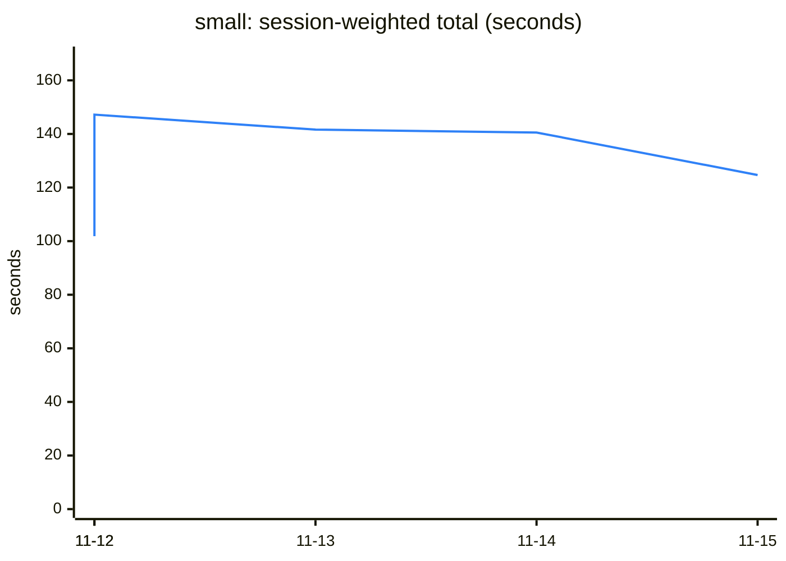
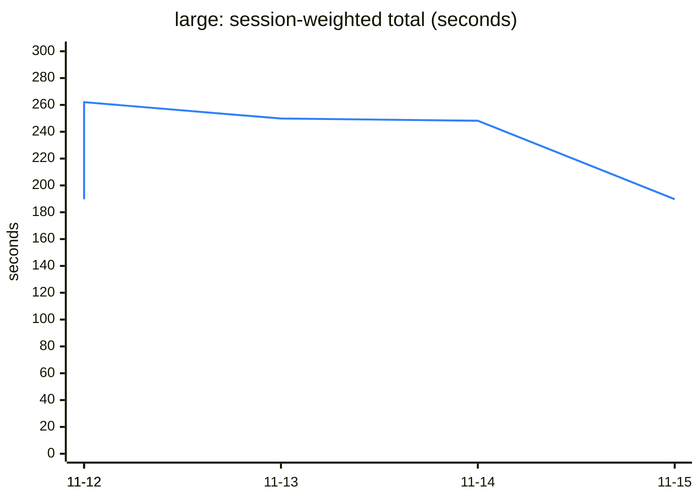
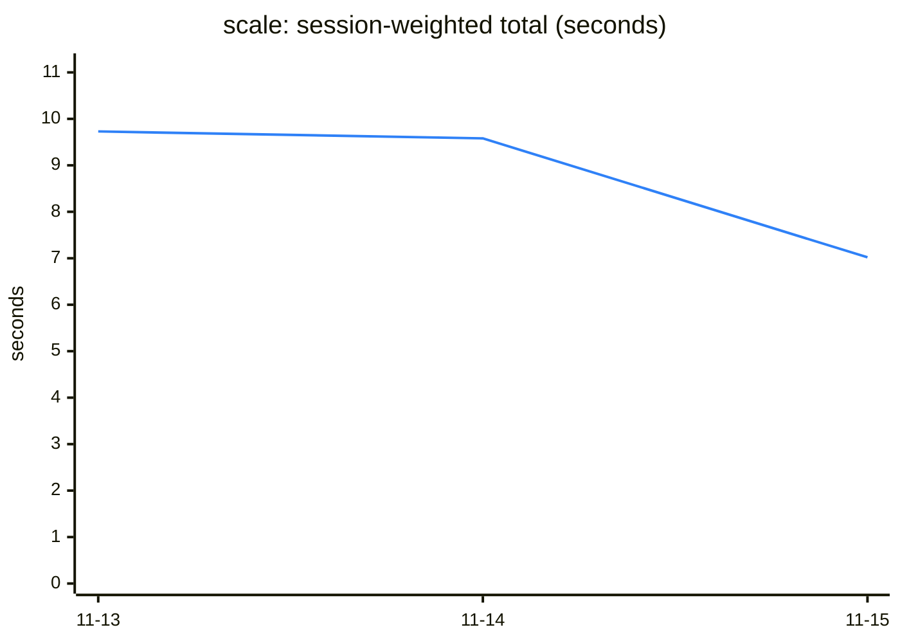
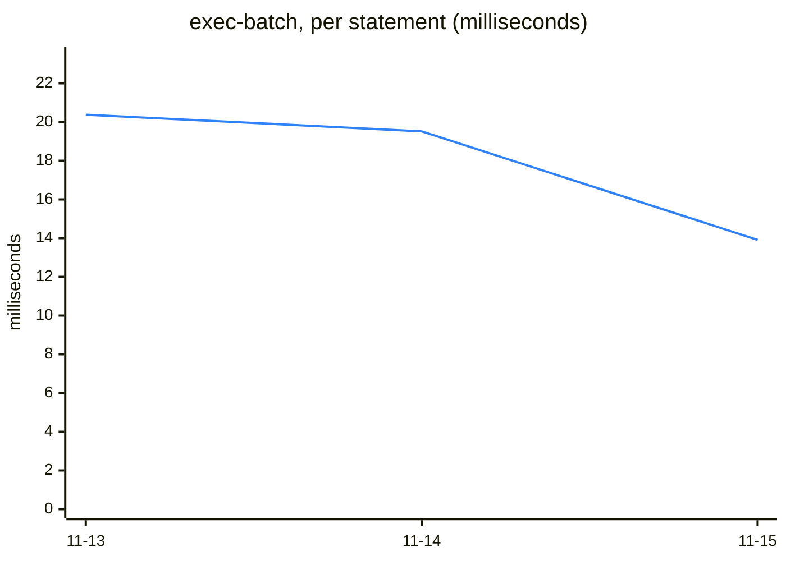
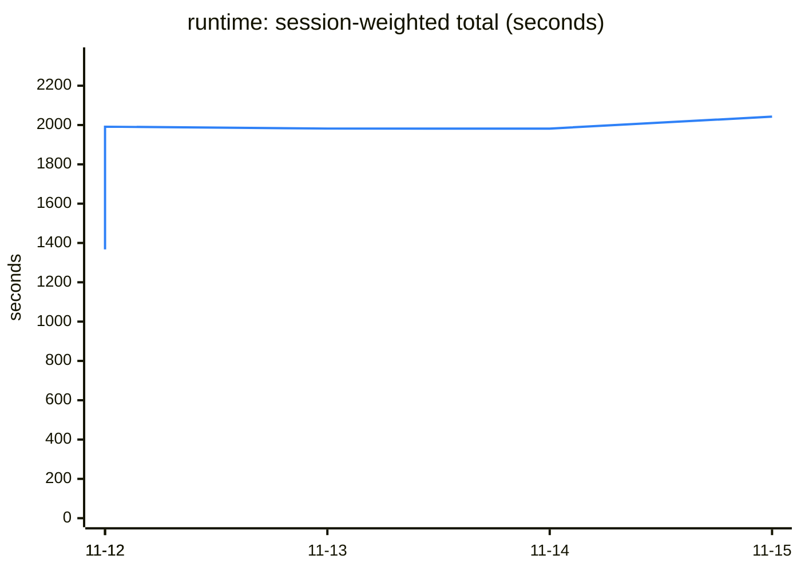

# Agent dev-loop benchmark — trend

5 runs, 2026-11-12 to 2026-11-15. Latest: `mxcli version 1550cdd (2026-11-15T08:54:35Z)` against `mxcli version nightly-20261114-a051fa62f (2026-11-14T09:35:26Z)`.

Generated by `scripts/agentbench/trend` after each run; do not edit. Times are the candidate's median wall time on that night's runner, so two nights differ by the machine as well as by the code: read a level that stays, not one night's step. How to read it: `docs-site/src/internals/agent-benchmark.md` on `main`.

## Alerts

None.

## small project — 370 units



| step | latest | run before | median of the 7 before | against that median | against its baseline, latest | last runs |
|---|---:|---:|---:|---:|---:|---|
| (session-weighted total) | 124.7 s | 140.5 s | 141.1 s | × 0.88 | × 0.88 | ▁██▇▅ |
| open-cold | 187 ms | 186 ms | 186 ms | × 1.01 | × 1.05 | ▁████ |
| open | 69 ms | 69 ms | 69 ms | × 1.00 | × 1.09 | ▁████ |
| domain | 841 ms | 844 ms | 943 ms | × 0.89 | × 1.00 | █▂▁▁▁ |
| microflows | 603 ms | 615 ms | 707 ms | × 0.85 | × 0.99 | █▄▁▁▁ |
| pages | 1.94 s | 1.95 s | 2.35 s | × 0.83 | × 0.99 | █▄▁▁▁ |
| describe | 148 ms | 156 ms | 158 ms | × 0.94 | × 0.93 | ▁█▇▇▆ |
| catalog | 284 ms | 285 ms | 278 ms | × 1.02 | × 1.00 | ▁████ |
| catalog-full | 1.43 s | 1.44 s | 1.44 s | × 0.99 | × 1.00 | ▁████ |
| query | 95 ms | 97 ms | 97 ms | × 0.98 | × 0.96 | ▁████ |
| check | 400 ms | 563 ms | 565 ms | × 0.71 | × 0.69 | ▁███▂ |
| single-edit | 414 ms | 418 ms | 420 ms | × 0.99 | × 0.99 | ▁████ |
| catalog-after-edit | 261 ms | 267 ms | 262 ms | × 1.00 | × 0.99 | ▁████ |
| bulk-alter | 1.35 s | 1.35 s | 1.94 s | × 0.70 | × 1.00 | ██▁▁▁ |
| re-exec | 675 ms | 690 ms | 1.14 s | × 0.59 | × 0.98 | ▆█▁▁▁ |
| rename | 609 ms | 617 ms | 614 ms | × 0.99 | × 0.98 | ▁█▆▇▆ |

## large project — 910 units



| step | latest | run before | median of the 7 before | against that median | against its baseline, latest | last runs |
|---|---:|---:|---:|---:|---:|---|
| (session-weighted total) | 189.8 s | 248.2 s | 249.0 s | × 0.76 | × 0.76 | ▁█▇▇▁ |
| open-cold | 358 ms | 364 ms | 360 ms | × 0.99 | × 1.00 | ▁▇▇█▆ |
| open | 84 ms | 84 ms | 84 ms | × 1.01 | × 0.93 | ▁████ |
| domain | 993 ms | 1.00 s | 1.09 s | × 0.91 | × 1.00 | █▁▁▁▁ |
| microflows | 1.53 s | 1.54 s | 1.64 s | × 0.93 | × 0.99 | █▂▁▁▁ |
| pages | 2.38 s | 2.41 s | 2.92 s | × 0.82 | × 0.99 | █▂▁▁▁ |
| describe | 187 ms | 188 ms | 189 ms | × 0.99 | × 1.01 | ▁█▆▆▆ |
| catalog | 426 ms | 426 ms | 427 ms | × 1.00 | × 1.01 | ▁████ |
| catalog-full | 4.51 s | 4.53 s | 4.53 s | × 1.00 | × 1.00 | ▁████ |
| query | 103 ms | 99 ms | 97 ms | × 1.06 | × 1.02 | ▁█▇▇█ |
| check | 640 ms | 1.29 s | 1.29 s | × 0.50 | × 0.50 | ▃███▁ |
| single-edit | 628 ms | 628 ms | 630 ms | × 1.00 | × 0.99 | ▁████ |
| catalog-after-edit | 375 ms | 378 ms | 380 ms | × 0.99 | × 0.98 | ▁████ |
| bulk-alter | 1.65 s | 1.68 s | 2.33 s | × 0.71 | × 0.97 | █▆▁▁▁ |
| re-exec | 951 ms | 989 ms | 1.60 s | × 0.59 | × 0.95 | ██▁▁▁ |
| rename | 1.24 s | 1.26 s | 1.25 s | × 0.99 | × 0.99 | ▁█▇█▇ |

## scale project — 4374 units



```mermaid
---
config:
  themeVariables:
    xyChart:
      plotColorPalette: "#2f81f7"
---
xychart-beta
    title "check-one (seconds)"
    x-axis ["11-13", "11-14", "11-15"]
    y-axis "seconds" 0 --> 1.12
    line [0.98, 0.97, 0.73]
```



| step | latest | run before | median of the 7 before | against that median | against its baseline, latest | last runs |
|---|---:|---:|---:|---:|---:|---|
| (session-weighted total) | 7.02 s | 9.58 s | 9.66 s | × 0.73 | × 0.72 | ██▁ |
| check-cold | 1.93 s | 2.40 s | 2.41 s | × 0.80 | × 0.79 | ██▁ |
| check-one | 728 ms | 973 ms | 975 ms | × 0.75 | × 0.74 | ██▁ |
| check-batch | 1.30 s | 1.69 s | 1.69 s | × 0.77 | × 0.76 | ██▁ |
| exec-batch | 1.39 s | 1.95 s | 1.99 s | × 0.70 | × 0.71 | █▇▁ |
| re-exec-batch | 744 ms | 1.28 s | 1.28 s | × 0.58 | × 0.58 | ██▁ |
| new-batch | 923 ms | 1.29 s | 1.30 s | × 0.71 | × 0.71 | ██▁ |

## running app — 476 units



| step | latest | run before | median of the 7 before | against that median | against its baseline, latest | last runs |
|---|---:|---:|---:|---:|---:|---|
| (session-weighted total) | 2042.5 s | 1981.9 s | 1982.0 s | × 1.03 | × 1.02 | ▁████ |
| mx-check | 8.09 s | 7.90 s | 7.89 s | × 1.03 | × 1.01 | ▁████ |
| build | 57.9 s | 57.4 s | 57.3 s | × 1.01 | × 1.00 | ▁████ |
| boot | 29.9 s | 29.1 s | 28.5 s | × 1.05 | × 0.98 | ▁█▇██ |
| page-check | 3.33 s | 3.30 s | 3.26 s | × 1.02 | × 1.02 | ▁▇███ |
| hot-apply | 6.15 s | 5.76 s | 5.75 s | × 1.07 | × 1.06 | ▁▇▇▇█ |
| test-attach | 132 ms | 125 ms | 132 ms | × 1.00 | × 1.04 | ▁██▆▇ |
| apply-entity | 18.7 s | 18.4 s | 18.5 s | × 1.01 | × 1.00 | ▁████ |
| stop | 842 ms | 839 ms | 839 ms | × 1.00 | × 1.00 | ▁████ |
| test-cold | 25.3 s | 23.7 s | 24.1 s | × 1.05 | × 1.03 | ▁▇█▇█ |
