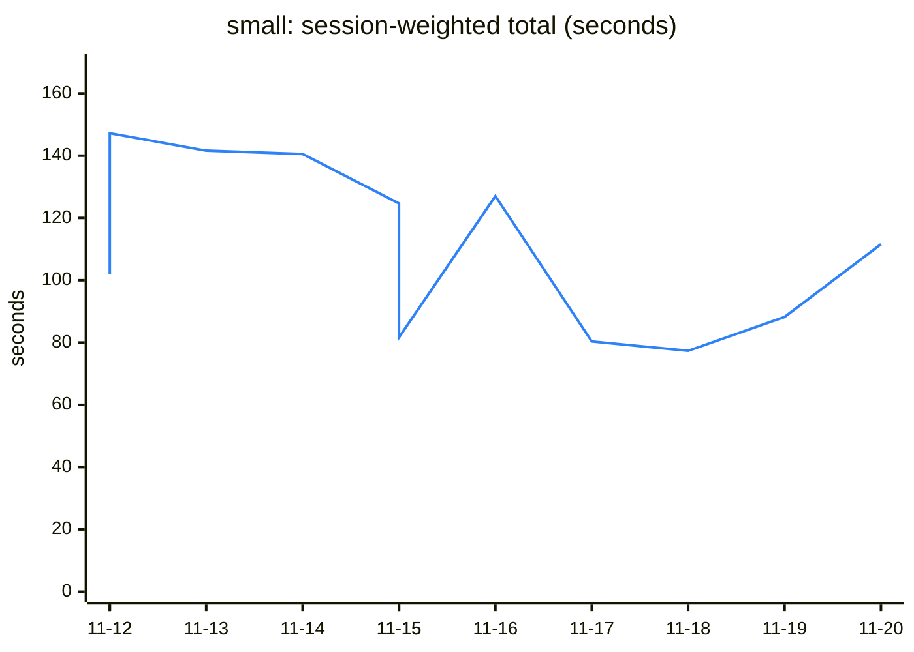
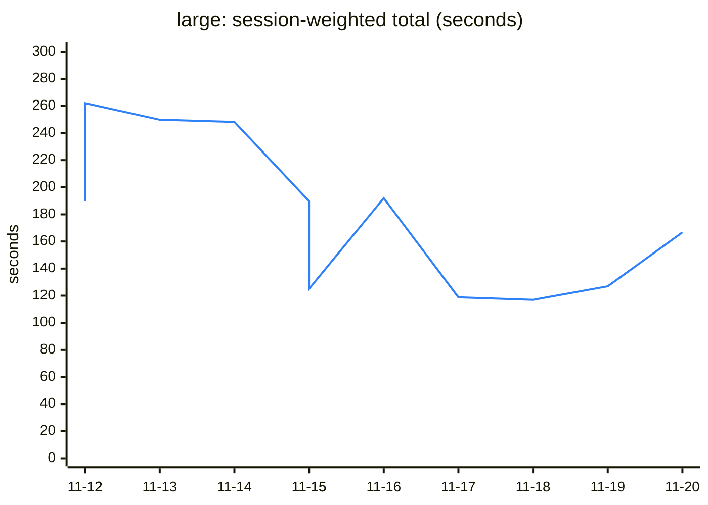
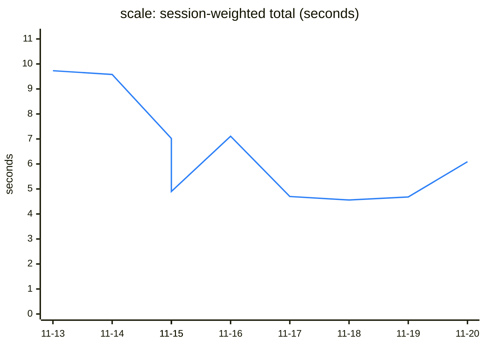
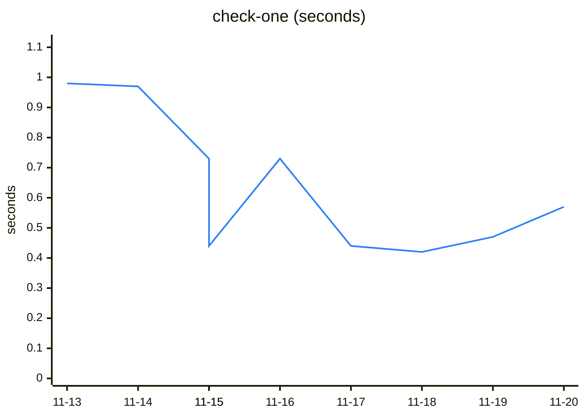
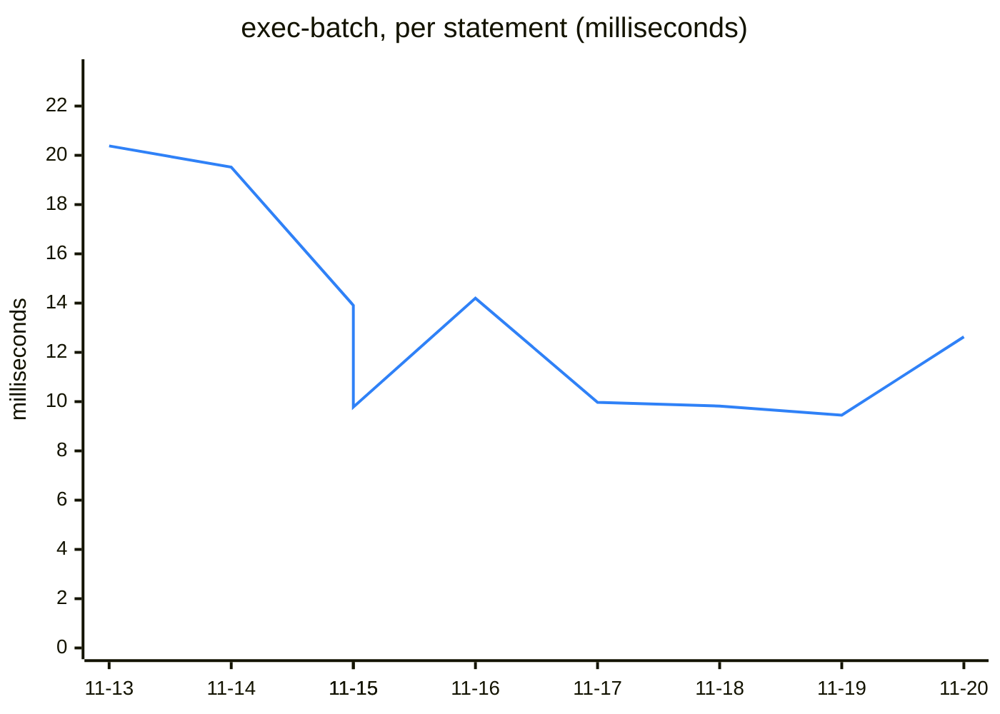
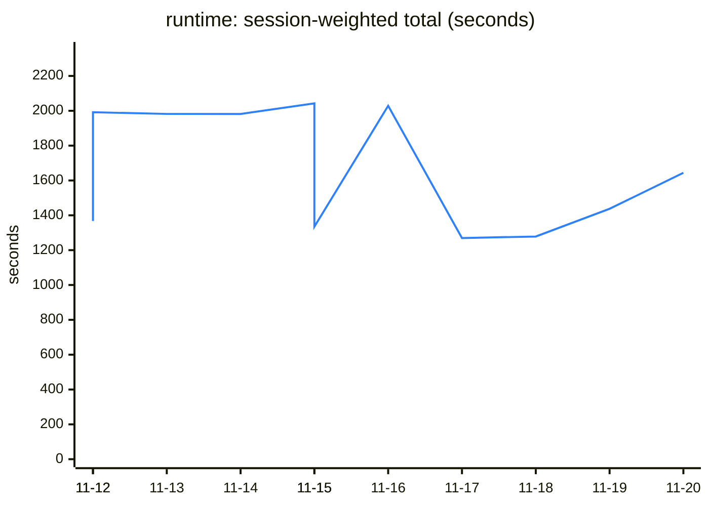

# Agent dev-loop benchmark — trend

11 runs, 2026-11-12 to 2026-11-20. Latest: `mxcli version 245d5dc (2026-11-20T09:46:32Z)` against `mxcli version nightly-20261119-32a67fa4a (2026-11-19T10:53:32Z)`.

Generated by `scripts/agentbench/trend` after each run; do not edit. Times are the candidate's median wall time on that night's runner, so two nights differ by the machine as well as by the code: read a level that stays, not one night's step. How to read it: `docs-site/src/internals/agent-benchmark.md` on `main`.

## Alerts

None.

## small project — 370 units

| step | latest | run before | median of the 7 before | against that median | against its baseline, latest | last runs |
|---|---:|---:|---:|---:|---:|---|
| (session-weighted total) | 111.6 s | 88.2 s | 88.2 s | × 1.26 | × 1.00 | ▃███▆▁▆▁▁▂▄ |
| open-cold | 192 ms | 131 ms | 161 ms | × 1.19 | × 1.09 | ▄████▄█▄▃▁█ |
| open | 54 ms | 44 ms | 45 ms | × 1.21 | × 0.93 | ▂████▁▇▁▁▁▄ |
| domain | 702 ms | 585 ms | 585 ms | × 1.20 | × 1.01 | █▄▃▃▃▁▃▁▁▁▂ |
| microflows | 579 ms | 405 ms | 405 ms | × 1.43 | × 0.90 | █▅▃▃▃▁▃▁▁▁▃ |
| pages | 1.87 s | 1.36 s | 1.36 s | × 1.37 | × 1.12 | █▅▃▃▃▁▃▁▁▁▂ |
| describe | 129 ms | 105 ms | 105 ms | × 1.23 | × 1.04 | ▃██▇▆▂▇▁▁▂▄ |
| catalog | 224 ms | 173 ms | 173 ms | × 1.30 | × 1.01 | ▁████▁█▁▁▁▅ |
| catalog-full | 1.11 s | 922 ms | 922 ms | × 1.20 | × 0.99 | ▁████▁█▁▁▂▄ |
| query | 82 ms | 67 ms | 67 ms | × 1.23 | × 1.00 | ▁████▁█▁▁▂▅ |
| check | 333 ms | 286 ms | 286 ms | × 1.16 | × 1.00 | ▃███▄▁▄▁▁▁▃ |
| single-edit | 389 ms | 296 ms | 296 ms | × 1.31 | × 1.00 | ▂████▁█▁▁▂▇ |
| catalog-after-edit | 224 ms | 164 ms | 171 ms | × 1.31 | × 0.95 | ▁████▁█▁▁▁▅ |
| bulk-alter | 1.79 s | 973 ms | 973 ms | × 1.84 | × 1.34 | ██▃▃▃▁▃▁▁▁▅ |
| re-exec | 580 ms | 505 ms | 505 ms | × 1.15 | × 1.00 | ▇█▂▂▂▁▂▁▁▁▁ |
| rename | 495 ms | 419 ms | 419 ms | × 1.18 | × 1.00 | ▂█▇▇▇▂▇▁▁▂▄ |

## large project — 910 units

| step | latest | run before | median of the 7 before | against that median | against its baseline, latest | last runs |
|---|---:|---:|---:|---:|---:|---|
| (session-weighted total) | 166.7 s | 126.9 s | 126.9 s | × 1.31 | × 1.05 | ▅███▅▁▅▁▁▁▃ |
| open-cold | 361 ms | 256 ms | 314 ms | × 1.15 | × 0.90 | ▇████▅█▃▃▁█ |
| open | 71 ms | 57 ms | 57 ms | × 1.26 | × 1.00 | ▂████▁█▁▁▂▅ |
| domain | 813 ms | 682 ms | 682 ms | × 1.19 | × 0.98 | █▂▂▂▂▁▂▁▁▁▁ |
| microflows | 1.49 s | 900 ms | 978 ms | × 1.52 | × 0.96 | █▄▃▃▃▁▃▁▁▁▃ |
| pages | 2.61 s | 1.65 s | 1.65 s | × 1.58 | × 0.94 | █▂▁▁▁▁▁▁▁▁▁ |
| describe | 157 ms | 127 ms | 127 ms | × 1.24 | × 0.98 | ▃█▇▇▇▂▇▁▁▂▄ |
| catalog | 368 ms | 258 ms | 262 ms | × 1.41 | × 1.02 | ▂████▁█▁▁▁▆ |
| catalog-full | 3.42 s | 2.90 s | 2.90 s | × 1.18 | × 1.01 | ▁████▁█▁▁▂▄ |
| query | 84 ms | 66 ms | 67 ms | × 1.26 | × 0.98 | ▂█▇██▁▇▁▁▁▅ |
| check | 524 ms | 429 ms | 429 ms | × 1.22 | × 1.00 | ▄███▃▁▃▁▁▁▂ |
| single-edit | 574 ms | 421 ms | 421 ms | × 1.36 | × 1.01 | ▃████▁█▁▁▂▆ |
| catalog-after-edit | 357 ms | 245 ms | 275 ms | × 1.30 | × 1.04 | ▂████▂█▂▁▁▇ |
| bulk-alter | 2.10 s | 1.17 s | 1.17 s | × 1.79 | × 1.25 | █▆▂▂▂▁▂▁▁▁▄ |
| re-exec | 846 ms | 687 ms | 687 ms | × 1.23 | × 1.00 | ██▂▂▂▁▂▁▁▁▂ |
| rename | 1.04 s | 824 ms | 824 ms | × 1.26 | × 0.99 | ▂████▁█▁▁▂▅ |

## scale project — 4374 units

| step | latest | run before | median of the 7 before | against that median | against its baseline, latest | last runs |
|---|---:|---:|---:|---:|---:|---|
| (session-weighted total) | 6.09 s | 4.68 s | 4.90 s | × 1.24 | × 1.01 | ██▄▁▄▁▁▁▃ |
| check-cold | 1.69 s | 1.26 s | 1.42 s | × 1.19 | × 0.97 | ██▅▂▅▁▁▁▃ |
| check-one | 566 ms | 467 ms | 467 ms | × 1.21 | × 1.01 | ██▅▁▅▁▁▁▃ |
| check-batch | 990 ms | 876 ms | 876 ms | × 1.13 | × 1.00 | ██▅▁▅▁▁▂▃ |
| exec-batch | 1.26 s | 945 ms | 997 ms | × 1.27 | × 1.00 | ██▄▁▄▁▁▁▃ |
| re-exec-batch | 629 ms | 521 ms | 521 ms | × 1.21 | × 1.00 | ██▃▁▃▁▁▁▂ |
| new-batch | 957 ms | 602 ms | 725 ms | × 1.32 | × 1.13 | ██▄▂▅▁▁▁▄ |

## running app — 476 units

| step | latest | run before | median of the 7 before | against that median | against its baseline, latest | last runs |
|---|---:|---:|---:|---:|---:|---|
| (session-weighted total) | 1643.9 s | 1437.4 s | 1437.4 s | × 1.14 | × 1.01 | ▂████▁█▁▁▂▄ |
| mx-check | 6.06 s | 5.35 s | 5.35 s | × 1.13 | × 1.01 | ▂████▂█▁▁▃▄ |
| build | 50.2 s | 40.3 s | 40.6 s | × 1.24 | × 0.99 | ▂████▁█▁▁▁▅ |
| boot | 24.1 s | 21.3 s | 21.3 s | × 1.13 | × 0.98 | ▂▇▆▇█▂█▁▁▃▄ |
| page-check | 2.75 s | 2.69 s | 2.69 s | × 1.02 | × 0.99 | ▁▇███▁█▂▁▃▃ |
| hot-apply | 4.99 s | 4.33 s | 4.33 s | × 1.15 | × 0.99 | ▂▇▇▇█▁▇▁▁▂▄ |
| test-attach | 110 ms | 91 ms | 92 ms | × 1.19 | × 0.99 | ▂██▆▇▂█▁▁▁▄ |
| apply-entity | 16.2 s | 13.8 s | 13.8 s | × 1.17 | × 1.02 | ▂████▁█▁▁▂▅ |
| stop | 834 ms | 628 ms | 737 ms | × 1.13 | × 1.00 | ▁████▅█▁▁▁█ |
| test-cold | 20.4 s | 18.1 s | 18.1 s | × 1.13 | × 1.05 | ▂██▇█▁█▁▁▃▄ |
