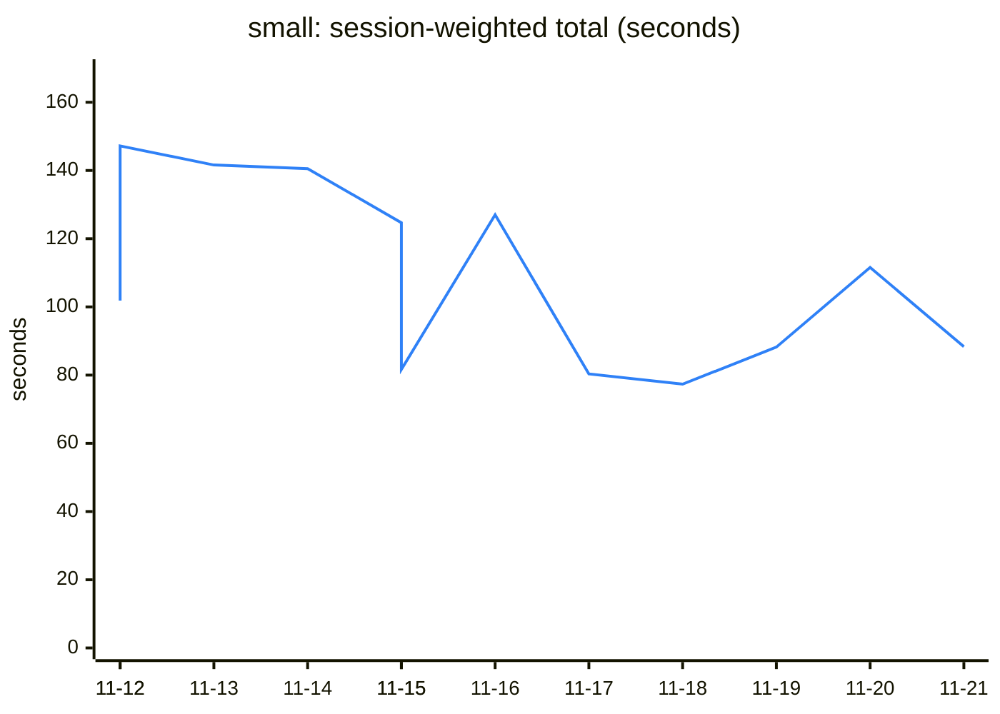
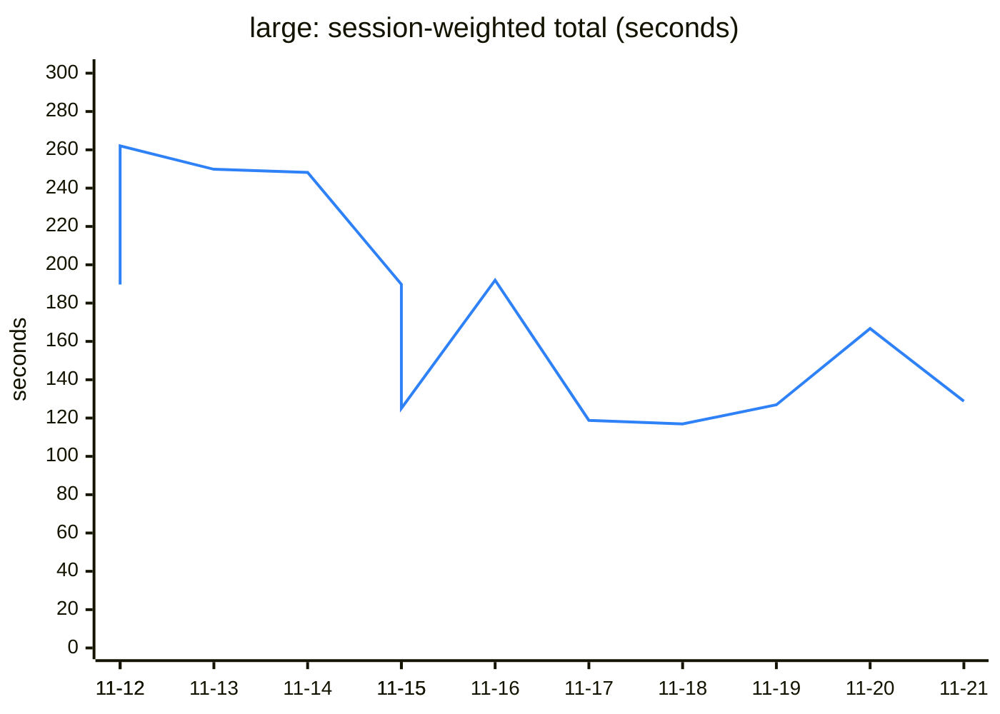
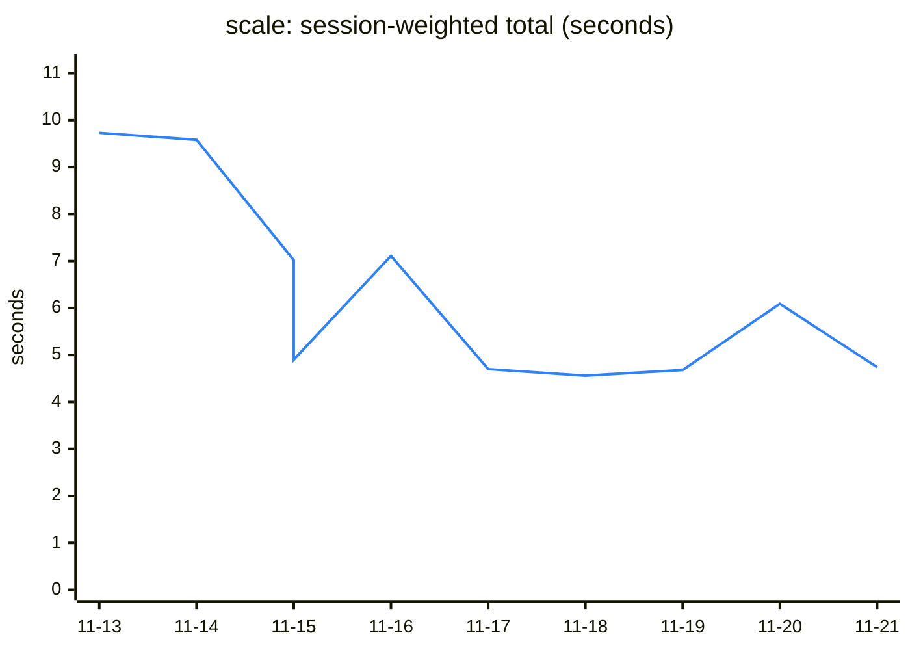
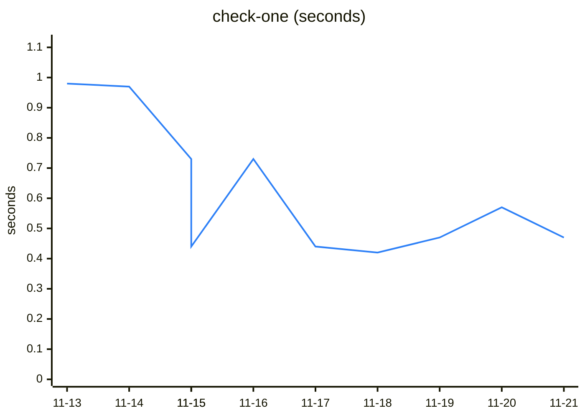
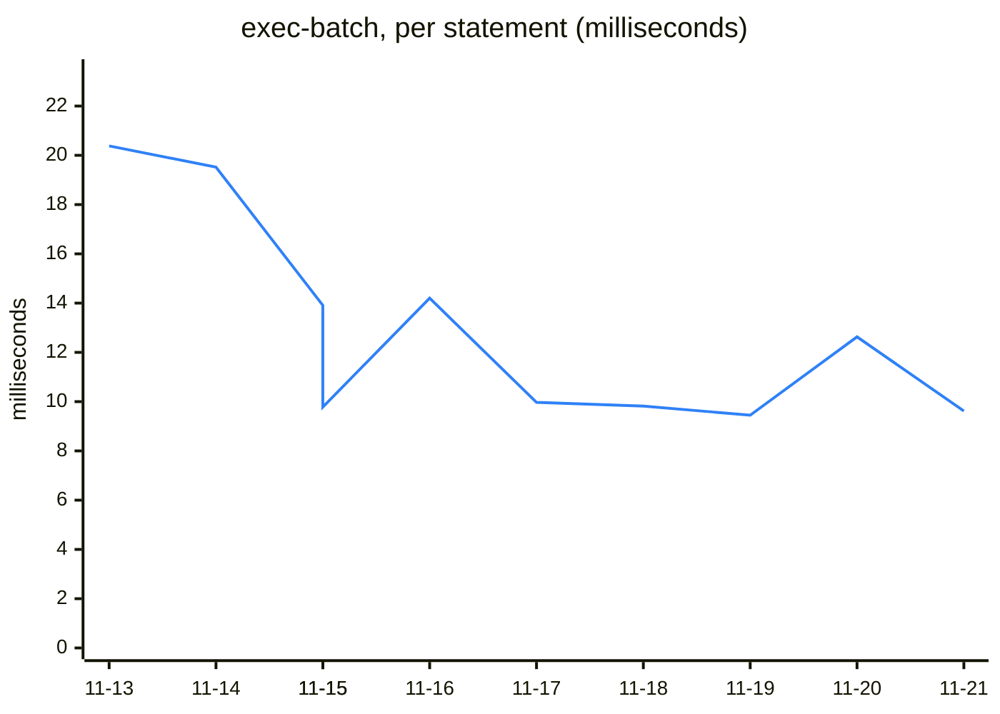
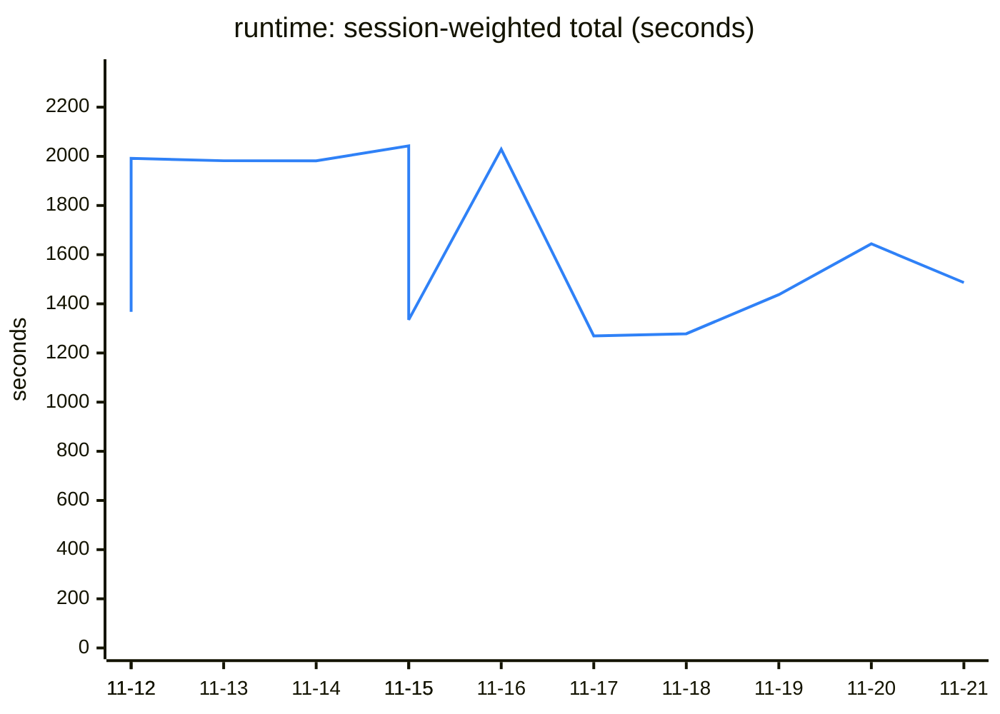

# Agent dev-loop benchmark — trend

12 runs, 2026-11-12 to 2026-11-21. Latest: `mxcli version 591bcd7 (2026-11-21T09:19:11Z)` against `mxcli version nightly-20261119-32a67fa4a (2026-11-19T10:53:32Z)`.

Generated by `scripts/agentbench/trend` after each run; do not edit. Times are the candidate's median wall time on that night's runner, so two nights differ by the machine as well as by the code: read a level that stays, not one night's step. How to read it: `docs-site/src/internals/agent-benchmark.md` on `main`.

## Alerts

None.

## small project — 370 units

| step | latest | run before | median of the 7 before | against that median | against its baseline, latest | last runs |
|---|---:|---:|---:|---:|---:|---|
| (session-weighted total) | 88.4 s | 111.6 s | 88.2 s | × 1.00 | × 1.00 | ▃███▆▁▆▁▁▂▄▂ |
| open-cold | 135 ms | 192 ms | 161 ms | × 0.84 | × 0.99 | ▄████▄█▄▃▁█▁ |
| open | 45 ms | 54 ms | 45 ms | × 1.01 | × 1.00 | ▂████▁▇▁▁▁▄▁ |
| domain | 600 ms | 702 ms | 585 ms | × 1.03 | × 1.03 | █▄▃▃▃▁▃▁▁▁▂▁ |
| microflows | 404 ms | 579 ms | 405 ms | × 1.00 | × 1.00 | █▅▃▃▃▁▃▁▁▁▃▁ |
| pages | 1.39 s | 1.87 s | 1.36 s | × 1.02 | × 1.03 | █▅▃▃▃▁▃▁▁▁▂▁ |
| describe | 108 ms | 129 ms | 105 ms | × 1.03 | × 1.03 | ▃██▇▆▂▇▁▁▂▄▂ |
| catalog | 176 ms | 224 ms | 173 ms | × 1.01 | × 0.99 | ▁████▁█▁▁▁▅▁ |
| catalog-full | 924 ms | 1.11 s | 922 ms | × 1.00 | × 1.00 | ▁████▁█▁▁▂▄▂ |
| query | 69 ms | 82 ms | 67 ms | × 1.02 | × 1.07 | ▁████▁█▁▁▂▅▂ |
| check | 279 ms | 333 ms | 286 ms | × 0.98 | × 0.98 | ▃███▄▁▄▁▁▁▃▁ |
| single-edit | 298 ms | 389 ms | 296 ms | × 1.01 | × 1.01 | ▂████▁█▁▁▂▇▂ |
| catalog-after-edit | 176 ms | 224 ms | 171 ms | × 1.03 | × 1.03 | ▁████▁█▁▁▁▅▁ |
| bulk-alter | 965 ms | 1.79 s | 973 ms | × 0.99 | × 1.00 | ██▃▃▃▁▃▁▁▁▅▁ |
| re-exec | 509 ms | 580 ms | 505 ms | × 1.01 | × 0.98 | ▇█▂▂▂▁▂▁▁▁▁▁ |
| rename | 423 ms | 495 ms | 419 ms | × 1.01 | × 1.00 | ▂█▇▇▇▂▇▁▁▂▄▂ |

## large project — 910 units

| step | latest | run before | median of the 7 before | against that median | against its baseline, latest | last runs |
|---|---:|---:|---:|---:|---:|---|
| (session-weighted total) | 128.8 s | 166.7 s | 126.9 s | × 1.01 | × 0.99 | ▅███▅▁▅▁▁▁▃▁ |
| open-cold | 257 ms | 361 ms | 314 ms | × 0.82 | × 1.02 | ▇████▅█▃▃▁█▁ |
| open | 57 ms | 71 ms | 57 ms | × 1.01 | × 1.04 | ▂████▁█▁▁▂▅▂ |
| domain | 704 ms | 813 ms | 682 ms | × 1.03 | × 1.02 | █▂▂▂▂▁▂▁▁▁▁▁ |
| microflows | 950 ms | 1.49 s | 978 ms | × 0.97 | × 1.00 | █▄▃▃▃▁▃▁▁▁▃▁ |
| pages | 1.73 s | 2.61 s | 1.65 s | × 1.05 | × 1.03 | █▂▁▁▁▁▁▁▁▁▁▁ |
| describe | 129 ms | 157 ms | 127 ms | × 1.02 | × 1.02 | ▃█▇▇▇▂▇▁▁▂▄▂ |
| catalog | 257 ms | 368 ms | 262 ms | × 0.98 | × 0.98 | ▂████▁█▁▁▁▆▁ |
| catalog-full | 2.92 s | 3.42 s | 2.90 s | × 1.01 | × 1.01 | ▁████▁█▁▁▂▄▂ |
| query | 70 ms | 84 ms | 67 ms | × 1.05 | × 1.03 | ▂█▇██▁▇▁▁▁▅▂ |
| check | 428 ms | 524 ms | 429 ms | × 1.00 | × 0.98 | ▄███▃▁▃▁▁▁▂▁ |
| single-edit | 430 ms | 574 ms | 421 ms | × 1.02 | × 1.00 | ▃████▁█▁▁▂▆▂ |
| catalog-after-edit | 266 ms | 357 ms | 275 ms | × 0.97 | × 1.05 | ▂████▂█▂▁▁▇▂ |
| bulk-alter | 1.21 s | 2.10 s | 1.17 s | × 1.03 | × 0.99 | █▆▂▂▂▁▂▁▁▁▄▁ |
| re-exec | 701 ms | 846 ms | 687 ms | × 1.02 | × 0.99 | ██▂▂▂▁▂▁▁▁▂▁ |
| rename | 834 ms | 1.04 s | 824 ms | × 1.01 | × 0.99 | ▂████▁█▁▁▂▅▂ |

## scale project — 4374 units

| step | latest | run before | median of the 7 before | against that median | against its baseline, latest | last runs |
|---|---:|---:|---:|---:|---:|---|
| (session-weighted total) | 4.74 s | 6.09 s | 4.90 s | × 0.97 | × 1.00 | ██▄▁▄▁▁▁▃▁ |
| check-cold | 1.27 s | 1.69 s | 1.42 s | × 0.90 | × 1.00 | ██▅▂▅▁▁▁▃▁ |
| check-one | 471 ms | 566 ms | 467 ms | × 1.01 | × 1.01 | ██▅▁▅▁▁▁▃▁ |
| check-batch | 894 ms | 990 ms | 876 ms | × 1.02 | × 1.00 | ██▅▁▅▁▁▂▃▂ |
| exec-batch | 962 ms | 1.26 s | 997 ms | × 0.96 | × 1.01 | ██▄▁▄▁▁▁▃▁ |
| re-exec-batch | 526 ms | 629 ms | 521 ms | × 1.01 | × 0.99 | ██▃▁▃▁▁▁▂▁ |
| new-batch | 615 ms | 957 ms | 725 ms | × 0.85 | × 1.02 | ██▄▂▅▁▁▁▄▁ |

## running app — 476 units

| step | latest | run before | median of the 7 before | against that median | against its baseline, latest | last runs |
|---|---:|---:|---:|---:|---:|---|
| (session-weighted total) | 1486.6 s | 1643.9 s | 1437.4 s | × 1.03 | × 1.03 | ▂████▁█▁▁▂▄▃ |
| mx-check | 5.53 s | 6.06 s | 5.35 s | × 1.03 | × 1.01 | ▂████▂█▁▁▃▄▃ |
| build | 41.3 s | 50.2 s | 40.6 s | × 1.02 | × 0.99 | ▂████▁█▁▁▁▅▁ |
| boot | 21.6 s | 24.1 s | 21.3 s | × 1.01 | × 1.02 | ▂▇▆▇█▂█▁▁▃▄▃ |
| page-check | 2.45 s | 2.75 s | 2.69 s | × 0.91 | × 1.00 | ▁▇███▁█▂▁▃▃▁ |
| hot-apply | 4.58 s | 4.99 s | 4.33 s | × 1.06 | × 1.06 | ▂▇▇▇█▁▇▁▁▂▄▂ |
| test-attach | 100 ms | 110 ms | 92 ms | × 1.08 | × 0.96 | ▂██▆▇▂█▁▁▁▄▃ |
| apply-entity | 14.6 s | 16.2 s | 13.8 s | × 1.06 | × 1.08 | ▂████▁█▁▁▂▅▃ |
| stop | 628 ms | 834 ms | 737 ms | × 0.85 | × 1.00 | ▁████▅█▁▁▁█▁ |
| test-cold | 19.3 s | 20.4 s | 18.1 s | × 1.07 | × 1.04 | ▂██▇█▁█▁▁▃▄▄ |
