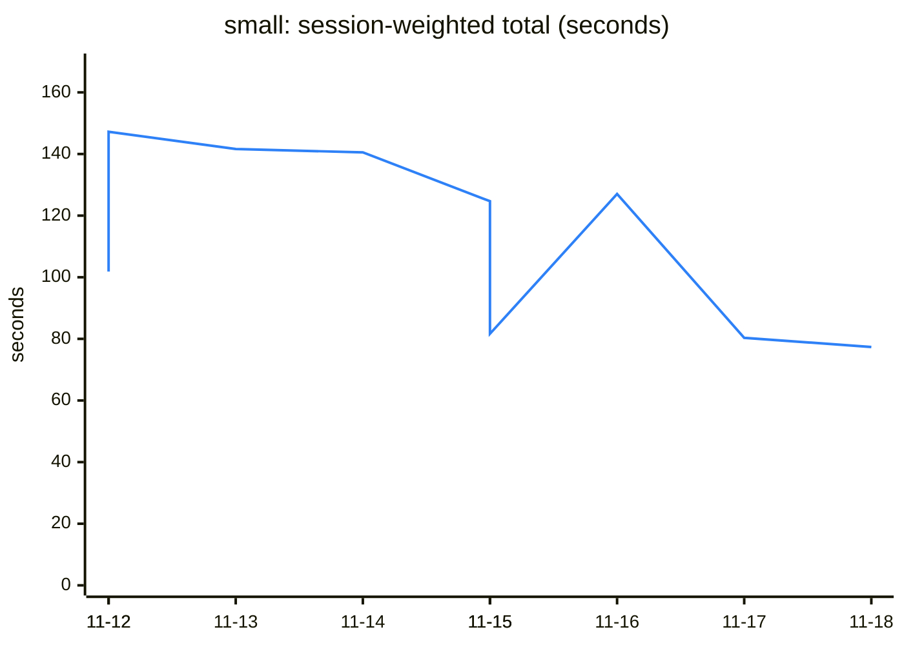
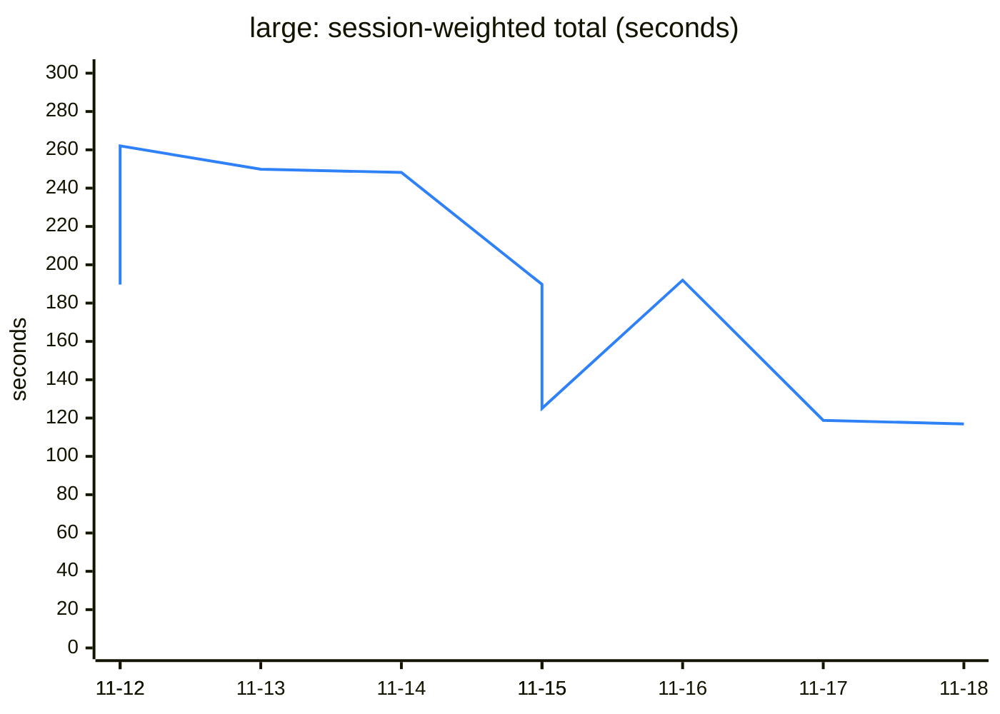
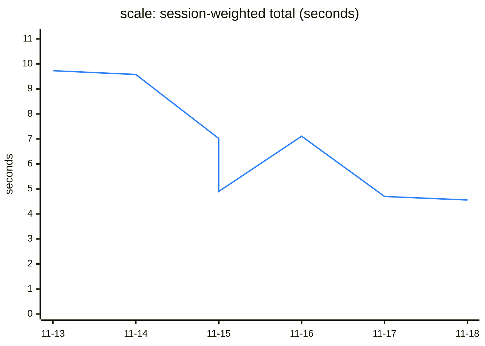
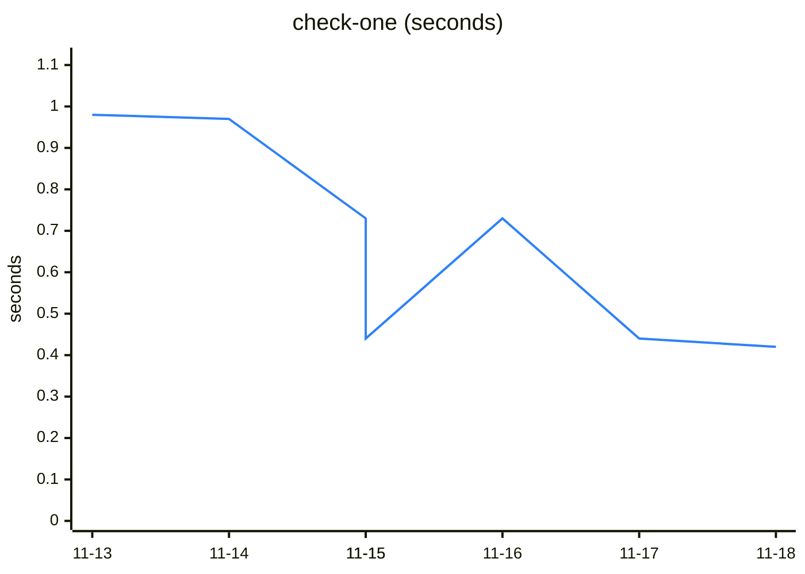
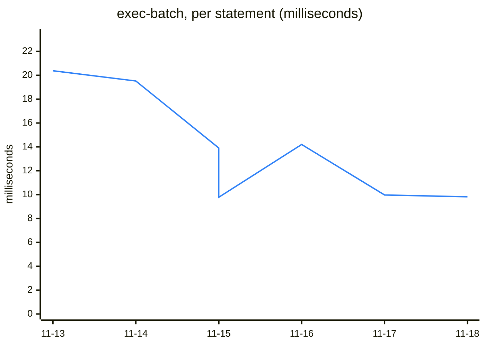
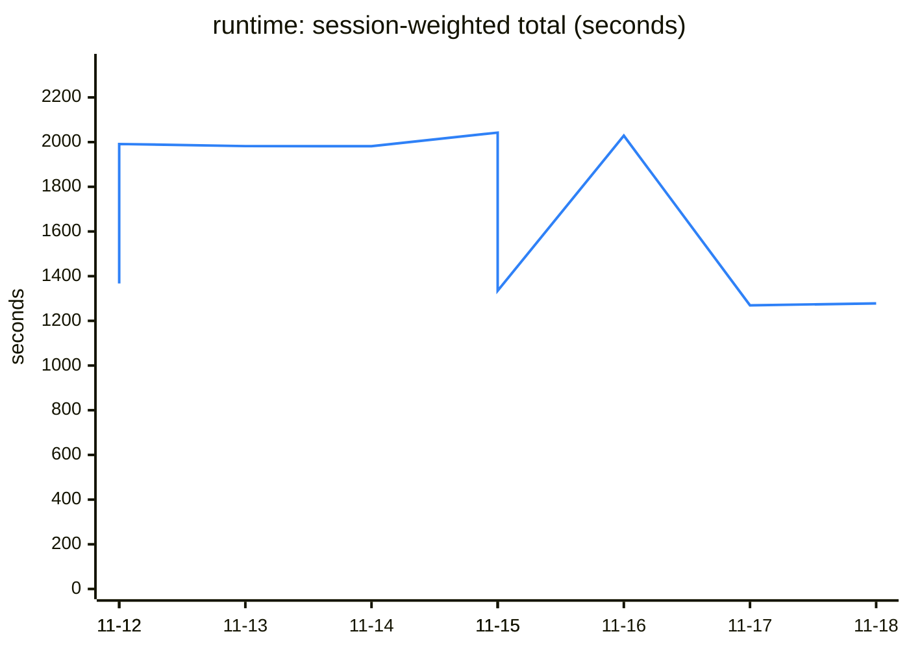

# Agent dev-loop benchmark — trend

9 runs, 2026-11-12 to 2026-11-18. Latest: `mxcli version 9d76448 (2026-11-18T09:50:29Z)` against `mxcli version nightly-20261117-b7dc2f863 (2026-11-17T11:04:39Z)`.

Generated by `scripts/agentbench/trend` after each run; do not edit. Times are the candidate's median wall time on that night's runner, so two nights differ by the machine as well as by the code: read a level that stays, not one night's step. How to read it: `docs-site/src/internals/agent-benchmark.md` on `main`.

## Alerts

None.

## small project — 370 units

| step | latest | run before | median of the 7 before | against that median | against its baseline, latest | last runs |
|---|---:|---:|---:|---:|---:|---|
| (session-weighted total) | 77.4 s | 80.3 s | 127.0 s | × 0.61 | × 1.00 | ▃███▆▁▆▁▁ |
| open-cold | 152 ms | 160 ms | 186 ms | × 0.82 | × 1.03 | ▂████▂█▂▁ |
| open | 43 ms | 45 ms | 68 ms | × 0.63 | × 1.05 | ▂████▁▇▁▁ |
| domain | 480 ms | 498 ms | 844 ms | × 0.57 | × 1.00 | █▄▃▃▃▁▃▁▁ |
| microflows | 391 ms | 399 ms | 615 ms | × 0.64 | × 1.01 | █▅▃▃▃▁▃▁▁ |
| pages | 1.18 s | 1.27 s | 1.95 s | × 0.60 | × 1.00 | █▅▃▃▃▁▃▁▁ |
| describe | 93 ms | 98 ms | 156 ms | × 0.60 | × 0.96 | ▃██▇▆▂▇▁▁ |
| catalog | 160 ms | 162 ms | 278 ms | × 0.58 | × 1.03 | ▁████▁█▁▁ |
| catalog-full | 794 ms | 833 ms | 1.43 s | × 0.55 | × 1.00 | ▁████▁█▁▁ |
| query | 62 ms | 61 ms | 95 ms | × 0.65 | × 0.96 | ▁████▁█▁▁ |
| check | 245 ms | 251 ms | 405 ms | × 0.60 | × 1.00 | ▃███▄▁▄▁▁ |
| single-edit | 259 ms | 271 ms | 418 ms | × 0.62 | × 0.99 | ▂████▁█▁▁ |
| catalog-after-edit | 164 ms | 169 ms | 262 ms | × 0.63 | × 0.99 | ▁████▁█▁▁ |
| bulk-alter | 869 ms | 871 ms | 1.35 s | × 0.64 | × 1.01 | ██▃▃▃▁▃▁▁ |
| re-exec | 434 ms | 440 ms | 690 ms | × 0.63 | × 1.01 | ▇█▂▂▂▁▂▁▁ |
| rename | 353 ms | 371 ms | 609 ms | × 0.58 | × 0.99 | ▂█▇▇▇▂▇▁▁ |

## large project — 910 units

| step | latest | run before | median of the 7 before | against that median | against its baseline, latest | last runs |
|---|---:|---:|---:|---:|---:|---|
| (session-weighted total) | 116.9 s | 118.8 s | 192.0 s | × 0.61 | × 1.00 | ▅███▅▁▅▁▁ |
| open-cold | 293 ms | 294 ms | 359 ms | × 0.82 | × 1.08 | ▆████▃█▁▁ |
| open | 52 ms | 55 ms | 84 ms | × 0.62 | × 1.01 | ▂████▁█▁▁ |
| domain | 584 ms | 599 ms | 1.00 s | × 0.58 | × 0.99 | █▂▂▂▂▁▂▁▁ |
| microflows | 913 ms | 906 ms | 1.54 s | × 0.59 | × 1.00 | █▄▃▃▃▁▃▁▁ |
| pages | 1.58 s | 1.51 s | 2.41 s | × 0.65 | × 0.99 | █▂▁▁▁▁▁▁▁ |
| describe | 112 ms | 117 ms | 188 ms | × 0.59 | × 1.00 | ▃█▇▇▇▂▇▁▁ |
| catalog | 248 ms | 248 ms | 426 ms | × 0.58 | × 0.98 | ▂████▁█▁▁ |
| catalog-full | 2.55 s | 2.61 s | 4.51 s | × 0.57 | × 1.00 | ▁████▁█▁▁ |
| query | 63 ms | 64 ms | 96 ms | × 0.65 | × 0.97 | ▂█▇██▁▇▁▁ |
| check | 391 ms | 392 ms | 644 ms | × 0.61 | × 1.00 | ▄███▃▁▃▁▁ |
| single-edit | 390 ms | 398 ms | 628 ms | × 0.62 | × 1.00 | ▃████▁█▁▁ |
| catalog-after-edit | 262 ms | 274 ms | 378 ms | × 0.69 | × 0.98 | ▂████▁█▁▁ |
| bulk-alter | 1.08 s | 1.13 s | 1.68 s | × 0.64 | × 0.98 | █▆▂▂▂▁▂▁▁ |
| re-exec | 612 ms | 618 ms | 989 ms | × 0.62 | × 1.00 | ██▂▂▂▁▂▁▁ |
| rename | 705 ms | 703 ms | 1.24 s | × 0.57 | × 0.99 | ▂████▁█▁▁ |

## scale project — 4374 units

| step | latest | run before | median of the 7 before | against that median | against its baseline, latest | last runs |
|---|---:|---:|---:|---:|---:|---|
| (session-weighted total) | 4.56 s | 4.70 s | 7.06 s | × 0.65 | × 1.01 | ██▄▁▄▁▁ |
| check-cold | 1.29 s | 1.35 s | 1.93 s | × 0.67 | × 1.00 | ██▅▁▅▁▁ |
| check-one | 421 ms | 440 ms | 729 ms | × 0.58 | × 0.99 | ██▅▁▅▁▁ |
| check-batch | 748 ms | 776 ms | 1.30 s | × 0.57 | × 1.00 | ██▅▁▅▁▁ |
| exec-batch | 982 ms | 997 ms | 1.41 s | × 0.70 | × 1.00 | ██▄▁▄▁▁ |
| re-exec-batch | 488 ms | 497 ms | 748 ms | × 0.65 | × 1.01 | ██▃▁▃▁▁ |
| new-batch | 627 ms | 637 ms | 945 ms | × 0.66 | × 1.01 | ██▄▂▄▁▁ |

## running app — 476 units

| step | latest | run before | median of the 7 before | against that median | against its baseline, latest | last runs |
|---|---:|---:|---:|---:|---:|---|
| (session-weighted total) | 1278.2 s | 1269.5 s | 1982.0 s | × 0.64 | × 0.97 | ▂████▁█▁▁ |
| mx-check | 4.42 s | 4.28 s | 7.90 s | × 0.56 | × 0.98 | ▂████▂█▁▁ |
| build | 39.7 s | 39.7 s | 57.4 s | × 0.69 | × 1.01 | ▂████▁█▁▁ |
| boot | 17.3 s | 18.1 s | 29.1 s | × 0.60 | × 0.91 | ▂▇▆▇█▂█▁▁ |
| page-check | 2.40 s | 2.53 s | 3.30 s | × 0.73 | × 1.00 | ▁▇███▁█▂▁ |
| hot-apply | 4.30 s | 4.07 s | 5.75 s | × 0.75 | × 1.06 | ▂▇▇▇█▁▇▁▁ |
| test-attach | 85 ms | 88 ms | 132 ms | × 0.64 | × 0.82 | ▂██▆▇▂█▁▁ |
| apply-entity | 12.8 s | 13.0 s | 18.6 s | × 0.69 | × 0.96 | ▂████▁█▁▁ |
| stop | 627 ms | 628 ms | 840 ms | × 0.75 | × 0.99 | ▁████▅█▁▁ |
| test-cold | 15.5 s | 15.5 s | 24.4 s | × 0.63 | × 0.94 | ▂██▇█▁█▁▁ |
