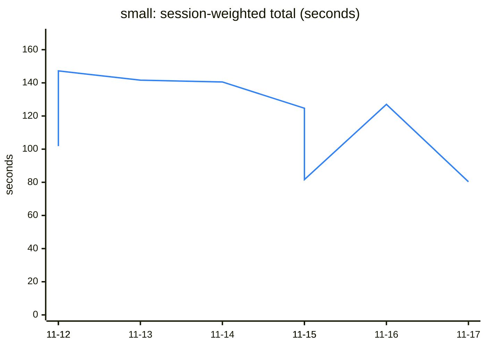
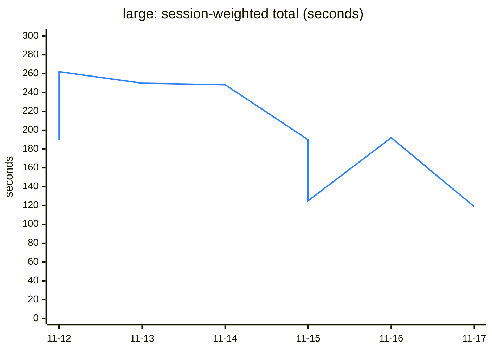
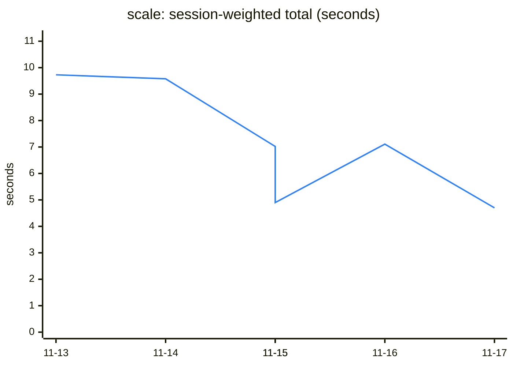
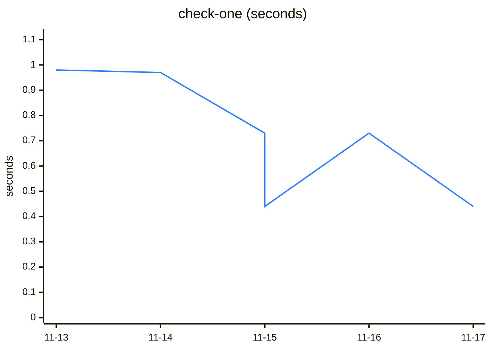
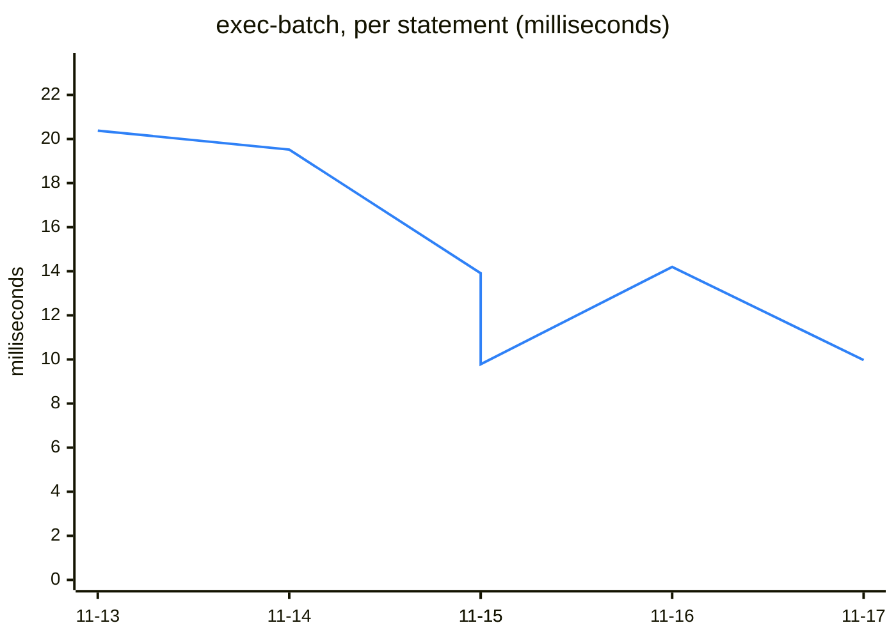
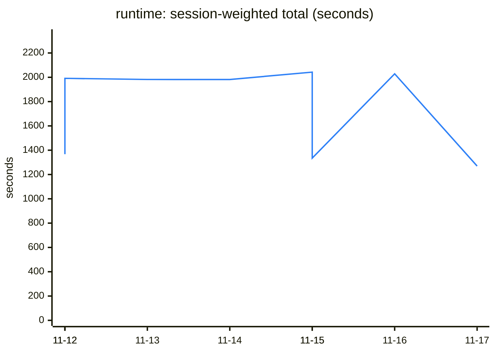

# Agent dev-loop benchmark — trend

8 runs, 2026-11-12 to 2026-11-17. Latest: `mxcli version b7dc2f8 (2026-11-17T10:18:47Z)` against `mxcli version nightly-20261116-121c9b550 (2026-11-16T10:01:16Z)`.

Generated by `scripts/agentbench/trend` after each run; do not edit. Times are the candidate's median wall time on that night's runner, so two nights differ by the machine as well as by the code: read a level that stays, not one night's step. How to read it: `docs-site/src/internals/agent-benchmark.md` on `main`.

## Alerts

None.

## small project — 370 units

| step | latest | run before | median of the 7 before | against that median | against its baseline, latest | last runs |
|---|---:|---:|---:|---:|---:|---|
| (session-weighted total) | 80.3 s | 127.0 s | 127.0 s | × 0.63 | × 1.01 | ▃███▆▁▆▁ |
| open-cold | 160 ms | 190 ms | 186 ms | × 0.86 | × 1.05 | ▁▇▇██▁█▁ |
| open | 45 ms | 65 ms | 68 ms | × 0.65 | × 1.01 | ▁████▁▇▁ |
| domain | 498 ms | 855 ms | 855 ms | × 0.58 | × 1.01 | █▄▃▃▃▁▃▁ |
| microflows | 399 ms | 615 ms | 615 ms | × 0.65 | × 1.03 | █▅▃▃▃▁▃▁ |
| pages | 1.27 s | 1.97 s | 1.96 s | × 0.65 | × 1.03 | █▅▃▂▂▁▃▁ |
| describe | 98 ms | 157 ms | 156 ms | × 0.63 | × 0.95 | ▂██▇▆▁▇▁ |
| catalog | 162 ms | 286 ms | 278 ms | × 0.58 | × 1.00 | ▁████▁█▁ |
| catalog-full | 833 ms | 1.41 s | 1.43 s | × 0.58 | × 0.99 | ▁████▁█▁ |
| query | 61 ms | 95 ms | 95 ms | × 0.64 | × 0.97 | ▁████▁█▁ |
| check | 251 ms | 405 ms | 405 ms | × 0.62 | × 1.00 | ▃███▄▁▄▁ |
| single-edit | 271 ms | 424 ms | 418 ms | × 0.65 | × 1.01 | ▁████▁█▁ |
| catalog-after-edit | 169 ms | 268 ms | 262 ms | × 0.65 | × 0.98 | ▁████▁█▁ |
| bulk-alter | 871 ms | 1.37 s | 1.37 s | × 0.64 | × 1.01 | ██▃▃▃▁▃▁ |
| re-exec | 440 ms | 712 ms | 694 ms | × 0.63 | × 1.01 | ▇█▂▂▂▁▂▁ |
| rename | 371 ms | 607 ms | 609 ms | × 0.61 | × 1.00 | ▂█▇▇▇▁▇▁ |

## large project — 910 units

| step | latest | run before | median of the 7 before | against that median | against its baseline, latest | last runs |
|---|---:|---:|---:|---:|---:|---|
| (session-weighted total) | 118.8 s | 192.0 s | 192.0 s | × 0.62 | × 1.01 | ▄███▄▁▅▁ |
| open-cold | 294 ms | 364 ms | 359 ms | × 0.82 | × 1.12 | ▆████▃█▁ |
| open | 55 ms | 84 ms | 84 ms | × 0.65 | × 0.98 | ▂████▁█▁ |
| domain | 599 ms | 1.01 s | 1.01 s | × 0.60 | × 1.00 | █▂▂▂▂▁▂▁ |
| microflows | 906 ms | 1.56 s | 1.55 s | × 0.59 | × 1.02 | █▄▃▃▃▁▃▁ |
| pages | 1.51 s | 2.45 s | 2.43 s | × 0.62 | × 0.97 | █▂▁▁▁▁▁▁ |
| describe | 117 ms | 191 ms | 188 ms | × 0.62 | × 0.98 | ▂█▇▇▇▁▇▁ |
| catalog | 248 ms | 426 ms | 426 ms | × 0.58 | × 0.96 | ▂████▁█▁ |
| catalog-full | 2.61 s | 4.45 s | 4.51 s | × 0.58 | × 1.01 | ▁████▁█▁ |
| query | 64 ms | 96 ms | 96 ms | × 0.67 | × 1.01 | ▂█▇██▁▇▁ |
| check | 392 ms | 644 ms | 831 ms | × 0.47 | × 1.00 | ▄███▃▁▃▁ |
| single-edit | 398 ms | 639 ms | 628 ms | × 0.63 | × 1.01 | ▃████▁█▁ |
| catalog-after-edit | 274 ms | 378 ms | 378 ms | × 0.72 | × 0.98 | ▁████▁█▁ |
| bulk-alter | 1.13 s | 1.72 s | 1.71 s | × 0.66 | × 1.03 | █▆▂▂▂▁▂▁ |
| re-exec | 618 ms | 996 ms | 996 ms | × 0.62 | × 1.02 | ██▂▂▂▁▂▁ |
| rename | 703 ms | 1.24 s | 1.24 s | × 0.57 | × 0.99 | ▂████▁█▁ |

## scale project — 4374 units

| step | latest | run before | median of the 7 before | against that median | against its baseline, latest | last runs |
|---|---:|---:|---:|---:|---:|---|
| (session-weighted total) | 4.70 s | 7.11 s | 7.11 s | × 0.66 | × 0.99 | ██▄▁▄▁ |
| check-cold | 1.35 s | 1.93 s | 1.93 s | × 0.70 | × 1.04 | ██▅▁▅▁ |
| check-one | 440 ms | 730 ms | 730 ms | × 0.60 | × 0.99 | ██▅▁▅▁ |
| check-batch | 776 ms | 1.31 s | 1.31 s | × 0.59 | × 0.99 | ██▅▁▅▁ |
| exec-batch | 997 ms | 1.42 s | 1.42 s | × 0.70 | × 0.95 | ██▄▁▄▁ |
| re-exec-batch | 497 ms | 751 ms | 751 ms | × 0.66 | × 1.02 | ██▃▁▃▁ |
| new-batch | 637 ms | 967 ms | 967 ms | × 0.66 | × 0.98 | ██▄▂▄▁ |

## running app — 476 units

| step | latest | run before | median of the 7 before | against that median | against its baseline, latest | last runs |
|---|---:|---:|---:|---:|---:|---|
| (session-weighted total) | 1269.5 s | 2028.7 s | 1982.0 s | × 0.64 | × 0.98 | ▂████▁█▁ |
| mx-check | 4.28 s | 7.97 s | 7.90 s | × 0.54 | × 0.98 | ▂████▂█▁ |
| build | 39.7 s | 57.6 s | 57.4 s | × 0.69 | × 0.99 | ▂████▁█▁ |
| boot | 18.1 s | 31.6 s | 29.1 s | × 0.62 | × 0.96 | ▁▇▆▇▇▁█▁ |
| page-check | 2.53 s | 3.36 s | 3.30 s | × 0.77 | × 1.00 | ▁▇███▁█▂ |
| hot-apply | 4.07 s | 5.77 s | 5.75 s | × 0.71 | × 0.95 | ▂▇▇▇█▁▇▁ |
| test-attach | 88 ms | 136 ms | 132 ms | × 0.66 | × 1.01 | ▂██▆▇▁█▁ |
| apply-entity | 13.0 s | 18.9 s | 18.6 s | × 0.70 | × 1.00 | ▂████▁█▁ |
| stop | 628 ms | 841 ms | 840 ms | × 0.75 | × 1.00 | ▁████▅█▁ |
| test-cold | 15.5 s | 24.4 s | 24.4 s | × 0.64 | × 0.96 | ▂██▇█▁█▁ |
