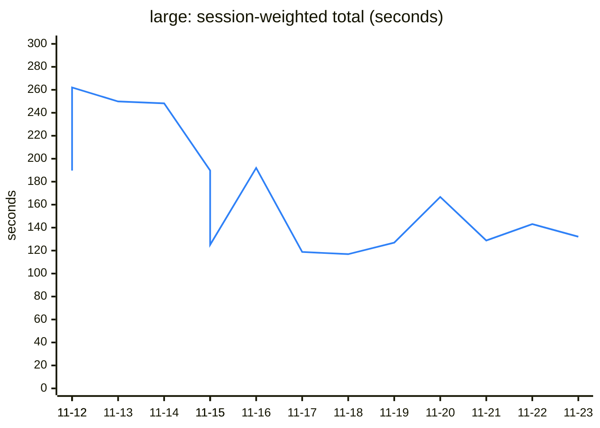
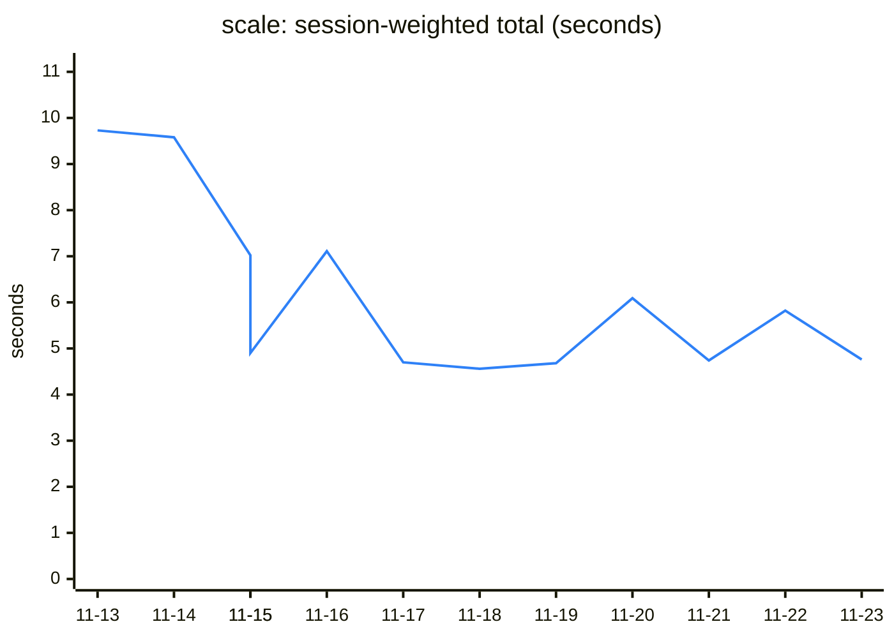
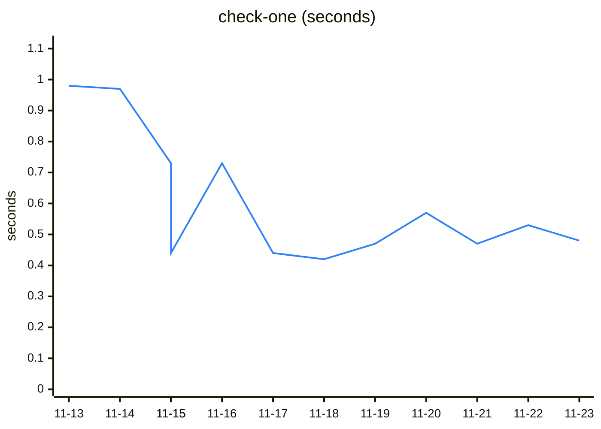
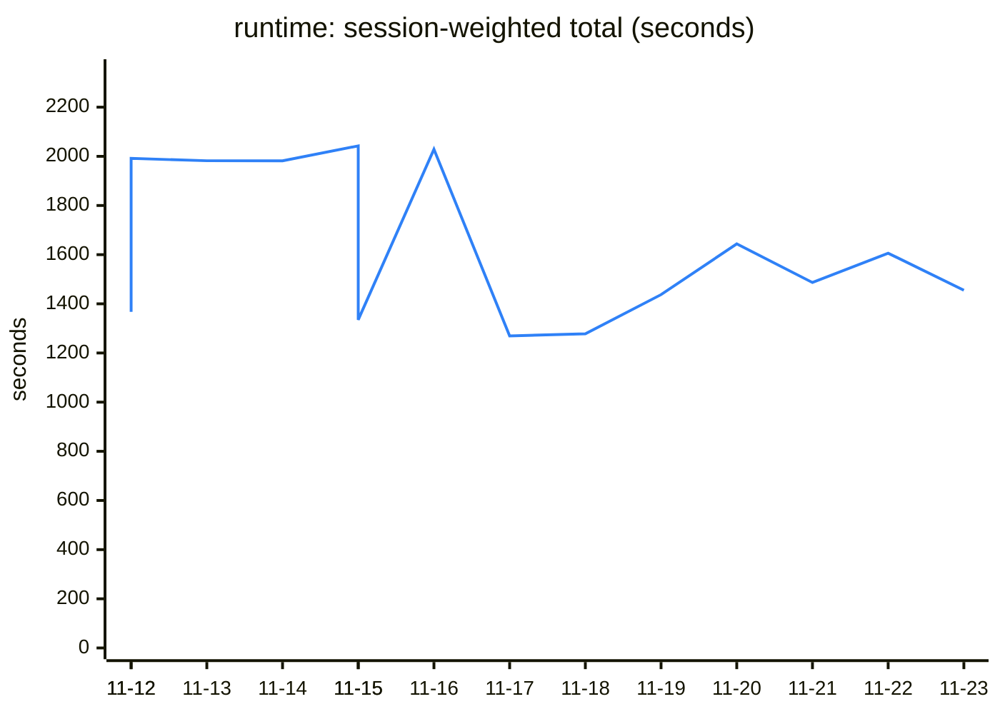

# Agent dev-loop benchmark — trend

14 runs, 2026-11-12 to 2026-11-23. Latest: `mxcli version 811702b (2026-11-23T10:27:29Z)` against `mxcli version nightly-20261122-6176c6661 (2026-11-22T10:18:27Z)`.

Generated by `scripts/agentbench/trend` after each run; do not edit. Times are the candidate's median wall time on that night's runner, so two nights differ by the machine as well as by the code: read a level that stays, not one night's step. How to read it: `docs-site/src/internals/agent-benchmark.md` on `main`.

## Alerts

None.

## small project — 370 units

| step | latest | run before | median of the 7 before | against that median | against its baseline, latest | last runs |
|---|---:|---:|---:|---:|---:|---|
| (session-weighted total) | 90.3 s | 97.7 s | 88.4 s | × 1.02 | × 1.03 | ▃███▆▁▆▁▁▂▄▂▃▂ |
| open-cold | 133 ms | 171 ms | 160 ms | × 0.83 | × 1.04 | ▄████▄█▄▃▁█▁▆▁ |
| open | 46 ms | 55 ms | 45 ms | × 1.02 | × 1.01 | ▂████▁▇▁▁▁▄▁▄▁ |
| domain | 611 ms | 666 ms | 600 ms | × 1.02 | × 1.02 | █▄▃▃▃▁▃▁▁▁▂▁▂▁ |
| microflows | 415 ms | 547 ms | 405 ms | × 1.03 | × 1.02 | █▅▃▃▃▁▃▁▁▁▃▁▂▁ |
| pages | 1.42 s | 1.61 s | 1.39 s | × 1.02 | × 1.00 | █▅▃▃▃▁▃▁▁▁▂▁▂▁ |
| describe | 106 ms | 124 ms | 108 ms | × 0.98 | × 0.96 | ▃██▇▆▂▇▁▁▂▄▂▄▂ |
| catalog | 174 ms | 195 ms | 176 ms | × 0.99 | × 1.00 | ▁████▁█▁▁▁▅▁▃▁ |
| catalog-full | 923 ms | 1.04 s | 924 ms | × 1.00 | × 1.01 | ▁████▁█▁▁▂▄▂▄▂ |
| query | 65 ms | 78 ms | 69 ms | × 0.95 | × 0.99 | ▁████▁█▁▁▂▅▂▄▁ |
| check | 293 ms | 305 ms | 286 ms | × 1.02 | × 1.05 | ▃███▄▁▄▁▁▁▃▁▂▂ |
| single-edit | 303 ms | 324 ms | 298 ms | × 1.02 | × 1.04 | ▂████▁█▁▁▂▇▂▄▃ |
| catalog-after-edit | 175 ms | 212 ms | 176 ms | × 0.99 | × 0.99 | ▁████▁█▁▁▁▅▁▄▁ |
| bulk-alter | 984 ms | 1.19 s | 973 ms | × 1.01 | × 1.02 | ██▃▃▃▁▃▁▁▁▅▁▂▁ |
| re-exec | 519 ms | 569 ms | 509 ms | × 1.02 | × 1.02 | ▇█▂▂▂▁▂▁▁▁▁▁▁▁ |
| rename | 427 ms | 477 ms | 423 ms | × 1.01 | × 1.01 | ▂█▇▇▇▂▇▁▁▂▄▂▄▂ |

## large project — 910 units

| step | latest | run before | median of the 7 before | against that median | against its baseline, latest | last runs |
|---|---:|---:|---:|---:|---:|---|
| (session-weighted total) | 132.1 s | 143.1 s | 128.8 s | × 1.03 | × 1.02 | ▅███▅▁▅▁▁▁▃▁▂▁ |
| open-cold | 259 ms | 357 ms | 294 ms | × 0.88 | × 1.00 | ▇████▅█▃▃▁█▁█▁ |
| open | 56 ms | 67 ms | 57 ms | × 0.98 | × 0.98 | ▂████▁█▁▁▂▅▂▄▁ |
| domain | 719 ms | 783 ms | 704 ms | × 1.02 | × 1.01 | █▂▂▂▂▁▂▁▁▁▁▁▁▁ |
| microflows | 983 ms | 1.13 s | 950 ms | × 1.04 | × 1.02 | █▄▃▃▃▁▃▁▁▁▃▁▂▁ |
| pages | 1.76 s | 1.97 s | 1.73 s | × 1.02 | × 1.01 | █▂▁▁▁▁▁▁▁▁▁▁▁▁ |
| describe | 125 ms | 142 ms | 129 ms | × 0.97 | × 1.01 | ▃█▇▇▇▂▇▁▁▂▄▂▃▂ |
| catalog | 265 ms | 304 ms | 258 ms | × 1.03 | × 1.00 | ▂████▁█▁▁▁▆▁▃▁ |
| catalog-full | 2.94 s | 3.26 s | 2.92 s | × 1.01 | × 1.01 | ▁████▁█▁▁▂▄▂▃▂ |
| query | 68 ms | 78 ms | 70 ms | × 0.98 | × 0.95 | ▂█▇██▁▇▁▁▁▅▂▄▂ |
| check | 445 ms | 481 ms | 429 ms | × 1.04 | × 1.02 | ▄███▃▁▃▁▁▁▂▁▁▁ |
| single-edit | 442 ms | 468 ms | 430 ms | × 1.03 | × 1.02 | ▃████▁█▁▁▂▆▂▃▂ |
| catalog-after-edit | 274 ms | 333 ms | 274 ms | × 1.00 | × 1.01 | ▂████▂█▂▁▁▇▂▅▂ |
| bulk-alter | 1.22 s | 1.42 s | 1.21 s | × 1.01 | × 1.02 | █▆▂▂▂▁▂▁▁▁▄▁▂▁ |
| re-exec | 711 ms | 782 ms | 701 ms | × 1.01 | × 1.02 | ██▂▂▂▁▂▁▁▁▂▁▁▁ |
| rename | 838 ms | 938 ms | 834 ms | × 1.01 | × 1.01 | ▂████▁█▁▁▂▅▂▄▂ |

## scale project — 4374 units

| step | latest | run before | median of the 7 before | against that median | against its baseline, latest | last runs |
|---|---:|---:|---:|---:|---:|---|
| (session-weighted total) | 4.76 s | 5.82 s | 4.74 s | × 1.01 | × 1.00 | ██▄▁▄▁▁▁▃▁▂▁ |
| check-cold | 1.28 s | 1.53 s | 1.35 s | × 0.95 | × 0.99 | ██▅▂▅▁▁▁▃▁▂▁ |
| check-one | 481 ms | 526 ms | 471 ms | × 1.02 | × 1.02 | ██▅▁▅▁▁▁▃▁▂▁ |
| check-batch | 900 ms | 1.01 s | 894 ms | × 1.01 | × 1.01 | ██▅▁▅▁▁▂▃▂▃▂ |
| exec-batch | 961 ms | 1.25 s | 997 ms | × 0.96 | × 1.01 | ██▄▁▄▁▁▁▃▁▃▁ |
| re-exec-batch | 525 ms | 604 ms | 526 ms | × 1.00 | × 1.00 | ██▃▁▃▁▁▁▂▁▂▁ |
| new-batch | 618 ms | 894 ms | 637 ms | × 0.97 | × 1.01 | ██▄▂▅▁▁▁▄▁▄▁ |

## running app — 476 units

| step | latest | run before | median of the 7 before | against that median | against its baseline, latest | last runs |
|---|---:|---:|---:|---:|---:|---|
| (session-weighted total) | 1455.2 s | 1605.9 s | 1486.6 s | × 0.98 | × 1.00 | ▂████▁█▁▁▂▄▃▄▂ |
| mx-check | 5.53 s | 6.25 s | 5.53 s | × 1.00 | × 1.01 | ▂████▂█▁▁▃▄▃▅▃ |
| build | 42.0 s | 48.4 s | 41.3 s | × 1.01 | × 1.01 | ▂████▁█▁▁▁▅▁▄▂ |
| boot | 22.1 s | 22.6 s | 21.6 s | × 1.02 | × 1.05 | ▂▇▆▇█▂█▁▁▃▄▃▃▃ |
| page-check | 2.46 s | 2.84 s | 2.69 s | × 0.91 | × 1.00 | ▁▇███▁█▂▁▃▃▁▄▁ |
| hot-apply | 4.12 s | 4.64 s | 4.58 s | × 0.90 | × 0.90 | ▂▇▇▇█▁▇▁▁▂▄▂▃▁ |
| test-attach | 97 ms | 111 ms | 100 ms | × 0.97 | × 0.99 | ▂██▆▇▂█▁▁▁▄▃▄▂ |
| apply-entity | 14.0 s | 15.6 s | 14.6 s | × 0.96 | × 0.98 | ▂████▁█▁▁▂▅▃▄▂ |
| stop | 629 ms | 632 ms | 628 ms | × 1.00 | × 1.00 | ▁████▅█▁▁▁█▁▁▁ |
| test-cold | 19.4 s | 19.7 s | 19.3 s | × 1.01 | × 1.09 | ▂██▇█▁█▁▁▃▄▄▄▄ |
