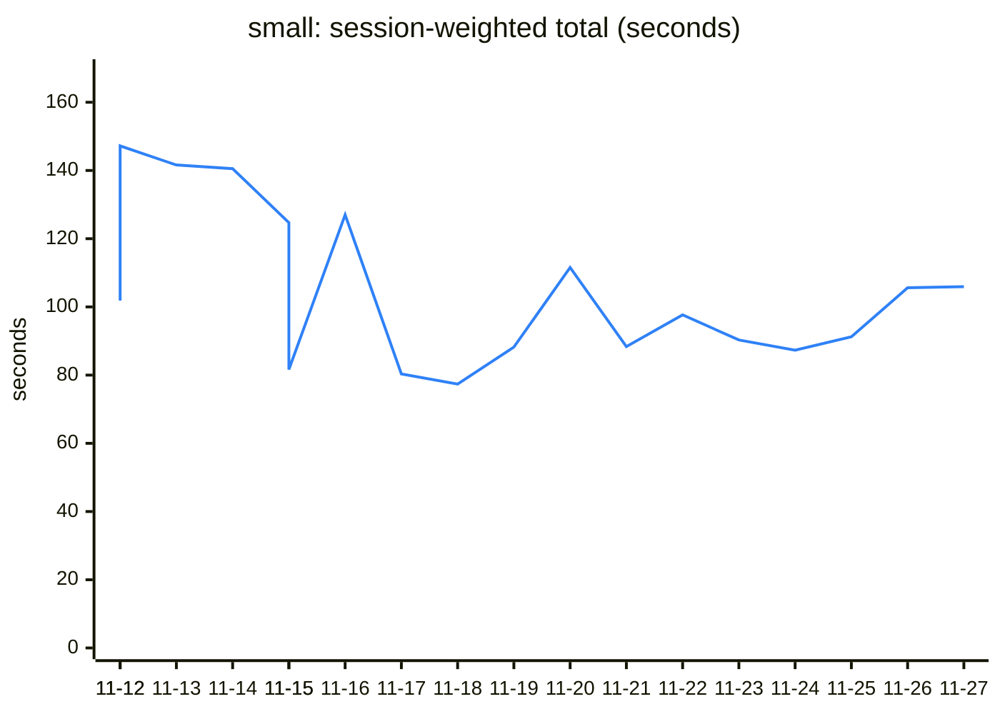
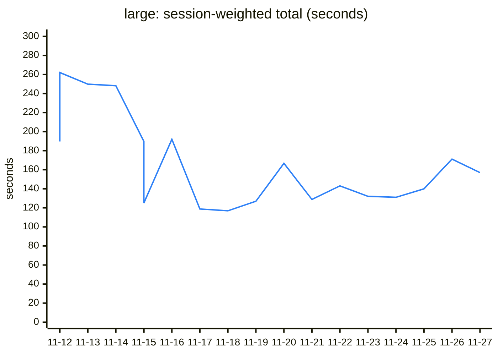
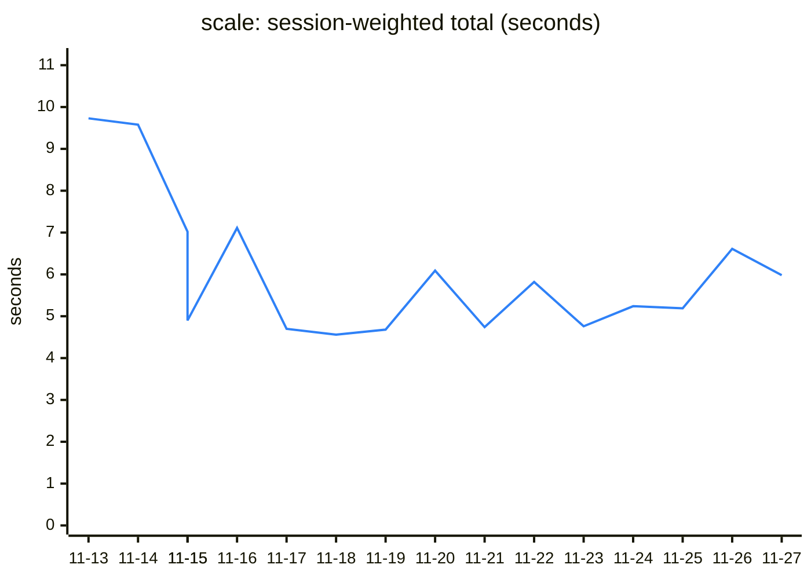
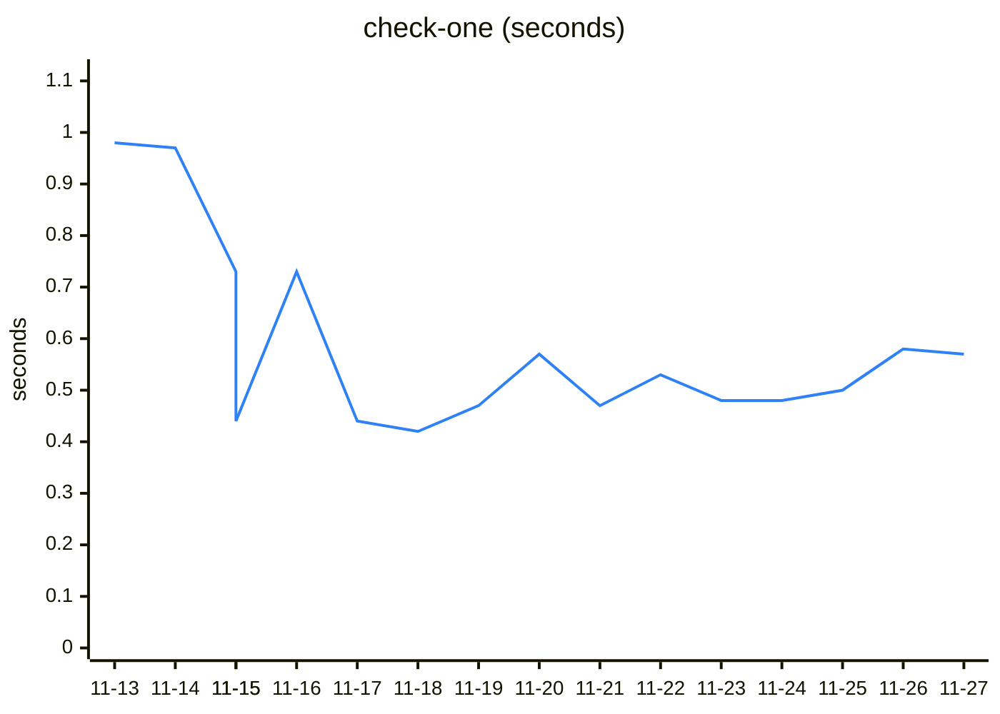
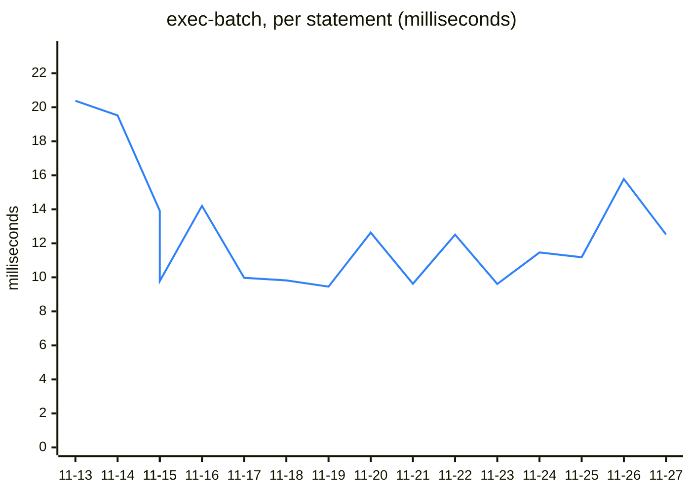
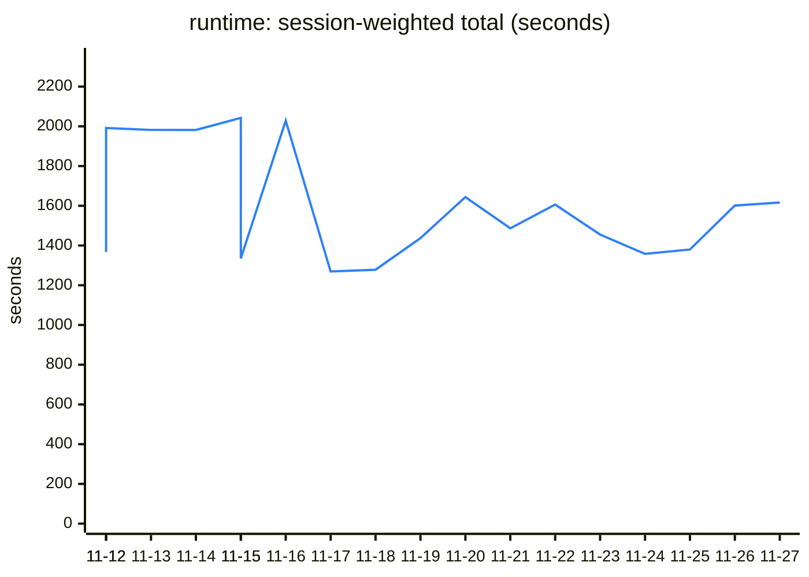

# Agent dev-loop benchmark — trend

18 runs, 2026-11-12 to 2026-11-27. Latest: `mxcli version 90b5994 (2026-11-27T10:37:04Z)` against `mxcli version nightly-20261126-a58195714 (2026-11-26T11:32:10Z)`.

Generated by `scripts/agentbench/trend` after each run; do not edit. Times are the candidate's median wall time on that night's runner, so two nights differ by the machine as well as by the code: read a level that stays, not one night's step. How to read it: `docs-site/src/internals/agent-benchmark.md` on `main`.

## Alerts

None.

## small project — 370 units

| step | latest | run before | median of the 7 before | against that median | against its baseline, latest | last runs |
|---|---:|---:|---:|---:|---:|---|
| (session-weighted total) | 105.9 s | 105.6 s | 91.2 s | × 1.16 | × 1.00 | █▁█▁▁▂▆▂▄▃▂▃▅▅ |
| open-cold | 201 ms | 196 ms | 162 ms | × 1.24 | × 1.06 | ▇▄▇▄▃▁▇▁▅▁▄▄██ |
| open | 54 ms | 53 ms | 48 ms | × 1.11 | × 0.95 | █▁▇▁▁▁▄▁▄▁▂▂▃▄ |
| domain | 681 ms | 684 ms | 611 ms | × 1.12 | × 1.02 | █▁█▁▁▃▅▃▄▃▂▃▅▅ |
| microflows | 513 ms | 635 ms | 488 ms | × 1.05 | × 0.95 | ▇▁█▁▁▁▇▁▆▁▂▄█▄ |
| pages | 1.64 s | 2.10 s | 1.47 s | × 1.12 | × 1.02 | ▇▁▇▁▁▂▆▂▄▃▃▃█▄ |
| describe | 124 ms | 126 ms | 109 ms | × 1.13 | × 0.98 | ▇▂█▁▁▂▅▂▄▂▂▃▅▄ |
| catalog | 213 ms | 243 ms | 181 ms | × 1.18 | × 1.00 | █▁█▁▁▁▅▁▃▁▂▂▆▄ |
| catalog-full | 1.04 s | 1.08 s | 924 ms | × 1.13 | × 0.99 | █▁█▁▁▂▄▂▄▂▁▂▄▄ |
| query | 84 ms | 81 ms | 70 ms | × 1.20 | × 0.97 | █▁█▁▁▂▅▂▄▂▁▃▅▆ |
| check | 340 ms | 330 ms | 293 ms | × 1.16 | × 1.00 | █▁█▁▁▃▅▂▄▃▂▃▅▅ |
| single-edit | 356 ms | 353 ms | 304 ms | × 1.17 | × 1.01 | █▁█▁▁▂▇▂▄▃▂▃▅▅ |
| catalog-after-edit | 227 ms | 233 ms | 193 ms | × 1.17 | × 0.96 | █▁█▁▁▁▅▁▄▁▂▃▆▅ |
| bulk-alter | 1.13 s | 1.26 s | 1.07 s | × 1.05 | × 0.98 | ▅▁▅▁▁▁█▁▃▁▂▂▄▃ |
| re-exec | 584 ms | 581 ms | 519 ms | × 1.13 | × 0.99 | ▇▁█▁▁▃▅▃▄▃▂▂▅▅ |
| rename | 490 ms | 488 ms | 427 ms | × 1.15 | × 1.00 | █▂█▁▁▃▅▃▄▃▂▃▅▅ |

## large project — 910 units

| step | latest | run before | median of the 7 before | against that median | against its baseline, latest | last runs |
|---|---:|---:|---:|---:|---:|---|
| (session-weighted total) | 157.0 s | 171.2 s | 140.0 s | × 1.12 | × 1.00 | █▁█▁▁▂▆▂▃▂▂▃▆▅ |
| open-cold | 350 ms | 402 ms | 331 ms | × 1.06 | × 1.09 | ▆▄▆▃▃▁▆▁▆▁▃▅█▆ |
| open | 69 ms | 68 ms | 63 ms | × 1.09 | × 1.01 | █▁█▁▁▂▅▂▄▁▂▃▄▅ |
| domain | 804 ms | 847 ms | 755 ms | × 1.06 | × 1.00 | █▂█▁▁▂▅▃▄▃▃▄▅▅ |
| microflows | 1.25 s | 1.37 s | 1.13 s | × 1.11 | × 1.00 | █▁█▁▁▁█▁▃▂▃▄▆▅ |
| pages | 2.15 s | 2.31 s | 1.89 s | × 1.14 | × 1.00 | ▇▁▇▁▁▂█▂▄▂▂▃▆▅ |
| describe | 148 ms | 150 ms | 133 ms | × 1.11 | × 0.97 | █▂█▁▁▂▅▂▄▂▂▃▄▄ |
| catalog | 327 ms | 342 ms | 292 ms | × 1.12 | × 1.00 | █▁█▁▁▁▆▁▃▁▂▂▅▄ |
| catalog-full | 3.25 s | 3.35 s | 2.94 s | × 1.11 | × 0.99 | █▁█▁▁▂▄▂▃▂▁▂▄▃ |
| query | 85 ms | 80 ms | 78 ms | × 1.08 | × 1.00 | █▁▇▁▁▁▅▂▄▂▂▄▄▅ |
| check | 520 ms | 523 ms | 462 ms | × 1.12 | × 1.00 | █▁█▁▁▂▅▂▃▂▂▃▅▅ |
| single-edit | 529 ms | 615 ms | 468 ms | × 1.13 | × 1.00 | █▁█▁▁▂▆▂▃▂▂▃█▅ |
| catalog-after-edit | 358 ms | 372 ms | 328 ms | × 1.09 | × 0.98 | █▂█▂▂▁▇▂▆▂▄▅█▇ |
| bulk-alter | 1.40 s | 1.64 s | 1.34 s | × 1.04 | × 1.00 | ▅▁▅▁▁▁█▂▃▂▂▃▅▃ |
| re-exec | 809 ms | 820 ms | 753 ms | × 1.07 | × 1.01 | █▁█▁▁▂▅▂▄▃▂▃▅▅ |
| rename | 931 ms | 1.10 s | 838 ms | × 1.11 | × 0.98 | █▁█▁▁▂▆▂▄▃▁▂▆▄ |

## scale project — 4374 units

| step | latest | run before | median of the 7 before | against that median | against its baseline, latest | last runs |
|---|---:|---:|---:|---:|---:|---|
| (session-weighted total) | 5.98 s | 6.61 s | 5.24 s | × 1.14 | × 1.00 | █▂█▁▁▁▅▁▄▁▃▂▇▅ |
| check-cold | 1.71 s | 1.76 s | 1.45 s | × 1.18 | × 1.01 | █▂█▂▁▁▆▁▄▁▃▃▆▆ |
| check-one | 571 ms | 583 ms | 497 ms | × 1.15 | × 1.01 | █▁█▁▁▂▄▂▃▂▂▂▅▄ |
| check-batch | 1.01 s | 1.02 s | 900 ms | × 1.13 | × 1.01 | █▂█▁▁▂▄▃▄▃▂▂▄▄ |
| exec-batch | 1.25 s | 1.58 s | 1.15 s | × 1.09 | × 0.96 | ▆▁▇▁▁▁▅▁▄▁▃▃█▄ |
| re-exec-batch | 616 ms | 633 ms | 536 ms | × 1.15 | × 0.99 | █▁█▁▁▂▅▂▄▂▂▂▅▄ |
| new-batch | 823 ms | 1.03 s | 794 ms | × 1.04 | × 0.97 | ▆▃▇▁▁▁▇▁▆▁▄▃█▅ |

## running app — 476 units

| step | latest | run before | median of the 7 before | against that median | against its baseline, latest | last runs |
|---|---:|---:|---:|---:|---:|---|
| (session-weighted total) | 1616.2 s | 1601.2 s | 1486.6 s | × 1.09 | × 1.02 | █▁█▁▁▂▄▃▄▂▁▂▄▄ |
| mx-check | 5.93 s | 5.84 s | 5.53 s | × 1.07 | × 1.01 | █▂█▁▁▃▄▃▅▃▁▁▄▄ |
| build | 49.4 s | 51.9 s | 42.6 s | × 1.16 | × 1.00 | █▁█▁▁▁▅▁▄▂▂▂▆▅ |
| boot | 25.1 s | 23.8 s | 22.1 s | × 1.14 | × 1.08 | █▂█▁▁▃▄▃▃▃▂▂▄▅ |
| page-check | 2.79 s | 2.79 s | 2.46 s | × 1.14 | × 1.10 | █▁█▂▁▃▃▁▄▁▁▁▄▄ |
| hot-apply | 4.68 s | 4.67 s | 4.58 s | × 1.02 | × 1.00 | █▁▇▁▁▂▄▂▃▁▂▂▃▃ |
| test-attach | 113 ms | 118 ms | 104 ms | × 1.09 | × 1.05 | █▂█▁▁▂▄▃▅▂▃▄▆▅ |
| apply-entity | 15.6 s | 15.8 s | 14.6 s | × 1.07 | × 1.03 | █▁█▁▁▂▅▃▄▂▁▃▅▄ |
| stop | 736 ms | 737 ms | 632 ms | × 1.16 | × 1.00 | █▅█▁▁▁█▁▁▁▁▄▅▅ |
| test-cold | 20.9 s | 20.1 s | 19.4 s | × 1.08 | × 1.03 | █▁█▁▁▃▅▄▄▄▂▂▄▅ |
