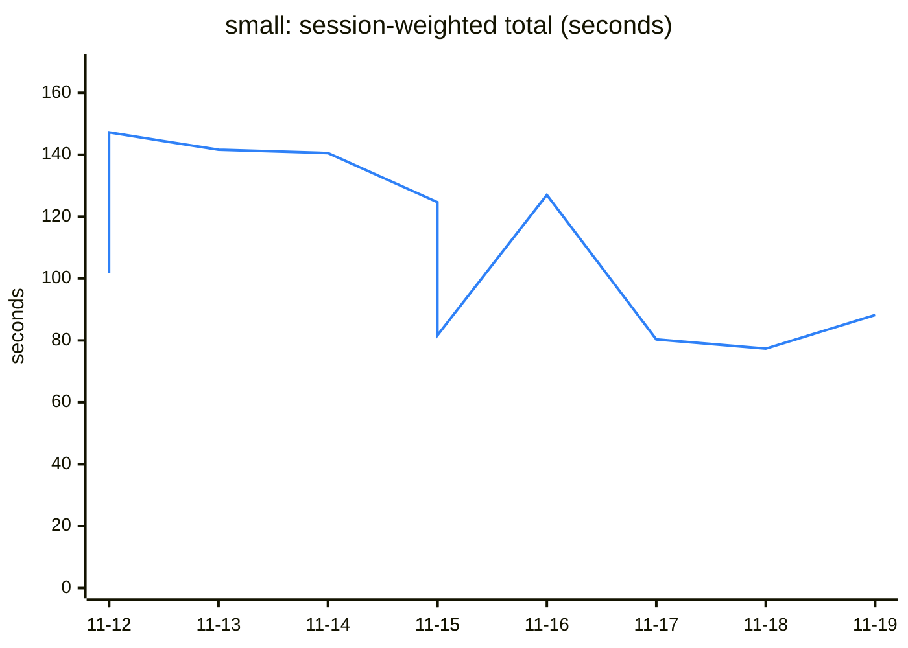
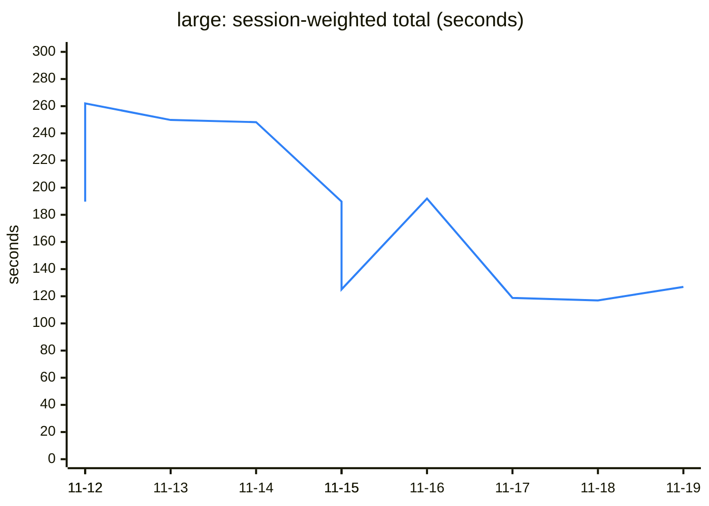
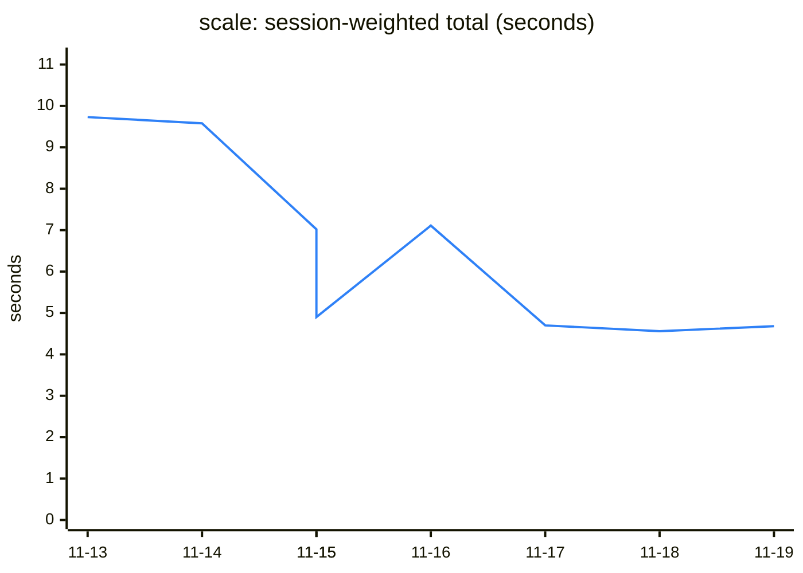
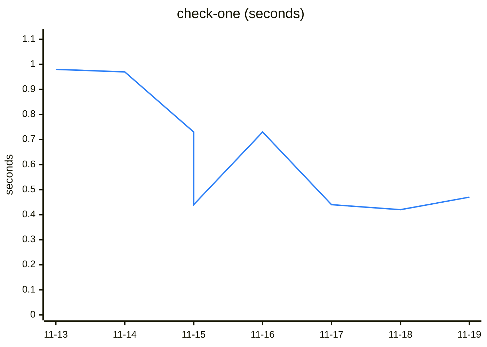
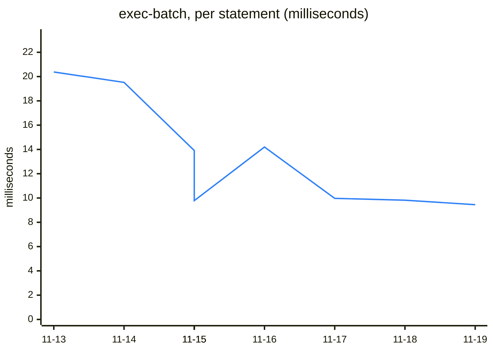
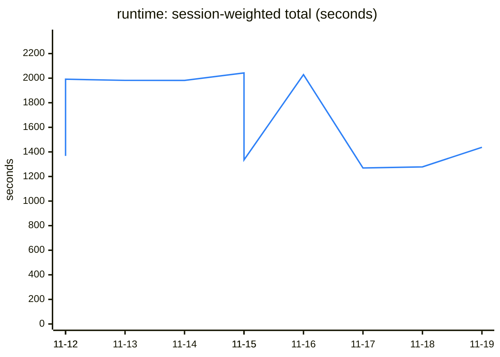

# Agent dev-loop benchmark — trend

10 runs, 2026-11-12 to 2026-11-19. Latest: `mxcli version 32a67fa (2026-11-19T10:03:06Z)` against `mxcli version nightly-20261118-9d764483c (2026-11-18T10:47:40Z)`.

Generated by `scripts/agentbench/trend` after each run; do not edit. Times are the candidate's median wall time on that night's runner, so two nights differ by the machine as well as by the code: read a level that stays, not one night's step. How to read it: `docs-site/src/internals/agent-benchmark.md` on `main`.

## Alerts

- **drift**, small session, step `open-cold`: median of the last 3 runs 216 ms, of the 7 before them 161 ms — × 1.34 (threshold × 1.30), each run corrected for its runner

## small project — 370 units

| step | latest | run before | median of the 7 before | against that median | against its baseline, latest | last runs |
|---|---:|---:|---:|---:|---:|---|
| (session-weighted total) | 88.2 s | 77.4 s | 124.7 s | × 0.71 | × 1.00 | ▃███▆▁▆▁▁▂ |
| open-cold | 131 ms | 152 ms | 186 ms | × 0.71 | × 1.02 | ▄████▅█▄▃▁ |
| open | 44 ms | 43 ms | 65 ms | × 0.68 | × 0.96 | ▂████▁▇▁▁▁ |
| domain | 585 ms | 480 ms | 841 ms | × 0.70 | × 1.00 | █▄▃▃▃▁▃▁▁▁ |
| microflows | 405 ms | 391 ms | 603 ms | × 0.67 | × 1.00 | █▅▃▃▃▁▃▁▁▁ |
| pages | 1.36 s | 1.18 s | 1.94 s | × 0.70 | × 1.00 | █▅▃▃▃▁▃▁▁▁ |
| describe | 105 ms | 93 ms | 148 ms | × 0.71 | × 1.02 | ▃██▇▆▂▇▁▁▂ |
| catalog | 173 ms | 160 ms | 278 ms | × 0.62 | × 1.01 | ▁████▁█▁▁▁ |
| catalog-full | 922 ms | 794 ms | 1.41 s | × 0.65 | × 1.00 | ▁████▁█▁▁▂ |
| query | 67 ms | 62 ms | 95 ms | × 0.71 | × 1.01 | ▁████▁█▁▁▂ |
| check | 286 ms | 245 ms | 400 ms | × 0.72 | × 1.00 | ▃███▄▁▄▁▁▁ |
| single-edit | 296 ms | 259 ms | 414 ms | × 0.71 | × 1.01 | ▂████▁█▁▁▂ |
| catalog-after-edit | 164 ms | 164 ms | 261 ms | × 0.63 | × 0.98 | ▁████▁█▁▁▁ |
| bulk-alter | 973 ms | 869 ms | 1.35 s | × 0.72 | × 1.00 | ██▃▃▃▁▃▁▁▁ |
| re-exec | 505 ms | 434 ms | 675 ms | × 0.75 | × 1.00 | ▇█▂▂▂▁▂▁▁▁ |
| rename | 419 ms | 353 ms | 607 ms | × 0.69 | × 0.99 | ▂█▇▇▇▂▇▁▁▂ |

## large project — 910 units

| step | latest | run before | median of the 7 before | against that median | against its baseline, latest | last runs |
|---|---:|---:|---:|---:|---:|---|
| (session-weighted total) | 126.9 s | 116.9 s | 189.8 s | × 0.67 | × 1.01 | ▅███▅▁▅▁▁▁ |
| open-cold | 256 ms | 293 ms | 358 ms | × 0.72 | × 1.01 | ▇████▅█▃▃▁ |
| open | 57 ms | 52 ms | 84 ms | × 0.68 | × 1.00 | ▂████▁█▁▁▂ |
| domain | 682 ms | 584 ms | 993 ms | × 0.69 | × 1.00 | █▂▂▂▂▁▂▁▁▁ |
| microflows | 900 ms | 913 ms | 1.53 s | × 0.59 | × 1.01 | █▄▃▃▃▁▃▁▁▁ |
| pages | 1.65 s | 1.58 s | 2.38 s | × 0.69 | × 1.00 | █▂▁▁▁▁▁▁▁▁ |
| describe | 127 ms | 112 ms | 187 ms | × 0.68 | × 1.02 | ▃█▇▇▇▂▇▁▁▂ |
| catalog | 258 ms | 248 ms | 426 ms | × 0.61 | × 0.97 | ▂████▁█▁▁▁ |
| catalog-full | 2.90 s | 2.55 s | 4.45 s | × 0.65 | × 1.00 | ▁████▁█▁▁▂ |
| query | 66 ms | 63 ms | 96 ms | × 0.69 | × 1.03 | ▂█▇██▁▇▁▁▁ |
| check | 429 ms | 391 ms | 640 ms | × 0.67 | × 1.00 | ▄███▃▁▃▁▁▁ |
| single-edit | 421 ms | 390 ms | 628 ms | × 0.67 | × 1.00 | ▃████▁█▁▁▂ |
| catalog-after-edit | 245 ms | 262 ms | 375 ms | × 0.65 | × 1.01 | ▂████▂█▂▁▁ |
| bulk-alter | 1.17 s | 1.08 s | 1.65 s | × 0.71 | × 1.00 | █▆▂▂▂▁▂▁▁▁ |
| re-exec | 687 ms | 612 ms | 951 ms | × 0.72 | × 1.00 | ██▂▂▂▁▂▁▁▁ |
| rename | 824 ms | 705 ms | 1.24 s | × 0.66 | × 1.00 | ▂████▁█▁▁▂ |

## scale project — 4374 units

| step | latest | run before | median of the 7 before | against that median | against its baseline, latest | last runs |
|---|---:|---:|---:|---:|---:|---|
| (session-weighted total) | 4.68 s | 4.56 s | 7.02 s | × 0.67 | × 1.00 | ██▄▁▄▁▁▁ |
| check-cold | 1.26 s | 1.29 s | 1.93 s | × 0.65 | × 1.01 | ██▅▂▅▁▁▁ |
| check-one | 467 ms | 421 ms | 728 ms | × 0.64 | × 1.00 | ██▅▁▅▁▁▁ |
| check-batch | 876 ms | 748 ms | 1.30 s | × 0.67 | × 1.00 | ██▅▁▅▁▁▂ |
| exec-batch | 945 ms | 982 ms | 1.39 s | × 0.68 | × 1.00 | ██▄▁▄▁▁▁ |
| re-exec-batch | 521 ms | 488 ms | 744 ms | × 0.70 | × 1.01 | ██▃▁▃▁▁▁ |
| new-batch | 602 ms | 627 ms | 923 ms | × 0.65 | × 1.01 | ██▄▂▅▁▁▁ |

## running app — 476 units

| step | latest | run before | median of the 7 before | against that median | against its baseline, latest | last runs |
|---|---:|---:|---:|---:|---:|---|
| (session-weighted total) | 1437.4 s | 1278.2 s | 1981.9 s | × 0.73 | × 1.00 | ▂████▁█▁▁▂ |
| mx-check | 5.35 s | 4.42 s | 7.87 s | × 0.68 | × 1.00 | ▂████▂█▁▁▃ |
| build | 40.3 s | 39.7 s | 57.3 s | × 0.70 | × 0.97 | ▂████▁█▁▁▁ |
| boot | 21.3 s | 17.3 s | 27.9 s | × 0.77 | × 1.04 | ▂▇▆▇█▂█▁▁▃ |
| page-check | 2.69 s | 2.40 s | 3.30 s | × 0.82 | × 1.01 | ▁▇███▁█▂▁▃ |
| hot-apply | 4.33 s | 4.30 s | 5.75 s | × 0.75 | × 1.00 | ▂▇▇▇█▁▇▁▁▂ |
| test-attach | 91 ms | 85 ms | 125 ms | × 0.73 | × 0.96 | ▂██▆▇▂█▁▁▁ |
| apply-entity | 13.8 s | 12.8 s | 18.4 s | × 0.75 | × 1.00 | ▂████▁█▁▁▂ |
| stop | 628 ms | 627 ms | 839 ms | × 0.75 | × 1.00 | ▁████▅█▁▁▁ |
| test-cold | 18.1 s | 15.5 s | 23.7 s | × 0.76 | × 1.02 | ▂██▇█▁█▁▁▃ |
