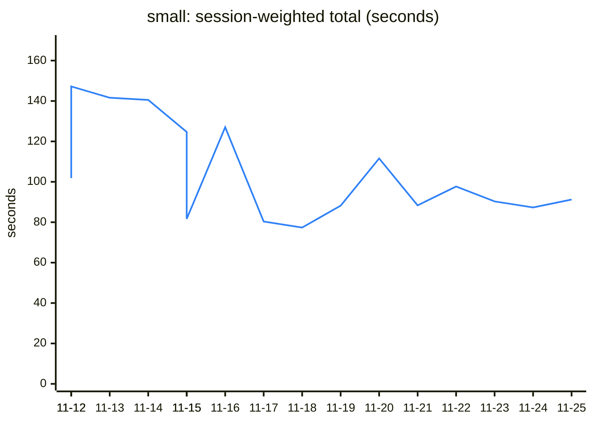
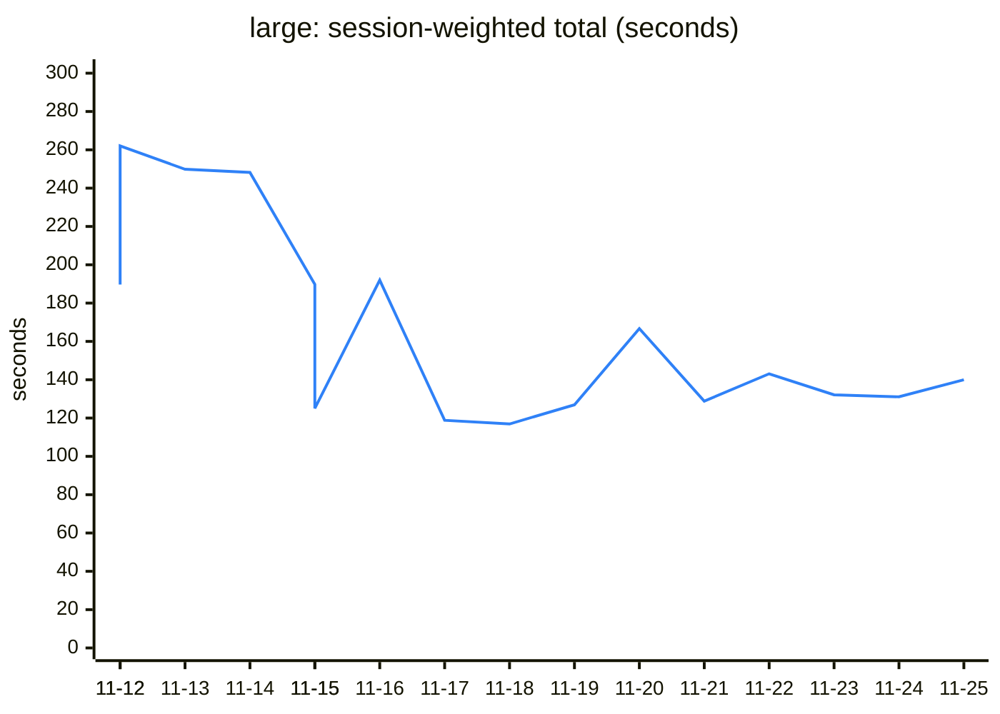
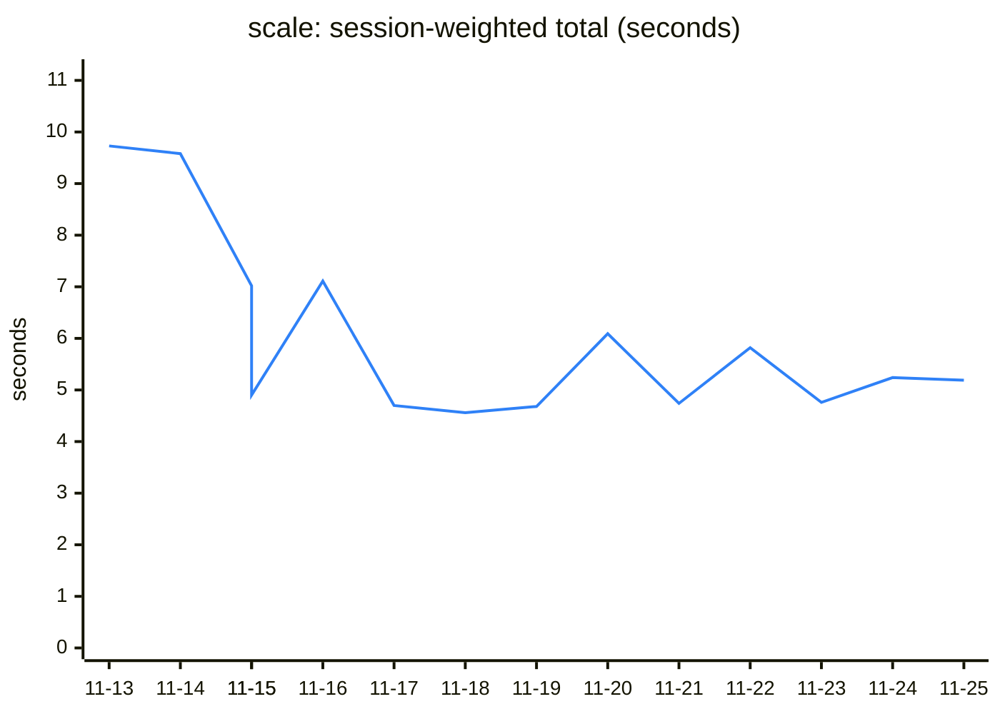
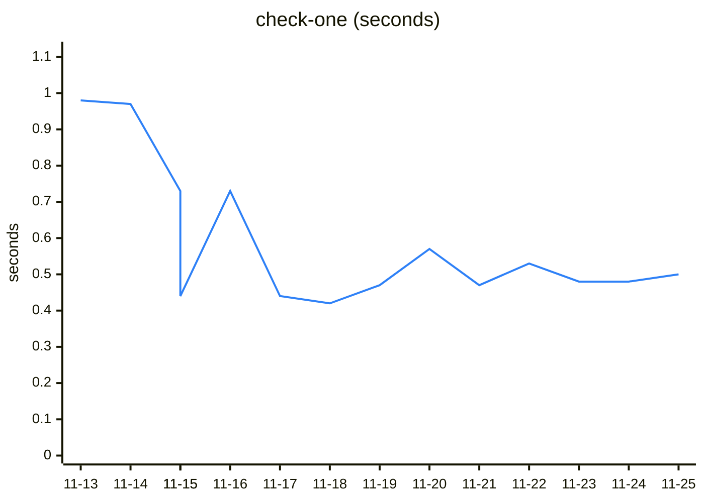
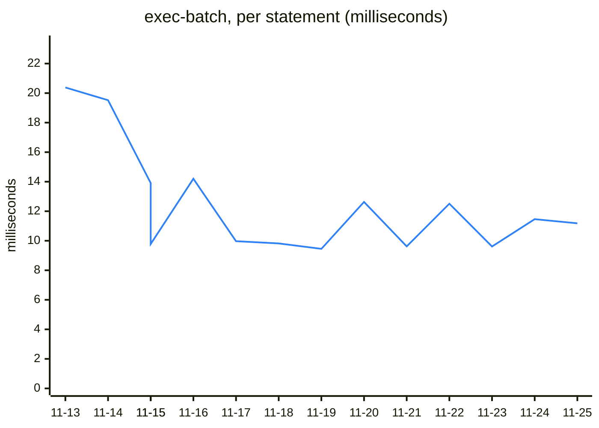

# Agent dev-loop benchmark — trend

16 runs, 2026-11-12 to 2026-11-25. Latest: `mxcli version 7ec3d1c (2026-11-25T10:57:28Z)` against `mxcli version nightly-20261124-997c721f6 (2026-11-24T12:59:12Z)`.

Generated by `scripts/agentbench/trend` after each run; do not edit. Times are the candidate's median wall time on that night's runner, so two nights differ by the machine as well as by the code: read a level that stays, not one night's step. How to read it: `docs-site/src/internals/agent-benchmark.md` on `main`.

## Alerts

None.

## small project — 370 units

| step | latest | run before | median of the 7 before | against that median | against its baseline, latest | last runs |
|---|---:|---:|---:|---:|---:|---|
| (session-weighted total) | 91.2 s | 87.3 s | 88.4 s | × 1.03 | × 0.99 | ██▆▁▇▁▁▂▅▂▃▂▂▂ |
| open-cold | 161 ms | 162 ms | 152 ms | × 1.06 | × 0.95 | ███▄█▄▃▁█▁▆▁▅▄ |
| open | 48 ms | 47 ms | 46 ms | × 1.04 | × 0.99 | ███▁▇▁▁▁▄▁▄▁▂▂ |
| domain | 593 ms | 558 ms | 600 ms | × 0.99 | × 0.99 | ███▁█▁▁▃▅▃▄▃▂▃ |
| microflows | 488 ms | 447 ms | 415 ms | × 1.18 | × 0.97 | ███▁█▁▁▁▇▁▆▁▂▄ |
| pages | 1.47 s | 1.47 s | 1.42 s | × 1.04 | × 0.93 | ███▂█▁▁▂▇▃▅▃▃▃ |
| describe | 109 ms | 104 ms | 106 ms | × 1.03 | × 1.02 | ██▇▂█▁▁▂▅▂▄▂▂▂ |
| catalog | 181 ms | 176 ms | 176 ms | × 1.03 | × 0.99 | ███▁█▁▁▁▅▁▃▁▂▂ |
| catalog-full | 876 ms | 855 ms | 923 ms | × 0.95 | × 0.96 | ███▁█▁▁▂▄▂▄▂▁▂ |
| query | 70 ms | 64 ms | 67 ms | × 1.04 | × 0.95 | ███▁█▁▁▂▅▂▄▁▁▂ |
| check | 292 ms | 275 ms | 286 ms | × 1.02 | × 1.02 | ██▄▁▄▁▁▂▃▁▂▂▁▂ |
| single-edit | 304 ms | 294 ms | 298 ms | × 1.02 | × 1.00 | ███▁█▁▁▂▇▂▄▃▂▃ |
| catalog-after-edit | 193 ms | 187 ms | 176 ms | × 1.09 | × 0.98 | ███▁█▁▁▁▅▁▄▁▂▃ |
| bulk-alter | 1.07 s | 1.04 s | 984 ms | × 1.09 | × 0.98 | ▅▅▅▁▅▁▁▁█▁▃▁▂▂ |
| re-exec | 503 ms | 491 ms | 509 ms | × 0.99 | × 1.00 | ██▇▁█▁▁▃▅▃▄▃▂▂ |
| rename | 420 ms | 388 ms | 423 ms | × 0.99 | × 1.02 | ███▂█▁▁▃▅▃▄▃▂▃ |

## large project — 910 units

| step | latest | run before | median of the 7 before | against that median | against its baseline, latest | last runs |
|---|---:|---:|---:|---:|---:|---|
| (session-weighted total) | 140.0 s | 131.1 s | 131.1 s | × 1.07 | × 0.99 | ██▅▁▅▁▁▁▃▁▂▁▁▂ |
| open-cold | 331 ms | 310 ms | 293 ms | × 1.13 | × 1.12 | ███▅█▃▃▁█▁█▁▄▆ |
| open | 63 ms | 59 ms | 57 ms | × 1.11 | × 1.02 | ███▁█▁▁▂▅▂▄▁▂▃ |
| domain | 755 ms | 698 ms | 704 ms | × 1.07 | × 1.00 | ███▂█▁▁▂▅▃▄▃▃▄ |
| microflows | 1.18 s | 1.08 s | 983 ms | × 1.20 | × 1.02 | ███▁█▁▁▁█▁▃▂▃▄ |
| pages | 1.89 s | 1.76 s | 1.76 s | × 1.08 | × 0.99 | ▇▇▇▁▇▁▁▂█▂▄▂▂▃ |
| describe | 133 ms | 131 ms | 129 ms | × 1.04 | × 0.96 | ███▂█▁▁▂▅▂▄▂▂▃ |
| catalog | 292 ms | 272 ms | 265 ms | × 1.10 | × 1.02 | ███▁█▁▁▁▆▁▃▁▂▂ |
| catalog-full | 2.85 s | 2.75 s | 2.92 s | × 0.98 | × 0.95 | ███▁█▁▁▂▄▂▃▂▁▂ |
| query | 79 ms | 69 ms | 69 ms | × 1.15 | × 1.02 | ▇██▁▇▁▁▁▅▂▄▂▂▄ |
| check | 462 ms | 434 ms | 434 ms | × 1.07 | × 1.01 | ██▃▁▃▁▁▁▂▁▁▁▁▁ |
| single-edit | 469 ms | 438 ms | 438 ms | × 1.07 | × 0.99 | ███▁█▁▁▂▆▂▃▂▂▃ |
| catalog-after-edit | 328 ms | 302 ms | 274 ms | × 1.20 | × 1.01 | ███▂█▂▁▁▇▂▅▂▄▅ |
| bulk-alter | 1.34 s | 1.21 s | 1.21 s | × 1.11 | × 0.97 | ▅▅▅▁▅▁▁▁█▂▃▂▂▃ |
| re-exec | 753 ms | 669 ms | 701 ms | × 1.07 | × 0.99 | ███▁█▁▁▂▅▂▄▃▂▃ |
| rename | 812 ms | 765 ms | 834 ms | × 0.97 | × 0.97 | ███▁█▁▁▂▅▂▄▂▁▂ |

## scale project — 4374 units

| step | latest | run before | median of the 7 before | against that median | against its baseline, latest | last runs |
|---|---:|---:|---:|---:|---:|---|
| (session-weighted total) | 5.19 s | 5.24 s | 4.76 s | × 1.09 | × 1.00 | ██▄▁▄▁▁▁▃▁▂▁▂▁ |
| check-cold | 1.45 s | 1.44 s | 1.29 s | × 1.12 | × 1.04 | ██▅▂▅▁▁▁▃▁▂▁▂▂ |
| check-one | 497 ms | 484 ms | 481 ms | × 1.03 | × 1.01 | ██▅▁▅▁▁▁▃▁▂▁▁▂ |
| check-batch | 855 ms | 846 ms | 894 ms | × 0.96 | × 1.00 | ██▅▁▅▁▁▂▃▂▃▂▁▁ |
| exec-batch | 1.12 s | 1.15 s | 982 ms | × 1.14 | × 1.01 | ██▄▁▄▁▁▁▃▁▃▁▂▂ |
| re-exec-batch | 536 ms | 535 ms | 526 ms | × 1.02 | × 1.00 | ██▃▁▃▁▁▁▂▁▂▁▁▁ |
| new-batch | 734 ms | 794 ms | 627 ms | × 1.17 | × 0.99 | ██▄▂▅▁▁▁▄▁▄▁▃▂ |

## running app — 476 units

| step | latest | run before | median of the 7 before | against that median | against its baseline, latest | last runs |
|---|---:|---:|---:|---:|---:|---|
| (session-weighted total) | 1380.1 s | 1358.0 s | 1455.2 s | × 0.95 | × 1.00 | ███▁█▁▁▂▄▃▄▂▁▂ |
| mx-check | 4.59 s | 4.60 s | 5.53 s | × 0.83 | × 0.97 | ███▂█▁▁▃▄▃▅▃▁▁ |
| build | 42.1 s | 42.6 s | 42.0 s | × 1.00 | × 0.96 | ███▁█▁▁▁▅▁▄▂▂▂ |
| boot | 20.8 s | 20.8 s | 21.6 s | × 0.97 | × 1.02 | ▆▇█▂█▁▁▃▄▃▃▃▂▂ |
| page-check | 2.42 s | 2.44 s | 2.46 s | × 0.98 | × 1.00 | ███▁█▂▁▃▃▁▄▁▁▁ |
| hot-apply | 4.37 s | 4.35 s | 4.35 s | × 1.00 | × 1.01 | ▇▇█▁▇▁▁▂▄▂▃▁▂▂ |
| test-attach | 104 ms | 103 ms | 100 ms | × 1.05 | × 0.98 | █▆▇▂█▁▁▁▄▃▄▂▃▃ |
| apply-entity | 14.6 s | 13.3 s | 14.0 s | × 1.04 | × 1.08 | ███▁█▁▁▂▅▃▄▂▁▃ |
| stop | 731 ms | 630 ms | 629 ms | × 1.16 | × 0.99 | ███▅█▁▁▁█▁▁▁▁▄ |
| test-cold | 16.8 s | 17.5 s | 19.3 s | × 0.87 | × 0.92 | █▇█▁█▁▁▃▄▄▄▄▂▂ |
