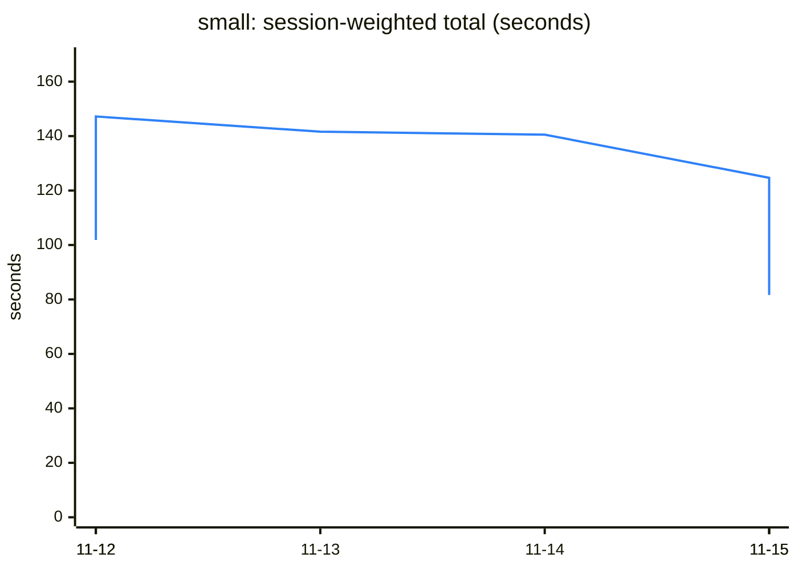
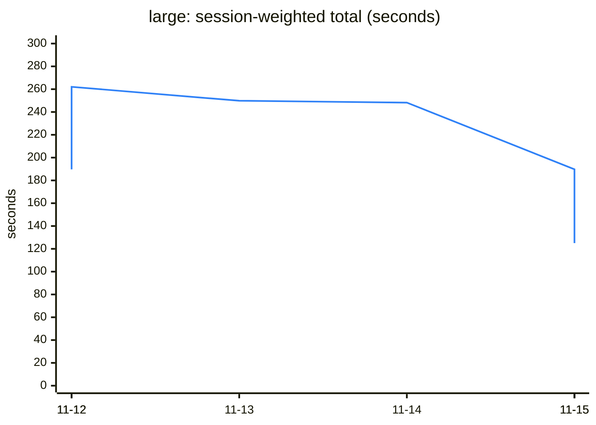
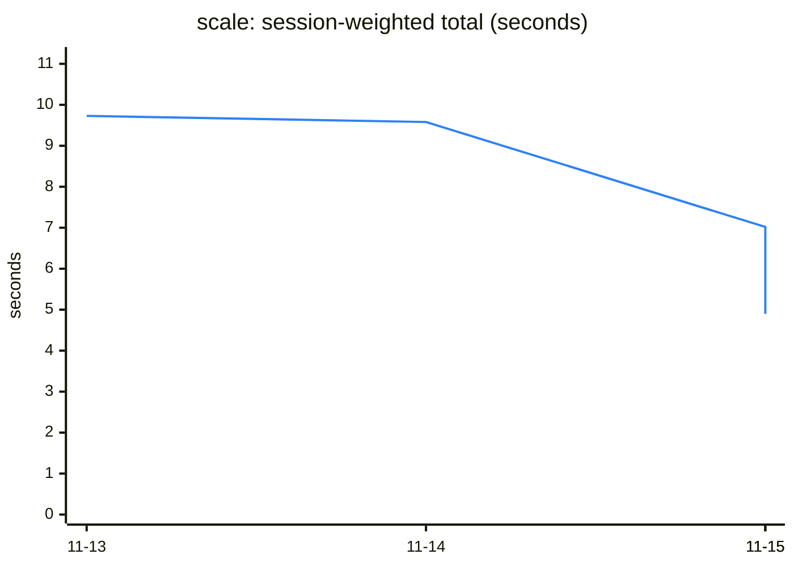
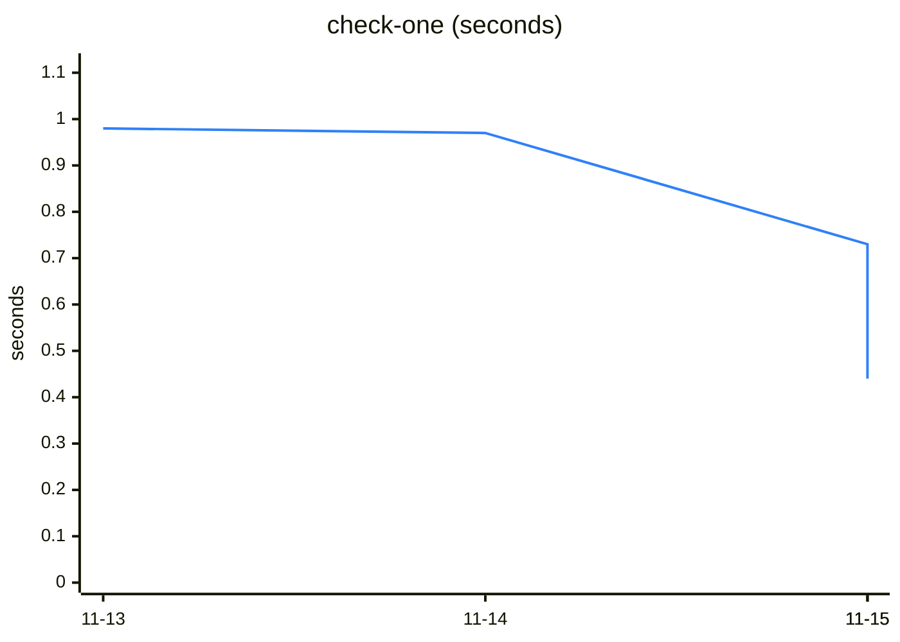
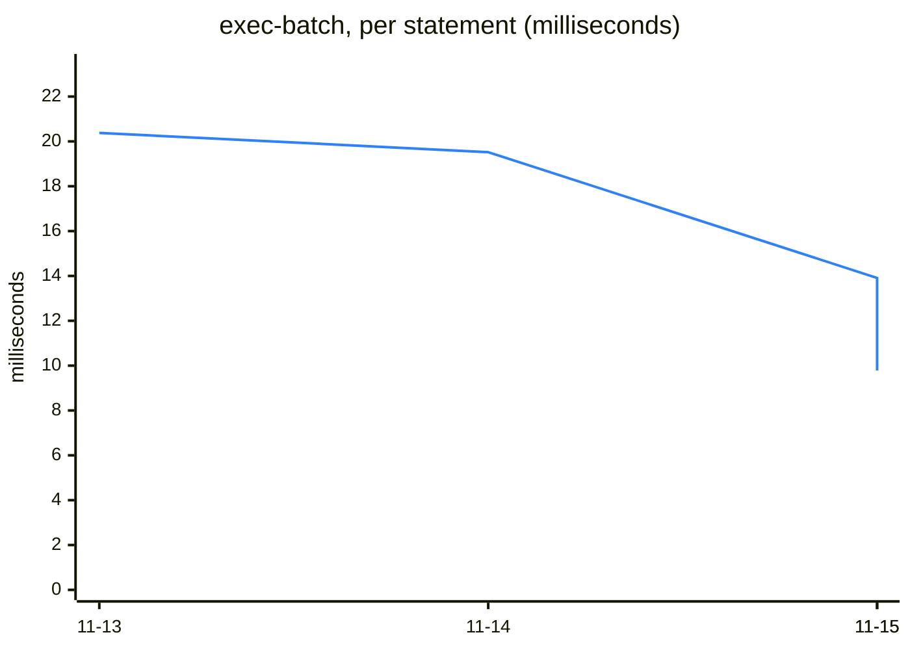
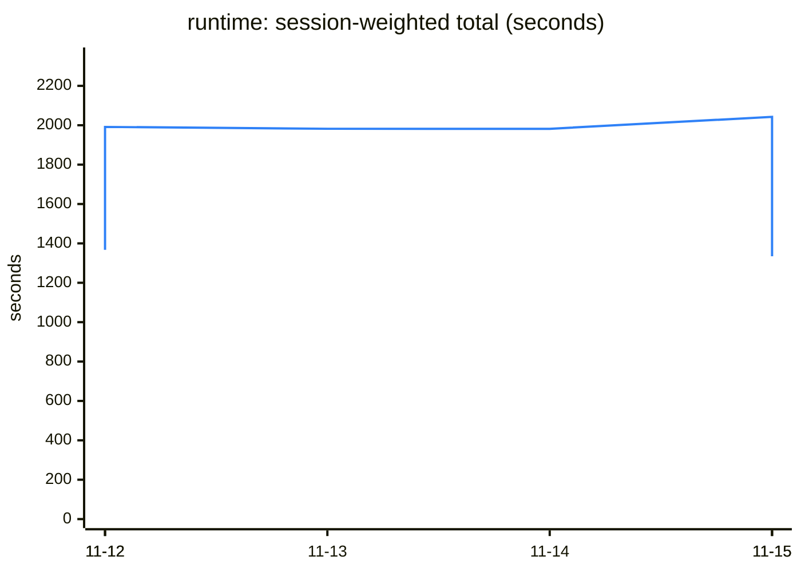

# Agent dev-loop benchmark — trend

6 runs, 2026-11-12 to 2026-11-15. Latest: `mxcli version c1a579a (2026-11-15T15:12:20Z)` against `mxcli version nightly-20261114-a051fa62f (2026-11-14T09:35:26Z)`.

Generated by `scripts/agentbench/trend` after each run; do not edit. Times are the candidate's median wall time on that night's runner, so two nights differ by the machine as well as by the code: read a level that stays, not one night's step. How to read it: `docs-site/src/internals/agent-benchmark.md` on `main`.

## Alerts

None.

## small project — 370 units

| step | latest | run before | median of the 7 before | against that median | against its baseline, latest | last runs |
|---|---:|---:|---:|---:|---:|---|
| (session-weighted total) | 81.7 s | 124.7 s | 140.5 s | × 0.58 | × 0.91 | ▃███▆▁ |
| open-cold | 161 ms | 187 ms | 186 ms | × 0.87 | × 1.10 | ▁████▁ |
| open | 44 ms | 69 ms | 69 ms | × 0.64 | × 1.03 | ▁████▁ |
| domain | 522 ms | 841 ms | 864 ms | × 0.60 | × 1.02 | █▄▃▃▃▁ |
| microflows | 396 ms | 603 ms | 616 ms | × 0.64 | × 0.98 | █▅▃▃▃▁ |
| pages | 1.29 s | 1.94 s | 1.96 s | × 0.66 | × 1.00 | █▅▂▂▂▁ |
| describe | 102 ms | 148 ms | 156 ms | × 0.66 | × 0.99 | ▂██▇▆▁ |
| catalog | 165 ms | 284 ms | 278 ms | × 0.59 | × 1.02 | ▁████▁ |
| catalog-full | 831 ms | 1.43 s | 1.44 s | × 0.58 | × 1.00 | ▁████▁ |
| query | 65 ms | 95 ms | 96 ms | × 0.67 | × 1.03 | ▁████▁ |
| check | 255 ms | 400 ms | 563 ms | × 0.45 | × 0.74 | ▃███▄▁ |
| single-edit | 274 ms | 414 ms | 418 ms | × 0.66 | × 0.98 | ▁████▁ |
| catalog-after-edit | 171 ms | 261 ms | 262 ms | × 0.65 | × 1.02 | ▁████▁ |
| bulk-alter | 922 ms | 1.35 s | 1.37 s | × 0.67 | × 0.98 | ██▃▂▂▁ |
| re-exec | 453 ms | 675 ms | 694 ms | × 0.65 | × 1.02 | ▇█▂▂▂▁ |
| rename | 395 ms | 609 ms | 611 ms | × 0.65 | × 1.10 | ▁█▇▇▇▁ |

## large project — 910 units

| step | latest | run before | median of the 7 before | against that median | against its baseline, latest | last runs |
|---|---:|---:|---:|---:|---:|---|
| (session-weighted total) | 125.1 s | 189.8 s | 248.2 s | × 0.50 | × 0.79 | ▄███▄▁ |
| open-cold | 314 ms | 358 ms | 359 ms | × 0.87 | × 1.09 | ▅████▁ |
| open | 56 ms | 84 ms | 84 ms | × 0.67 | × 0.97 | ▁████▁ |
| domain | 656 ms | 993 ms | 1.01 s | × 0.65 | × 1.05 | █▂▂▂▂▁ |
| microflows | 978 ms | 1.53 s | 1.55 s | × 0.63 | × 0.99 | █▄▃▃▃▁ |
| pages | 1.65 s | 2.38 s | 2.43 s | × 0.68 | × 1.00 | █▂▁▁▁▁ |
| describe | 125 ms | 187 ms | 188 ms | × 0.66 | × 0.99 | ▂█▇▇▇▁ |
| catalog | 262 ms | 426 ms | 426 ms | × 0.61 | × 0.97 | ▂████▁ |
| catalog-full | 2.65 s | 4.51 s | 4.53 s | × 0.59 | × 1.00 | ▁████▁ |
| query | 67 ms | 103 ms | 99 ms | × 0.68 | × 0.98 | ▁█▇██▁ |
| check | 411 ms | 640 ms | 1.29 s | × 0.32 | × 0.52 | ▄███▂▁ |
| single-edit | 420 ms | 628 ms | 628 ms | × 0.67 | × 1.01 | ▃████▁ |
| catalog-after-edit | 275 ms | 375 ms | 378 ms | × 0.73 | × 1.00 | ▁████▁ |
| bulk-alter | 1.14 s | 1.65 s | 1.71 s | × 0.67 | × 1.01 | █▆▂▂▂▁ |
| re-exec | 628 ms | 951 ms | 996 ms | × 0.63 | × 0.99 | ██▂▂▂▁ |
| rename | 736 ms | 1.24 s | 1.25 s | × 0.59 | × 0.99 | ▂████▁ |

## scale project — 4374 units

| step | latest | run before | median of the 7 before | against that median | against its baseline, latest | last runs |
|---|---:|---:|---:|---:|---:|---|
| (session-weighted total) | 4.90 s | 7.02 s | 9.58 s | × 0.51 | × 0.75 | ██▄▁ |
| check-cold | 1.42 s | 1.93 s | 2.40 s | × 0.59 | × 0.87 | ██▅▁ |
| check-one | 444 ms | 728 ms | 973 ms | × 0.46 | × 0.76 | ██▅▁ |
| check-batch | 819 ms | 1.30 s | 1.69 s | × 0.48 | × 0.78 | ██▅▁ |
| exec-batch | 978 ms | 1.39 s | 1.95 s | × 0.50 | × 0.72 | ██▄▁ |
| re-exec-batch | 516 ms | 744 ms | 1.28 s | × 0.40 | × 0.63 | ██▃▁ |
| new-batch | 725 ms | 923 ms | 1.29 s | × 0.56 | × 0.79 | ██▃▁ |

## running app — 476 units

| step | latest | run before | median of the 7 before | against that median | against its baseline, latest | last runs |
|---|---:|---:|---:|---:|---:|---|
| (session-weighted total) | 1334.9 s | 2042.5 s | 1982.0 s | × 0.67 | × 0.97 | ▁████▁ |
| mx-check | 4.78 s | 8.09 s | 7.90 s | × 0.60 | × 0.99 | ▁████▁ |
| build | 40.6 s | 57.9 s | 57.4 s | × 0.71 | × 0.99 | ▁████▁ |
| boot | 19.3 s | 29.9 s | 29.1 s | × 0.66 | × 1.07 | ▁█▇██▁ |
| page-check | 2.40 s | 3.33 s | 3.30 s | × 0.73 | × 0.99 | ▁▇███▁ |
| hot-apply | 4.30 s | 6.15 s | 5.75 s | × 0.75 | × 0.99 | ▁▇▇▇█▁ |
| test-attach | 92 ms | 132 ms | 132 ms | × 0.70 | × 1.00 | ▁██▆▇▁ |
| apply-entity | 12.8 s | 18.7 s | 18.6 s | × 0.68 | × 0.96 | ▂████▁ |
| stop | 737 ms | 842 ms | 840 ms | × 0.88 | × 1.01 | ▁████▅ |
| test-cold | 16.6 s | 25.3 s | 24.6 s | × 0.68 | × 0.97 | ▁██▇█▁ |
