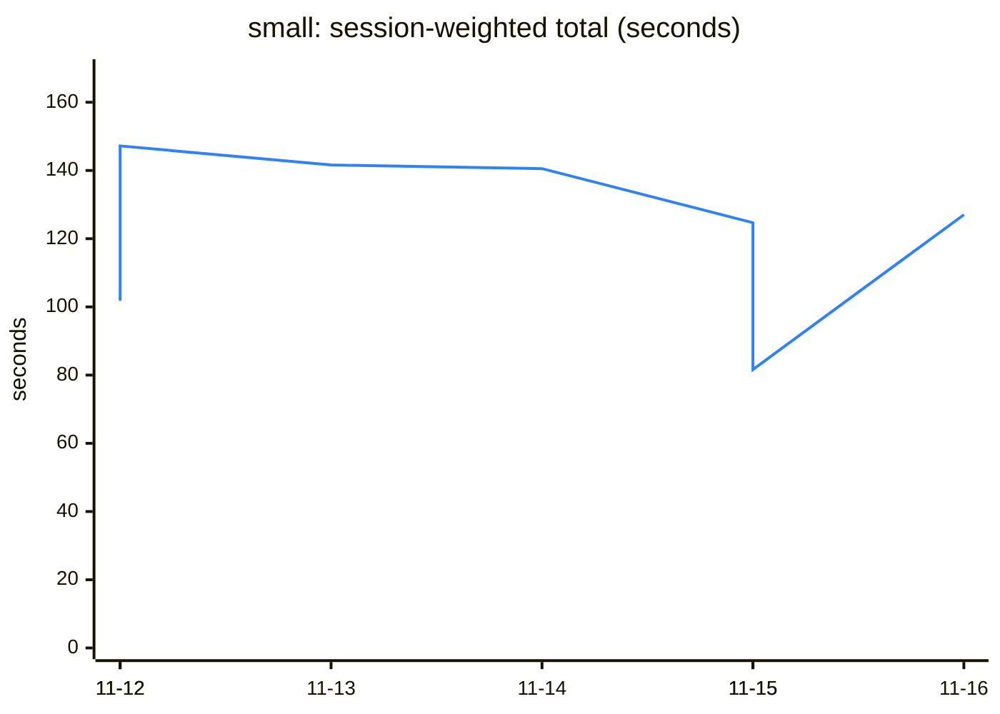
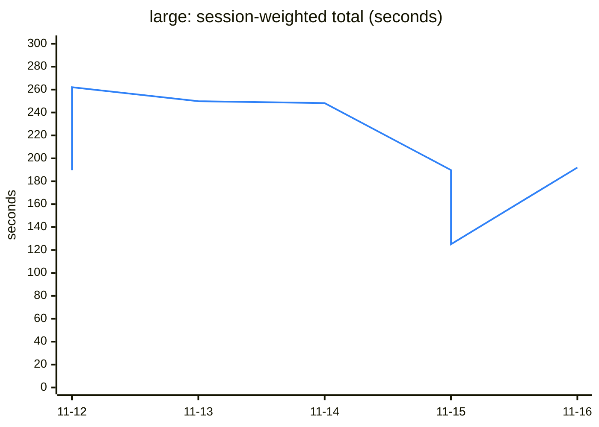
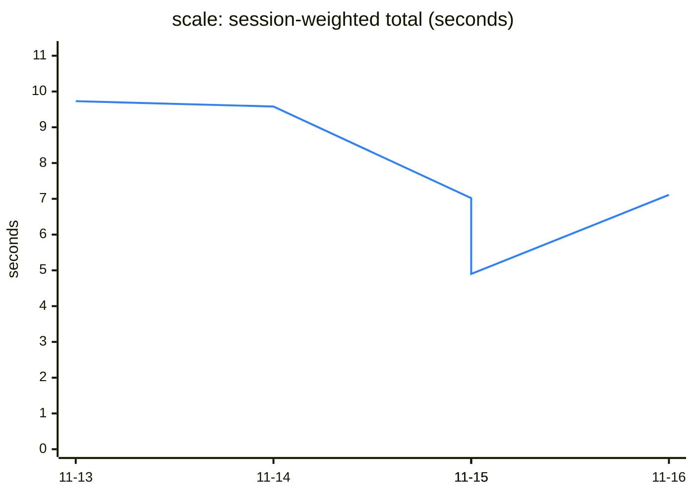
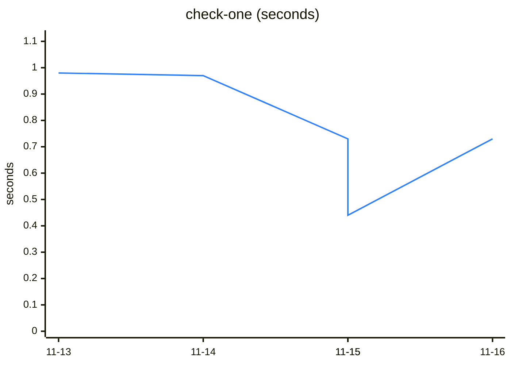
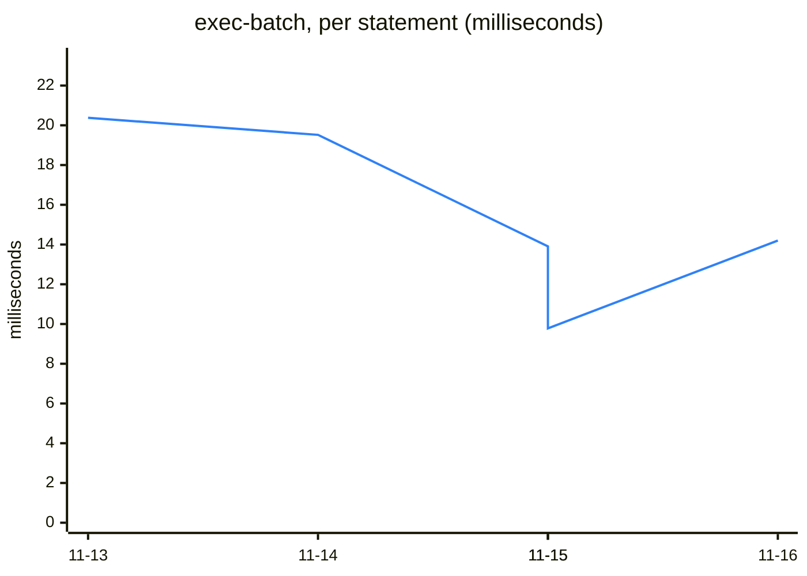
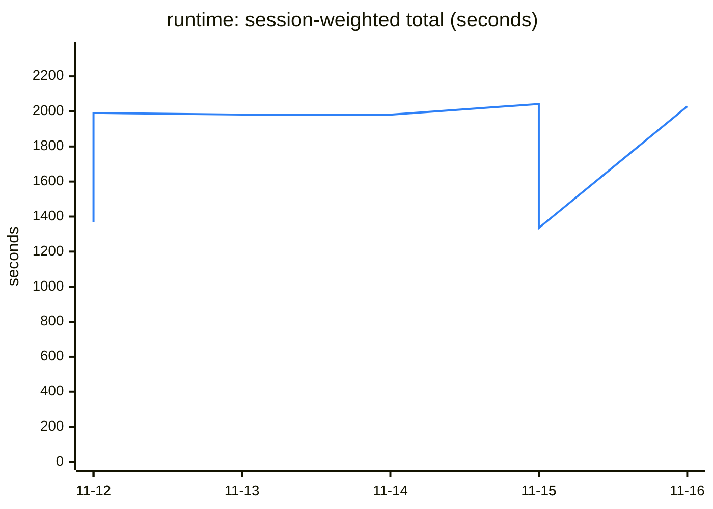

# Agent dev-loop benchmark — trend

7 runs, 2026-11-12 to 2026-11-16. Latest: `mxcli version 121c9b5 (2026-11-16T09:07:22Z)` against `mxcli version nightly-20261115-c1a579a7b (2026-11-15T16:07:33Z)`.

Generated by `scripts/agentbench/trend` after each run; do not edit. Times are the candidate's median wall time on that night's runner, so two nights differ by the machine as well as by the code: read a level that stays, not one night's step. How to read it: `docs-site/src/internals/agent-benchmark.md` on `main`.

## Alerts

None.

## small project — 370 units

| step | latest | run before | median of the 7 before | against that median | against its baseline, latest | last runs |
|---|---:|---:|---:|---:|---:|---|
| (session-weighted total) | 127.0 s | 81.7 s | 132.6 s | × 0.96 | × 1.01 | ▃███▆▁▆ |
| open-cold | 190 ms | 161 ms | 186 ms | × 1.02 | × 1.01 | ▁▇▇██▁█ |
| open | 65 ms | 44 ms | 69 ms | × 0.94 | × 1.05 | ▁████▁▇ |
| domain | 855 ms | 522 ms | 854 ms | × 1.00 | × 1.00 | █▄▃▃▃▁▃ |
| microflows | 615 ms | 396 ms | 616 ms | × 1.00 | × 0.98 | █▅▃▃▃▁▃ |
| pages | 1.97 s | 1.29 s | 1.96 s | × 1.01 | × 1.01 | █▅▂▂▂▁▂ |
| describe | 157 ms | 102 ms | 152 ms | × 1.03 | × 0.99 | ▂██▇▆▁▇ |
| catalog | 286 ms | 165 ms | 278 ms | × 1.03 | × 1.00 | ▁████▁█ |
| catalog-full | 1.41 s | 831 ms | 1.43 s | × 0.98 | × 1.00 | ▁████▁█ |
| query | 95 ms | 65 ms | 96 ms | × 1.00 | × 1.01 | ▁████▁█ |
| check | 405 ms | 255 ms | 482 ms | × 0.84 | × 0.98 | ▃███▄▁▄ |
| single-edit | 424 ms | 274 ms | 416 ms | × 1.02 | × 1.00 | ▁████▁█ |
| catalog-after-edit | 268 ms | 171 ms | 261 ms | × 1.02 | × 1.00 | ▁████▁█ |
| bulk-alter | 1.37 s | 922 ms | 1.36 s | × 1.01 | × 0.98 | ██▃▂▂▁▃ |
| re-exec | 712 ms | 453 ms | 692 ms | × 1.03 | × 1.00 | ▇█▂▂▂▁▂ |
| rename | 607 ms | 395 ms | 610 ms | × 0.99 | × 0.98 | ▁█▇▇▇▁▆ |

## large project — 910 units

| step | latest | run before | median of the 7 before | against that median | against its baseline, latest | last runs |
|---|---:|---:|---:|---:|---:|---|
| (session-weighted total) | 192.0 s | 125.1 s | 219.0 s | × 0.88 | × 1.00 | ▄███▄▁▄ |
| open-cold | 364 ms | 314 ms | 358 ms | × 1.02 | × 1.00 | ▅███▇▁█ |
| open | 84 ms | 56 ms | 84 ms | × 1.00 | × 0.97 | ▁████▁█ |
| domain | 1.01 s | 656 ms | 1.00 s | × 1.01 | × 1.00 | █▂▂▂▂▁▂ |
| microflows | 1.56 s | 978 ms | 1.54 s | × 1.01 | × 0.99 | █▄▃▃▃▁▃ |
| pages | 2.45 s | 1.65 s | 2.42 s | × 1.01 | × 1.01 | █▂▁▁▁▁▁ |
| describe | 191 ms | 125 ms | 188 ms | × 1.02 | × 1.01 | ▂█▇▇▇▁▇ |
| catalog | 426 ms | 262 ms | 426 ms | × 1.00 | × 1.00 | ▂████▁█ |
| catalog-full | 4.45 s | 2.65 s | 4.52 s | × 0.98 | × 1.00 | ▁████▁█ |
| query | 96 ms | 67 ms | 97 ms | × 0.99 | × 0.98 | ▁█▇██▁▇ |
| check | 644 ms | 411 ms | 1.06 s | × 0.61 | × 1.00 | ▄███▂▁▂ |
| single-edit | 639 ms | 420 ms | 628 ms | × 1.02 | × 1.02 | ▃████▁█ |
| catalog-after-edit | 378 ms | 275 ms | 377 ms | × 1.00 | × 0.98 | ▁████▁█ |
| bulk-alter | 1.72 s | 1.14 s | 1.69 s | × 1.01 | × 0.99 | █▆▂▂▂▁▂ |
| re-exec | 996 ms | 628 ms | 992 ms | × 1.00 | × 1.00 | ██▂▂▂▁▂ |
| rename | 1.24 s | 736 ms | 1.25 s | × 1.00 | × 1.00 | ▂████▁█ |

## scale project — 4374 units

| step | latest | run before | median of the 7 before | against that median | against its baseline, latest | last runs |
|---|---:|---:|---:|---:|---:|---|
| (session-weighted total) | 7.11 s | 4.90 s | 8.30 s | × 0.86 | × 1.00 | ██▄▁▄ |
| check-cold | 1.93 s | 1.42 s | 2.17 s | × 0.89 | × 0.99 | ██▅▁▅ |
| check-one | 730 ms | 444 ms | 850 ms | × 0.86 | × 1.00 | ██▅▁▅ |
| check-batch | 1.31 s | 819 ms | 1.50 s | × 0.87 | × 1.00 | ██▅▁▅ |
| exec-batch | 1.42 s | 978 ms | 1.67 s | × 0.85 | × 1.00 | ██▄▁▄ |
| re-exec-batch | 751 ms | 516 ms | 1.01 s | × 0.74 | × 0.99 | ██▃▁▃ |
| new-batch | 967 ms | 725 ms | 1.10 s | × 0.88 | × 0.99 | ██▃▁▄ |

## running app — 476 units

| step | latest | run before | median of the 7 before | against that median | against its baseline, latest | last runs |
|---|---:|---:|---:|---:|---:|---|
| (session-weighted total) | 2028.7 s | 1334.9 s | 1982.0 s | × 1.02 | × 1.01 | ▁████▁█ |
| mx-check | 7.97 s | 4.78 s | 7.89 s | × 1.01 | × 1.00 | ▁████▁█ |
| build | 57.6 s | 40.6 s | 57.3 s | × 1.01 | × 1.01 | ▁████▁█ |
| boot | 31.6 s | 19.3 s | 28.5 s | × 1.11 | × 1.10 | ▁▇▆▇▇▁█ |
| page-check | 3.36 s | 2.40 s | 3.26 s | × 1.03 | × 1.01 | ▁▇███▁█ |
| hot-apply | 5.77 s | 4.30 s | 5.75 s | × 1.00 | × 1.04 | ▁▇▇▇█▁▇ |
| test-attach | 136 ms | 92 ms | 129 ms | × 1.05 | × 0.96 | ▁██▆▇▁█ |
| apply-entity | 18.9 s | 12.8 s | 18.5 s | × 1.02 | × 1.00 | ▂████▁█ |
| stop | 841 ms | 737 ms | 839 ms | × 1.00 | × 1.00 | ▁████▅█ |
| test-cold | 24.4 s | 16.6 s | 24.1 s | × 1.01 | × 0.96 | ▁██▇█▁▇ |
