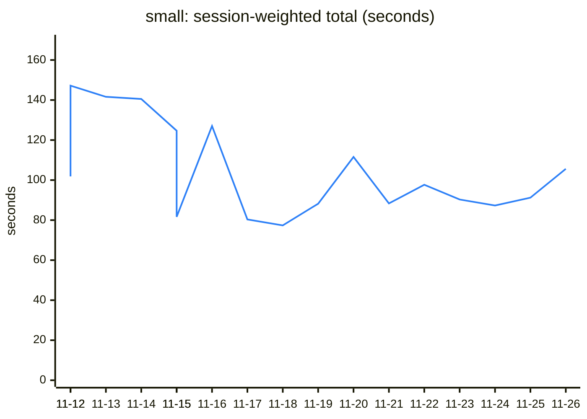
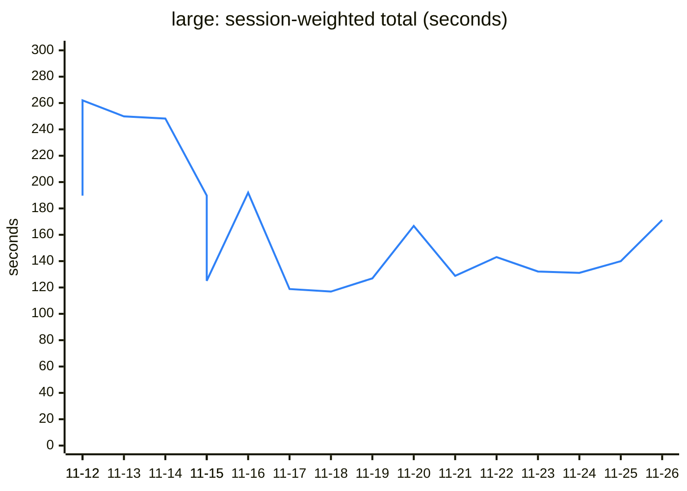
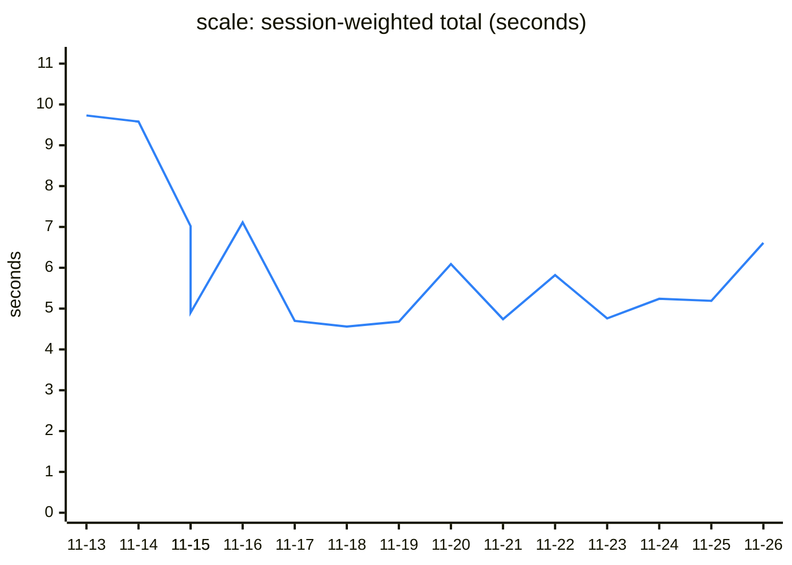
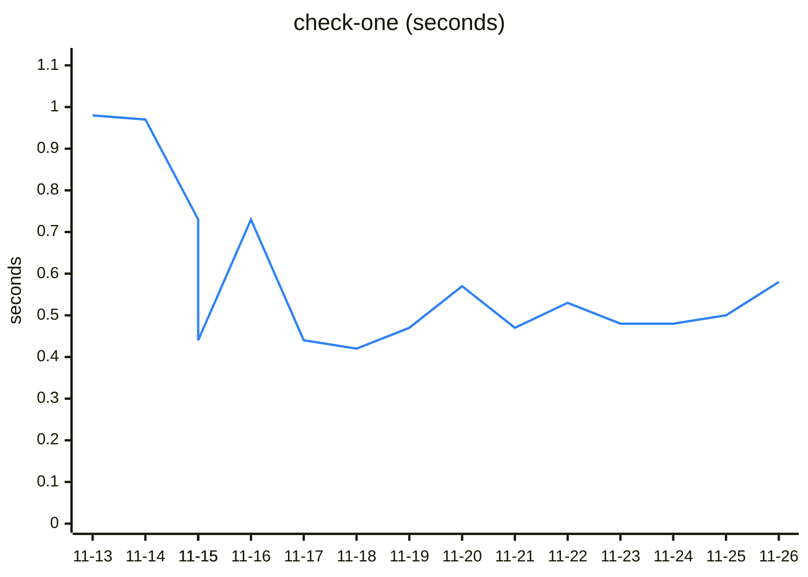
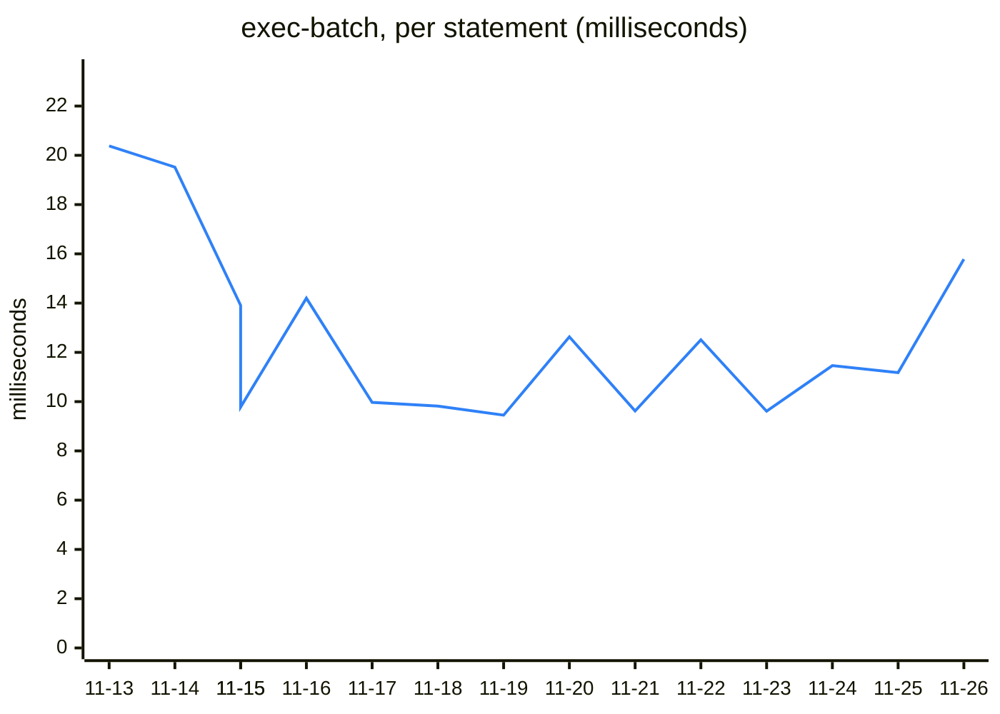
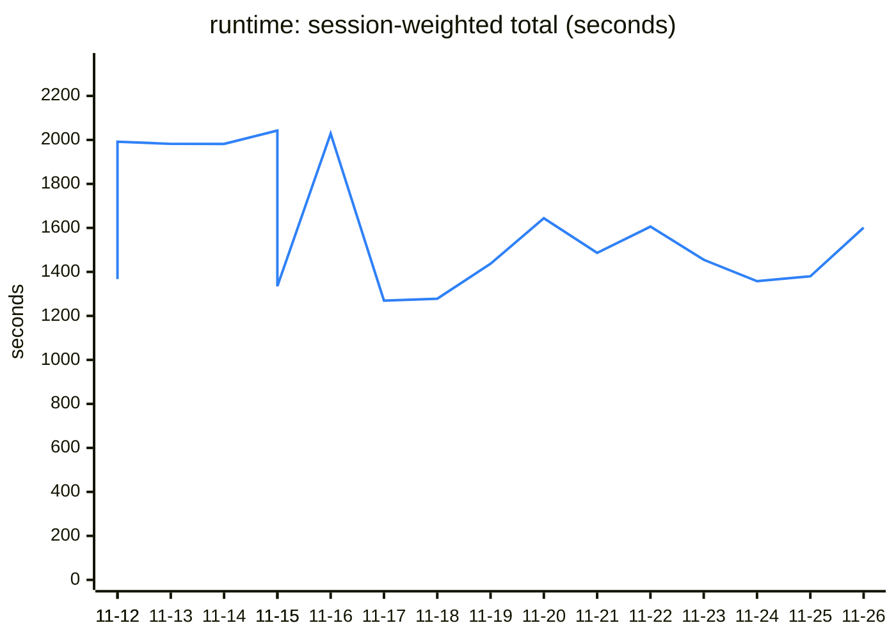

# Agent dev-loop benchmark — trend

17 runs, 2026-11-12 to 2026-11-26. Latest: `mxcli version a581957 (2026-11-26T10:32:50Z)` against `mxcli version nightly-20261125-7ec3d1cc1 (2026-11-25T11:52:45Z)`.

Generated by `scripts/agentbench/trend` after each run; do not edit. Times are the candidate's median wall time on that night's runner, so two nights differ by the machine as well as by the code: read a level that stays, not one night's step. How to read it: `docs-site/src/internals/agent-benchmark.md` on `main`.

## Alerts

None.

## small project — 370 units

| step | latest | run before | median of the 7 before | against that median | against its baseline, latest | last runs |
|---|---:|---:|---:|---:|---:|---|
| (session-weighted total) | 105.6 s | 91.2 s | 90.3 s | × 1.17 | × 0.99 | █▆▁▇▁▁▂▅▂▃▂▂▂▄ |
| open-cold | 196 ms | 161 ms | 161 ms | × 1.22 | × 1.07 | ▇▇▄█▄▃▁█▁▅▁▄▄█ |
| open | 53 ms | 48 ms | 47 ms | × 1.12 | × 0.94 | ██▁▇▁▁▁▄▁▄▁▂▂▃ |
| domain | 684 ms | 593 ms | 600 ms | × 1.14 | × 0.98 | ██▁█▁▁▃▅▃▄▃▂▃▅ |
| microflows | 635 ms | 488 ms | 447 ms | × 1.42 | × 1.03 | █▇▁█▁▁▁▇▁▆▁▂▄█ |
| pages | 2.10 s | 1.47 s | 1.47 s | × 1.44 | × 1.11 | ▇▇▁▇▁▁▂▆▂▄▃▃▃█ |
| describe | 126 ms | 109 ms | 108 ms | × 1.17 | × 1.02 | █▇▂█▁▁▂▅▂▄▂▂▃▅ |
| catalog | 243 ms | 181 ms | 176 ms | × 1.38 | × 1.03 | ██▁█▁▁▁▅▁▃▁▂▂▆ |
| catalog-full | 1.08 s | 876 ms | 923 ms | × 1.17 | × 1.02 | ██▁█▁▁▂▄▂▄▂▁▂▄ |
| query | 81 ms | 70 ms | 69 ms | × 1.18 | × 0.98 | ██▁█▁▁▂▅▂▄▁▁▂▅ |
| check | 330 ms | 292 ms | 292 ms | × 1.13 | × 1.01 | █▄▁▅▁▁▂▃▁▂▂▁▂▃ |
| single-edit | 353 ms | 304 ms | 303 ms | × 1.17 | × 0.99 | ██▁█▁▁▂▇▂▄▃▂▃▅ |
| catalog-after-edit | 233 ms | 193 ms | 187 ms | × 1.25 | × 1.01 | ██▁█▁▁▁▅▁▄▁▂▃▆ |
| bulk-alter | 1.26 s | 1.07 s | 1.04 s | × 1.21 | × 1.11 | ▅▅▁▅▁▁▁█▁▃▁▂▂▄ |
| re-exec | 581 ms | 503 ms | 509 ms | × 1.14 | × 1.01 | █▇▁█▁▁▃▅▃▄▃▂▂▅ |
| rename | 488 ms | 420 ms | 423 ms | × 1.15 | × 1.04 | ██▂█▁▁▃▅▃▄▃▂▃▅ |

## large project — 910 units

| step | latest | run before | median of the 7 before | against that median | against its baseline, latest | last runs |
|---|---:|---:|---:|---:|---:|---|
| (session-weighted total) | 171.2 s | 140.0 s | 132.1 s | × 1.30 | × 1.09 | █▅▁▅▁▁▁▄▁▂▁▁▂▄ |
| open-cold | 402 ms | 331 ms | 310 ms | × 1.30 | × 0.61 | ▆▆▄▆▃▃▁▆▁▆▁▃▅█ |
| open | 68 ms | 63 ms | 59 ms | × 1.16 | × 0.97 | ██▁█▁▁▂▅▂▄▁▂▃▄ |
| domain | 847 ms | 755 ms | 719 ms | × 1.18 | × 0.98 | ██▂█▁▁▂▅▃▄▃▃▄▅ |
| microflows | 1.37 s | 1.18 s | 1.08 s | × 1.27 | × 0.98 | ██▁█▁▁▁█▁▃▂▃▄▆ |
| pages | 2.31 s | 1.89 s | 1.76 s | × 1.31 | × 0.79 | ▇▇▁▇▁▁▂█▂▄▂▂▃▆ |
| describe | 150 ms | 133 ms | 131 ms | × 1.14 | × 1.00 | ██▂█▁▁▂▅▂▄▂▂▃▄ |
| catalog | 342 ms | 292 ms | 272 ms | × 1.26 | × 1.00 | ██▁█▁▁▁▆▁▃▁▂▂▅ |
| catalog-full | 3.35 s | 2.85 s | 2.92 s | × 1.15 | × 1.01 | ██▁█▁▁▂▄▂▃▂▁▂▄ |
| query | 80 ms | 79 ms | 70 ms | × 1.14 | × 0.98 | ██▁▇▁▁▁▅▂▄▂▂▄▄ |
| check | 523 ms | 462 ms | 445 ms | × 1.17 | × 1.00 | █▃▁▃▁▁▁▂▁▁▁▁▁▂ |
| single-edit | 615 ms | 469 ms | 442 ms | × 1.39 | × 1.02 | ██▁█▁▁▂▆▂▃▂▂▃█ |
| catalog-after-edit | 372 ms | 328 ms | 302 ms | × 1.23 | × 1.06 | ██▂█▂▂▁▇▂▆▂▄▅█ |
| bulk-alter | 1.64 s | 1.34 s | 1.22 s | × 1.34 | × 1.06 | ▅▅▁▅▁▁▁█▂▃▂▂▃▅ |
| re-exec | 820 ms | 753 ms | 711 ms | × 1.15 | × 1.00 | ██▁█▁▁▂▅▂▄▃▂▃▅ |
| rename | 1.10 s | 812 ms | 834 ms | × 1.32 | × 1.01 | ██▁█▁▁▂▅▂▄▂▁▂▆ |

## scale project — 4374 units

| step | latest | run before | median of the 7 before | against that median | against its baseline, latest | last runs |
|---|---:|---:|---:|---:|---:|---|
| (session-weighted total) | 6.61 s | 5.19 s | 5.19 s | × 1.27 | × 1.00 | █▄▁▅▁▁▁▃▁▃▁▂▂▄ |
| check-cold | 1.76 s | 1.45 s | 1.44 s | × 1.22 | × 0.99 | █▅▂▅▁▁▁▃▁▂▁▂▂▄ |
| check-one | 583 ms | 497 ms | 484 ms | × 1.20 | × 0.99 | █▅▁▅▁▁▁▃▁▂▁▁▂▃ |
| check-batch | 1.02 s | 855 ms | 894 ms | × 1.14 | × 0.99 | █▅▁▅▁▁▂▃▂▃▂▁▁▃ |
| exec-batch | 1.58 s | 1.12 s | 1.12 s | × 1.41 | × 1.00 | █▄▁▄▁▁▁▃▁▃▁▂▂▆ |
| re-exec-batch | 633 ms | 536 ms | 535 ms | × 1.18 | × 1.00 | █▃▁▃▁▁▁▂▁▂▁▁▁▂ |
| new-batch | 1.03 s | 734 ms | 734 ms | × 1.41 | × 0.93 | █▄▂▅▁▁▁▅▁▄▁▃▂▆ |

## running app — 476 units

| step | latest | run before | median of the 7 before | against that median | against its baseline, latest | last runs |
|---|---:|---:|---:|---:|---:|---|
| (session-weighted total) | 1601.2 s | 1380.1 s | 1455.2 s | × 1.10 | × 0.97 | ██▁█▁▁▂▄▃▄▂▁▂▄ |
| mx-check | 5.84 s | 4.59 s | 5.53 s | × 1.06 | × 0.97 | ██▂█▁▁▃▄▃▅▃▁▁▄ |
| build | 51.9 s | 42.1 s | 42.1 s | × 1.23 | × 1.01 | ██▁█▁▁▁▅▁▄▂▂▂▆ |
| boot | 23.8 s | 20.8 s | 21.6 s | × 1.10 | × 0.99 | ▇█▂█▁▁▃▄▃▃▃▂▂▄ |
| page-check | 2.79 s | 2.42 s | 2.46 s | × 1.14 | × 0.96 | ██▁█▂▁▃▃▁▄▁▁▁▄ |
| hot-apply | 4.67 s | 4.37 s | 4.37 s | × 1.07 | × 0.95 | ▇█▁▇▁▁▂▄▂▃▁▂▂▃ |
| test-attach | 118 ms | 104 ms | 103 ms | × 1.15 | × 0.95 | ▇█▂█▁▁▂▄▃▅▂▃▄▆ |
| apply-entity | 15.8 s | 14.6 s | 14.6 s | × 1.09 | × 1.00 | ██▁█▁▁▂▅▃▄▂▁▃▅ |
| stop | 737 ms | 731 ms | 630 ms | × 1.17 | × 1.00 | ██▅█▁▁▁█▁▁▁▁▄▅ |
| test-cold | 20.1 s | 16.8 s | 19.3 s | × 1.04 | × 0.92 | ▇█▁█▁▁▃▅▄▄▄▂▂▄ |
