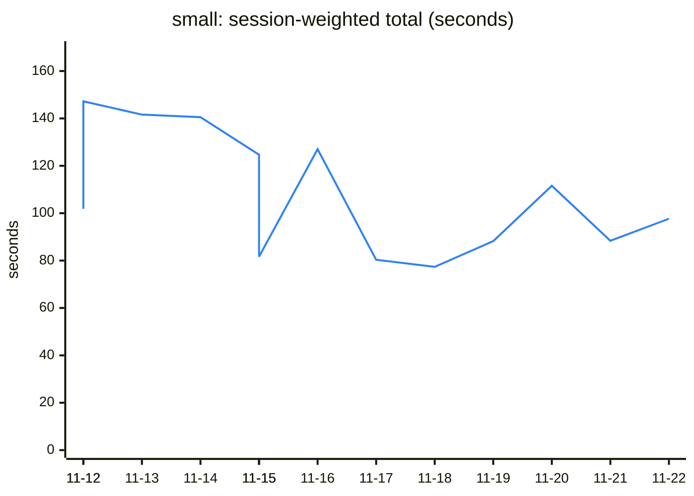
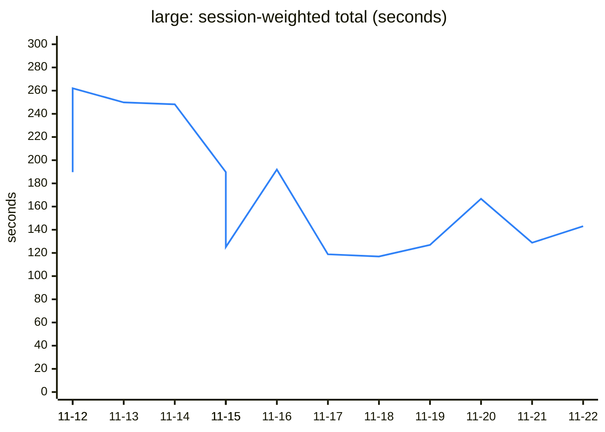
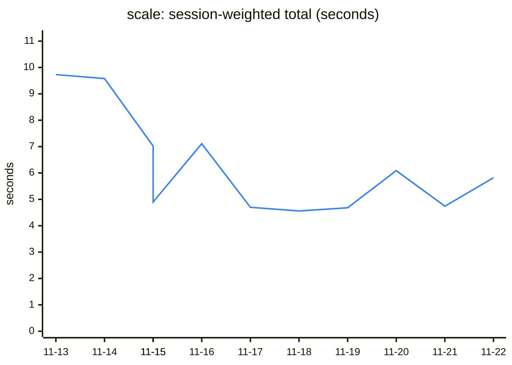
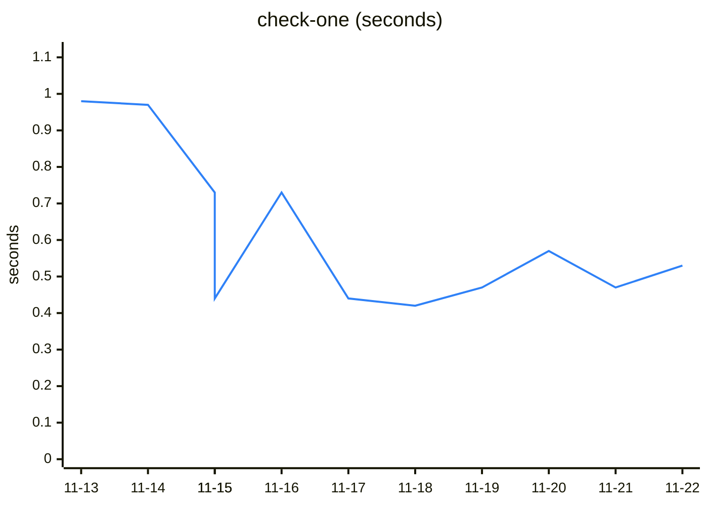
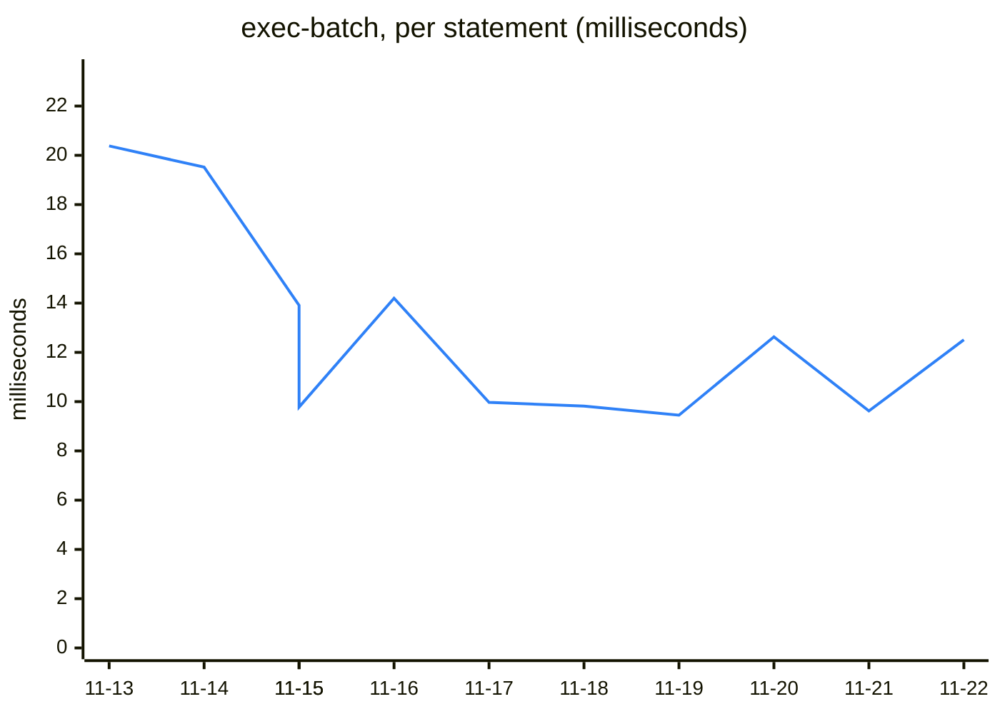
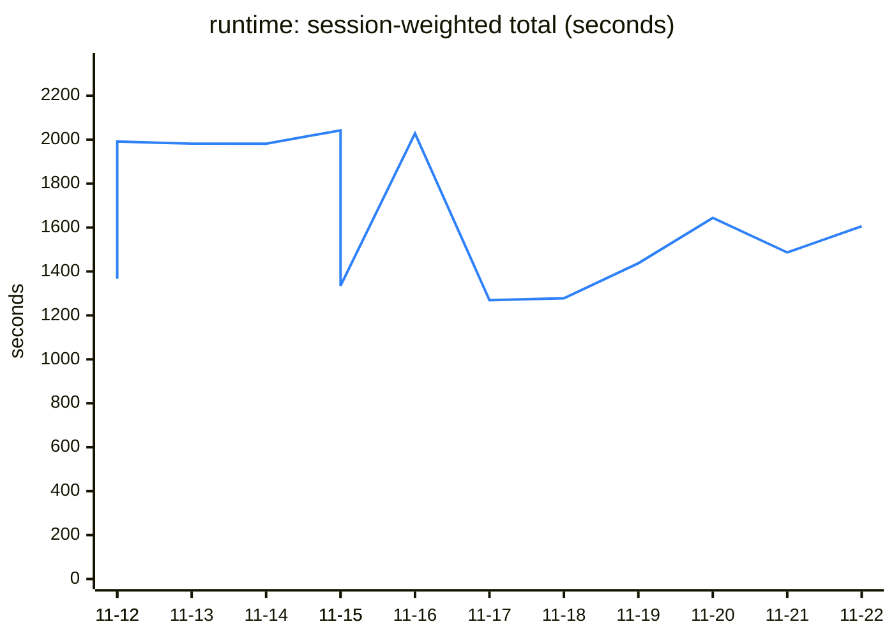

# Agent dev-loop benchmark — trend

13 runs, 2026-11-12 to 2026-11-22. Latest: `mxcli version 6176c66 (2026-11-22T09:27:56Z)` against `mxcli version nightly-20261121-591bcd73e (2026-11-21T10:14:33Z)`.

Generated by `scripts/agentbench/trend` after each run; do not edit. Times are the candidate's median wall time on that night's runner, so two nights differ by the machine as well as by the code: read a level that stays, not one night's step. How to read it: `docs-site/src/internals/agent-benchmark.md` on `main`.

## Alerts

None.

## small project — 370 units

| step | latest | run before | median of the 7 before | against that median | against its baseline, latest | last runs |
|---|---:|---:|---:|---:|---:|---|
| (session-weighted total) | 97.7 s | 88.4 s | 88.2 s | × 1.11 | × 1.00 | ▃███▆▁▆▁▁▂▄▂▃ |
| open-cold | 171 ms | 135 ms | 160 ms | × 1.07 | × 1.00 | ▄████▄█▄▃▁█▁▆ |
| open | 55 ms | 45 ms | 45 ms | × 1.23 | × 1.06 | ▂████▁▇▁▁▁▄▁▄ |
| domain | 666 ms | 600 ms | 585 ms | × 1.14 | × 0.99 | █▄▃▃▃▁▃▁▁▁▂▁▂ |
| microflows | 547 ms | 404 ms | 404 ms | × 1.35 | × 1.01 | █▅▃▃▃▁▃▁▁▁▃▁▂ |
| pages | 1.61 s | 1.39 s | 1.36 s | × 1.18 | × 1.00 | █▅▃▃▃▁▃▁▁▁▂▁▂ |
| describe | 124 ms | 108 ms | 105 ms | × 1.18 | × 1.02 | ▃██▇▆▂▇▁▁▂▄▂▄ |
| catalog | 195 ms | 176 ms | 173 ms | × 1.13 | × 0.99 | ▁████▁█▁▁▁▅▁▃ |
| catalog-full | 1.04 s | 924 ms | 922 ms | × 1.13 | × 1.00 | ▁████▁█▁▁▂▄▂▄ |
| query | 78 ms | 69 ms | 67 ms | × 1.16 | × 1.02 | ▁████▁█▁▁▂▅▂▄ |
| check | 305 ms | 279 ms | 279 ms | × 1.09 | × 1.00 | ▃███▄▁▄▁▁▁▃▁▂ |
| single-edit | 324 ms | 298 ms | 296 ms | × 1.10 | × 0.99 | ▂████▁█▁▁▂▇▂▄ |
| catalog-after-edit | 212 ms | 176 ms | 171 ms | × 1.24 | × 1.03 | ▁████▁█▁▁▁▅▁▄ |
| bulk-alter | 1.19 s | 965 ms | 965 ms | × 1.23 | × 1.02 | ██▃▃▃▁▃▁▁▁▅▁▂ |
| re-exec | 569 ms | 509 ms | 505 ms | × 1.13 | × 1.02 | ▇█▂▂▂▁▂▁▁▁▁▁▁ |
| rename | 477 ms | 423 ms | 419 ms | × 1.14 | × 0.98 | ▂█▇▇▇▂▇▁▁▂▄▂▄ |

## large project — 910 units

| step | latest | run before | median of the 7 before | against that median | against its baseline, latest | last runs |
|---|---:|---:|---:|---:|---:|---|
| (session-weighted total) | 143.1 s | 128.8 s | 126.9 s | × 1.13 | × 1.00 | ▅███▅▁▅▁▁▁▃▁▂ |
| open-cold | 357 ms | 257 ms | 294 ms | × 1.22 | × 1.08 | ▇████▅█▃▃▁█▁█ |
| open | 67 ms | 57 ms | 57 ms | × 1.18 | × 0.95 | ▂████▁█▁▁▂▅▂▄ |
| domain | 783 ms | 704 ms | 682 ms | × 1.15 | × 1.01 | █▂▂▂▂▁▂▁▁▁▁▁▁ |
| microflows | 1.13 s | 950 ms | 950 ms | × 1.19 | × 1.00 | █▄▃▃▃▁▃▁▁▁▃▁▂ |
| pages | 1.97 s | 1.73 s | 1.65 s | × 1.19 | × 1.00 | █▂▁▁▁▁▁▁▁▁▁▁▁ |
| describe | 142 ms | 129 ms | 127 ms | × 1.12 | × 0.98 | ▃█▇▇▇▂▇▁▁▂▄▂▃ |
| catalog | 304 ms | 257 ms | 258 ms | × 1.18 | × 1.01 | ▂████▁█▁▁▁▆▁▃ |
| catalog-full | 3.26 s | 2.92 s | 2.90 s | × 1.12 | × 1.01 | ▁████▁█▁▁▂▄▂▃ |
| query | 78 ms | 70 ms | 67 ms | × 1.17 | × 0.97 | ▂█▇██▁▇▁▁▁▅▂▄ |
| check | 481 ms | 428 ms | 428 ms | × 1.12 | × 1.02 | ▄███▃▁▃▁▁▁▂▁▁ |
| single-edit | 468 ms | 430 ms | 421 ms | × 1.11 | × 0.99 | ▃████▁█▁▁▂▆▂▃ |
| catalog-after-edit | 333 ms | 266 ms | 274 ms | × 1.21 | × 1.03 | ▂████▂█▂▁▁▇▂▅ |
| bulk-alter | 1.42 s | 1.21 s | 1.17 s | × 1.21 | × 1.01 | █▆▂▂▂▁▂▁▁▁▄▁▂ |
| re-exec | 782 ms | 701 ms | 687 ms | × 1.14 | × 1.01 | ██▂▂▂▁▂▁▁▁▂▁▁ |
| rename | 938 ms | 834 ms | 824 ms | × 1.14 | × 1.02 | ▂████▁█▁▁▂▅▂▄ |

## scale project — 4374 units

| step | latest | run before | median of the 7 before | against that median | against its baseline, latest | last runs |
|---|---:|---:|---:|---:|---:|---|
| (session-weighted total) | 5.82 s | 4.74 s | 4.74 s | × 1.23 | × 0.99 | ██▄▁▄▁▁▁▃▁▂ |
| check-cold | 1.53 s | 1.27 s | 1.35 s | × 1.14 | × 1.03 | ██▅▂▅▁▁▁▃▁▂ |
| check-one | 526 ms | 471 ms | 467 ms | × 1.13 | × 0.98 | ██▅▁▅▁▁▁▃▁▂ |
| check-batch | 1.01 s | 894 ms | 876 ms | × 1.15 | × 1.00 | ██▅▁▅▁▁▂▃▂▃ |
| exec-batch | 1.25 s | 962 ms | 982 ms | × 1.27 | × 0.98 | ██▄▁▄▁▁▁▃▁▃ |
| re-exec-batch | 604 ms | 526 ms | 521 ms | × 1.16 | × 1.00 | ██▃▁▃▁▁▁▂▁▂ |
| new-batch | 894 ms | 615 ms | 637 ms | × 1.40 | × 1.03 | ██▄▂▅▁▁▁▄▁▄ |

## running app — 476 units

| step | latest | run before | median of the 7 before | against that median | against its baseline, latest | last runs |
|---|---:|---:|---:|---:|---:|---|
| (session-weighted total) | 1605.9 s | 1486.6 s | 1437.4 s | × 1.12 | × 1.00 | ▂████▁█▁▁▂▄▃▄ |
| mx-check | 6.25 s | 5.53 s | 5.35 s | × 1.17 | × 0.99 | ▂████▂█▁▁▃▄▃▅ |
| build | 48.4 s | 41.3 s | 40.6 s | × 1.19 | × 0.99 | ▂████▁█▁▁▁▅▁▄ |
| boot | 22.6 s | 21.6 s | 21.3 s | × 1.06 | × 0.98 | ▂▇▆▇█▂█▁▁▃▄▃▃ |
| page-check | 2.84 s | 2.45 s | 2.53 s | × 1.12 | × 1.00 | ▁▇███▁█▂▁▃▃▁▄ |
| hot-apply | 4.64 s | 4.58 s | 4.33 s | × 1.07 | × 1.00 | ▂▇▇▇█▁▇▁▁▂▄▂▃ |
| test-attach | 111 ms | 100 ms | 92 ms | × 1.20 | × 1.04 | ▂██▆▇▂█▁▁▁▄▃▄ |
| apply-entity | 15.6 s | 14.6 s | 13.8 s | × 1.13 | × 1.03 | ▂████▁█▁▁▂▅▃▄ |
| stop | 632 ms | 628 ms | 628 ms | × 1.01 | × 1.00 | ▁████▅█▁▁▁█▁▁ |
| test-cold | 19.7 s | 19.3 s | 18.1 s | × 1.09 | × 0.96 | ▂██▇█▁█▁▁▃▄▄▄ |
