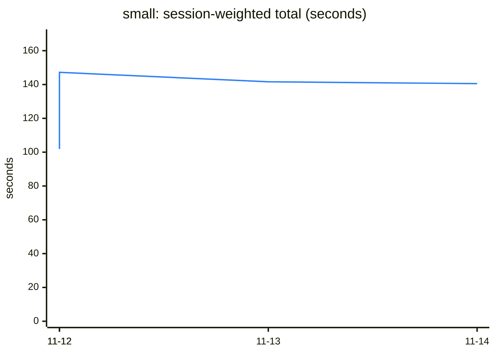
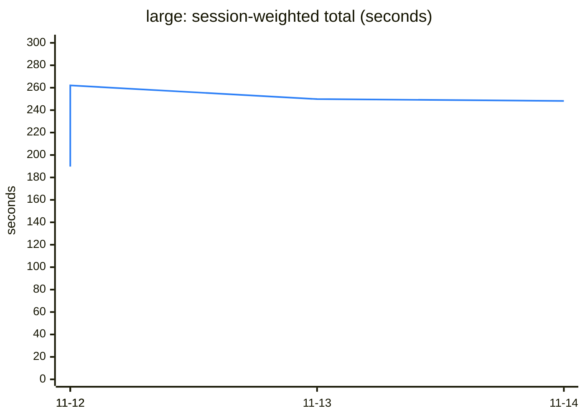
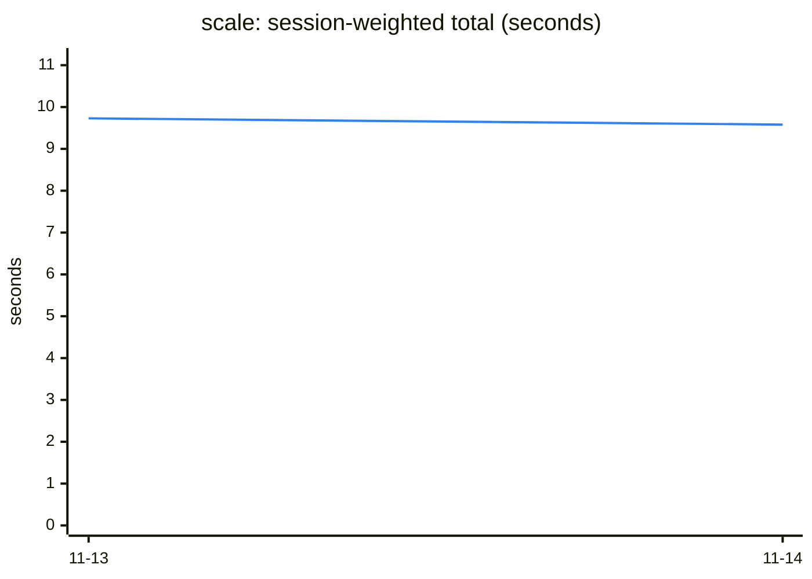
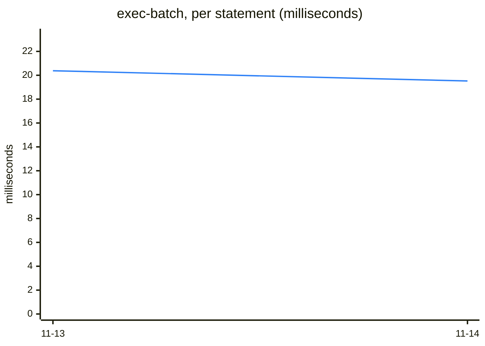
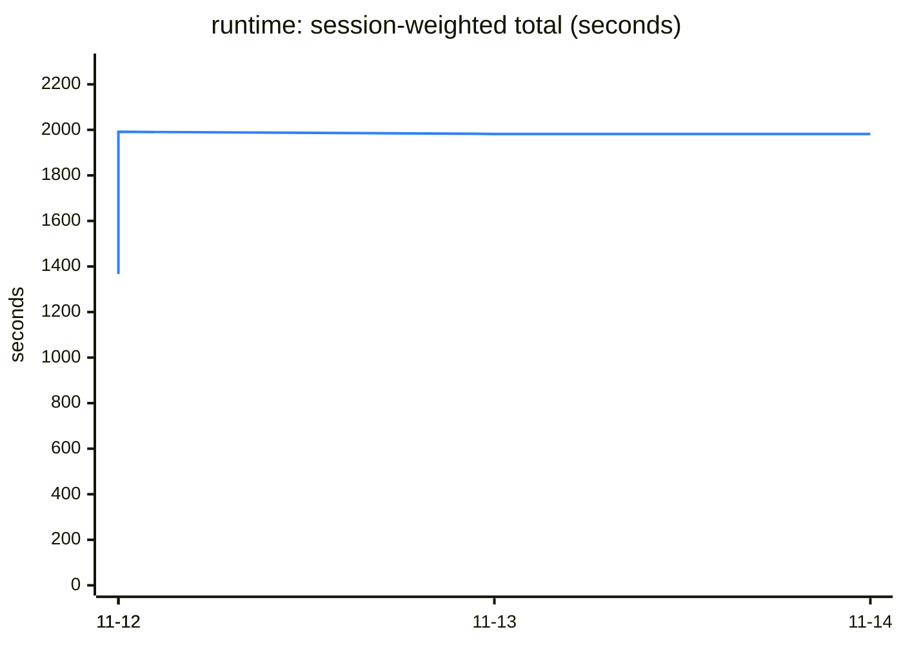

# Agent dev-loop benchmark — trend

4 runs, 2026-11-12 to 2026-11-14. Latest: `mxcli version a051fa6 (2026-11-14T08:42:52Z)` against `mxcli version nightly-20261113-02fd40836 (2026-11-13T10:06:55Z)`.

Generated by `scripts/agentbench/trend` after each run; do not edit. Times are the candidate's median wall time on that night's runner, so two nights differ by the machine as well as by the code: read a level that stays, not one night's step. How to read it: `docs-site/src/internals/agent-benchmark.md` on `main`.

## Alerts

None.

## small project — 370 units



| step | latest | run before | median of the 7 before | against that median | against its baseline, latest | last runs |
|---|---:|---:|---:|---:|---:|---|
| (session-weighted total) | 140.5 s | 141.6 s | 141.6 s | × 0.99 | × 1.00 | ▁██▇ |
| open-cold | 186 ms | 186 ms | 186 ms | × 1.00 | × 1.03 | ▁███ |
| open | 69 ms | 68 ms | 68 ms | × 1.01 | × 0.99 | ▁███ |
| domain | 844 ms | 864 ms | 1.02 s | × 0.83 | × 0.98 | █▂▁▁ |
| microflows | 615 ms | 616 ms | 797 ms | × 0.77 | × 1.01 | █▃▁▁ |
| pages | 1.95 s | 1.96 s | 2.74 s | × 0.71 | × 1.00 | █▄▁▁ |
| describe | 156 ms | 160 ms | 160 ms | × 0.97 | × 1.01 | ▁█▇▇ |
| catalog | 285 ms | 278 ms | 278 ms | × 1.03 | × 1.01 | ▁███ |
| catalog-full | 1.44 s | 1.45 s | 1.44 s | × 1.00 | × 1.00 | ▁███ |
| query | 97 ms | 97 ms | 96 ms | × 1.01 | × 0.97 | ▁███ |
| check | 563 ms | 566 ms | 566 ms | × 1.00 | × 1.00 | ▁███ |
| single-edit | 418 ms | 422 ms | 422 ms | × 0.99 | × 0.99 | ▁███ |
| catalog-after-edit | 267 ms | 262 ms | 262 ms | × 1.02 | × 1.01 | ▁███ |
| bulk-alter | 1.35 s | 1.37 s | 2.52 s | × 0.54 | × 1.00 | ██▁▁ |
| re-exec | 690 ms | 694 ms | 1.58 s | × 0.44 | × 0.99 | ▆█▁▁ |
| rename | 617 ms | 611 ms | 611 ms | × 1.01 | × 1.00 | ▁█▆▇ |

## large project — 910 units



| step | latest | run before | median of the 7 before | against that median | against its baseline, latest | last runs |
|---|---:|---:|---:|---:|---:|---|
| (session-weighted total) | 248.2 s | 249.8 s | 249.8 s | × 0.99 | × 0.99 | ▁█▇▇ |
| open-cold | 364 ms | 361 ms | 359 ms | × 1.01 | × 1.04 | ▁▇▇█ |
| open | 84 ms | 84 ms | 84 ms | × 0.99 | × 0.96 | ▁███ |
| domain | 1.00 s | 1.01 s | 1.17 s | × 0.85 | × 1.01 | █▁▁▁ |
| microflows | 1.54 s | 1.55 s | 1.73 s | × 0.89 | × 1.00 | █▂▁▁ |
| pages | 2.41 s | 2.43 s | 3.40 s | × 0.71 | × 1.00 | █▁▁▁ |
| describe | 188 ms | 189 ms | 189 ms | × 1.00 | × 0.97 | ▁█▆▆ |
| catalog | 426 ms | 427 ms | 427 ms | × 1.00 | × 1.01 | ▁███ |
| catalog-full | 4.53 s | 4.53 s | 4.53 s | × 1.00 | × 0.99 | ▁███ |
| query | 99 ms | 96 ms | 96 ms | × 1.03 | × 0.95 | ▁█▇▇ |
| check | 1.29 s | 1.29 s | 1.29 s | × 1.00 | × 0.99 | ▁█▇▇ |
| single-edit | 628 ms | 635 ms | 633 ms | × 0.99 | × 1.00 | ▁███ |
| catalog-after-edit | 378 ms | 387 ms | 381 ms | × 0.99 | × 1.00 | ▁███ |
| bulk-alter | 1.68 s | 1.71 s | 2.95 s | × 0.57 | × 0.99 | █▆▁▁ |
| re-exec | 989 ms | 996 ms | 2.21 s | × 0.45 | × 0.99 | ██▁▁ |
| rename | 1.26 s | 1.25 s | 1.25 s | × 1.00 | × 1.00 | ▁█▇█ |

## scale project — 4374 units



```mermaid
---
config:
  themeVariables:
    xyChart:
      plotColorPalette: "#2f81f7"
---
xychart-beta
    title "check-one (seconds)"
    x-axis ["11-13", "11-14"]
    y-axis "seconds" 0 --> 1.12
    line [0.98, 0.97]
```



| step | latest | run before | median of the 7 before | against that median | against its baseline, latest | last runs |
|---|---:|---:|---:|---:|---:|---|
| (session-weighted total) | 9.58 s | 9.73 s | 9.73 s | × 0.98 | × 1.00 | █▁ |
| check-cold | 2.40 s | 2.42 s | 2.42 s | × 0.99 | × 0.99 | █▁ |
| check-one | 973 ms | 977 ms | 977 ms | × 1.00 | × 1.01 | █▁ |
| check-batch | 1.69 s | 1.69 s | 1.69 s | × 1.00 | × 0.99 | ▁█ |
| exec-batch | 1.95 s | 2.04 s | 2.04 s | × 0.96 | × 1.00 | █▁ |
| re-exec-batch | 1.28 s | 1.29 s | 1.29 s | × 0.99 | × 1.00 | █▁ |
| new-batch | 1.29 s | 1.32 s | 1.32 s | × 0.98 | × 0.99 | █▁ |

## running app — 476 units



| step | latest | run before | median of the 7 before | against that median | against its baseline, latest | last runs |
|---|---:|---:|---:|---:|---:|---|
| (session-weighted total) | 1981.9 s | 1982.0 s | 1982.0 s | × 1.00 | × 1.00 | ▁███ |
| mx-check | 7.90 s | 7.87 s | 7.87 s | × 1.00 | × 1.00 | ▁███ |
| build | 57.4 s | 57.3 s | 57.3 s | × 1.00 | × 1.00 | ▁███ |
| boot | 29.1 s | 27.9 s | 27.9 s | × 1.04 | × 1.05 | ▁█▇█ |
| page-check | 3.30 s | 3.36 s | 3.22 s | × 1.02 | × 1.04 | ▁▇██ |
| hot-apply | 5.76 s | 5.75 s | 5.75 s | × 1.00 | × 1.00 | ▁███ |
| test-attach | 125 ms | 141 ms | 140 ms | × 0.90 | × 0.98 | ▁██▆ |
| apply-entity | 18.4 s | 18.6 s | 18.6 s | × 0.99 | × 0.99 | ▁███ |
| stop | 839 ms | 840 ms | 840 ms | × 1.00 | × 1.00 | ▁███ |
| test-cold | 23.7 s | 25.6 s | 24.6 s | × 0.96 | × 0.98 | ▁▇█▇ |
